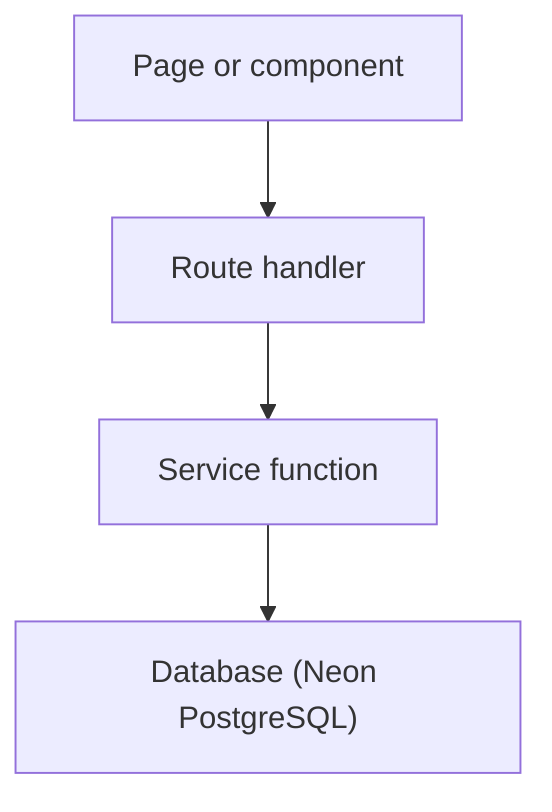

# Reelhouse backend: shared guide

This is the guide all three of us share. It covers the agreements we need before (and while) we replace the stub service bodies with real PostgreSQL code (a "stub" is a placeholder function that returns fake data). Read this file first, then your own file.

## Who owns what

| Who            | Area                         | Your file                                                                    |
| -------------- | ---------------------------- | ---------------------------------------------------------------------------- |
| **A**: Tejasva | Catalogue, admin, accounts   | [person-a-catalogue-admin-accounts.md](person-a-catalogue-admin-accounts.md) |
| **B**: Yash    | Billing and payments         | [person-b-billing-payments.md](person-b-billing-payments.md)                 |
| **C**: Sahil   | Activity and recommendations | [person-c-activity-recommendations.md](person-c-activity-recommendations.md) |

Services each person owns:

- **Tejasva (A):** `users.service`, `profiles.service`, `catalog.service`, `admin.service`, `admin-content.service`, the auth guards in `src/app/api/_lib/auth.ts`, and auth hardening.
- **Yash (B):** `billing.service`, `admin-billing.service`, `payments.service`. That covers plans, subscriptions, admin plan and subscription management, and the full Razorpay flow.
- **Sahil (C):** `activity.service`, `recommendations.service`.

**Order matters.**

- Tejasva (A) lands `users` + `profiles` + the guard swap first (day 1 to 2), because every guarded route depends on them.
- Yash (B) and Sahil (C) keep working against the mock-backed guards until Tejasva merges them.
- Tejasva also writes `profile_genre_preference` (onboarding), which Sahil's cold start (the first recommendations for a profile with no history) reads.

The schema itself is [`../schema/SCHEMA.md`](../schema/SCHEMA.md). It is the source of truth for tables, constraints, ranking formulas and the payment flow. The Drizzle schema in `src/server/db/schema/` and the three migrations (`drizzle/0000_schema.sql`, `drizzle/0001_genre_taste_view.sql` and `drizzle/0002_drop_recommendation.sql`) already implement it. (Drizzle is the TypeScript database toolkit we use; a migration is a numbered SQL file that changes the database structure.)

## Table of contents

1. [Architecture](#1-architecture)
2. [Setup, step by step](#2-setup-step-by-step)
3. [Conventions](#3-conventions)
4. [Testing routes with curl](#4-testing-routes-with-curl)
5. [Route to service index](#5-route-to-service-index)
6. [How `src/server/mocks` works today](#6-how-srcservermocks-works-today)
7. [Phase 1 schema checklist](#7-phase-1-schema-checklist)
8. [Branches, PRs, shared files, review rules, timeline](#8-branches-prs-shared-files-review-rules-timeline)
9. [Open decisions](#9-open-decisions)

---

## 1. Architecture

This section explains how a request travels through the code, which errors map to which HTTP status, where every folder lives, and which parts are real versus still stubbed. Knowing the layers keeps SQL out of routes and HTTP out of services.

### 1.1 Request flow

Every page or component reaches the database through the same chain: API client, route, service, database.



Walkthrough:

1. A **server component** (page) calls `serverApi.*` from `src/lib/api/server.ts` (marked `"server-only"`). It fetches `http://<host>/api/...` with the request's cookies.
2. A **client component** calls `api.*` from `src/lib/api/client.ts`.
3. Both land on a route in `src/app/api/**/route.ts`. The HTTP contract is written in the comment at the top of each route file. The route does four things:
   1. **Guard:** `requireUser` / `requireOwnedProfile` / `requireAdmin` / `getSelectedProfile`.
   2. **Validate:** `parseBody(request, zodSchema)` / `parseId(...)` / `parseWith(...)`.
   3. **Call** one function from `src/server/services/*.service.ts`.
   4. **Respond** with `Response.json(...)`, and `catch (e) { return handleError(e) }`.
4. The service holds the business rules and the SQL. It talks to `src/server/db` (Drizzle + a node-postgres `Pool`, meaning a reusable set of database connections), which connects to Neon PostgreSQL.

Rules:

- Pages and components never import `src/server/**` and never read `data/`. They only go through the API.
- `serverApi` exists so server components do not need a browser. It still hits the same routes, so the session cookie and the `profileId` cookie are checked exactly like a browser request.
- A route stays thin: guard, validate, call one service function, return JSON. If you are about to write SQL in a route, it belongs in a service.
- Services are plain async functions with typed inputs and outputs from `src/types`. They never touch `Request`/`Response`. They throw typed errors (below), never `Response`.

### 1.2 Typed errors become HTTP

`src/server/errors/index.ts` (import `@/server/errors`) defines the only errors services should throw. Each one maps to a fixed HTTP status.

- **`ValidationError(message, code?)`** gives **422**.
  - Use it when input breaks a rule the route's zod schema (the input-shape checker) cannot express.
  - Examples: fewer than 3 genres; series progress without an episode.
- **`UnauthorizedError(message = "Sign in to continue.", code?)`** gives **401**.
  - Use it when there is no valid session.
  - Example: `requireUser`.
- **`ForbiddenError(message = "You can't do that.", code?)`** gives **403**.
  - Use it when the user is signed in but not allowed.
  - Example: `requireAdmin` ("Admins only.").
- **`NotFoundError(message = "Not found.", code?)`** gives **404**.
  - Use it when the row is missing **or belongs to someone else** (never reveal which).
  - Examples: `getOwnedProfile`, unknown title.
- **`ConflictError(message, code?)`** gives **409**.
  - Use it for a uniqueness or state rule.
  - Examples: email taken; `PROFILE_LIMIT`; last profile.
- **`ServiceError(message, status, code?)`** gives **any status**.
  - This is the base class, for everything else.
  - Examples (Razorpay): 503 `PAYMENTS_NOT_CONFIGURED`, 502 gateway failure, 400 `INVALID_SIGNATURE`.

`handleError(error)` in `src/app/api/_lib/http.ts` turns a `ServiceError` into `Response.json({ error, code? }, { status })`. Anything else is `console.error`-ed and becomes `500 { error: "Something went wrong. Try again." }`. The message of a `ServiceError` is shown to the user as is, so keep it short and safe.

Route-level statuses that do not come from services:

- `parseBody` throws 400 `INVALID_JSON` (the body is not JSON) and 422 (a zod issue message).
- `parseId` throws 404 (a non-numeric path id cannot match a row).

### 1.3 Folder map (final tree)

Where every kind of code lives. Server-only code stays under `src/server`; everything under `src/lib` must be safe to ship to the browser.

```
data/
  tmdb/                  TMDB snapshot (genres, people, movies, series, meta) — written by scripts/import-tmdb.mts
  mock/                  hand-written accounts + activity (users, profiles, plans, subscriptions, payments,
                         watch-history, my-list, ratings) — read by src/server/mocks and by the seed
docs/
  schema/                SCHEMA.md (the schema, source of truth) + schema-diagram.png/.svg
  backend/               this guide + one file per person
drizzle/                 0000_schema.sql (tables, maturity_of()), 0001_genre_taste_view.sql (the view), 0002_drop_recommendation.sql (16 tables left), meta/  (migrations; commit them)
drizzle.config.ts
scripts/
  import-tmdb.mts        TMDB -> data/tmdb (already works)
src/
  app/                   routes + pages
    api/_lib/            route-only helpers: auth.ts (guards), http.ts (handleError, parseBody, parseWith, parseId),
                         tmdb.ts (TMDB client + error mapping for the admin routes)
    api/**/route.ts      the HTTP contract of every endpoint (top comment) + a thin handler
  components/            ui/ + one folder per feature
  hooks/                 use-media-query.ts, use-progress-sync.ts
  lib/                   CLIENT-SAFE code (no secrets, no database)
    api/                 client.ts (api.*), server.ts (serverApi.*, "server-only")
    constants/index.ts   SESSION_COOKIE, PROFILE_COOKIE, NO_PLAN_MAX_PROFILES, ONBOARDING_MIN_GENRES,
                         COMPLETED_THRESHOLD, AVATAR_KEYS, ...
    content/             maturity.ts, progress.ts (isCompleted)
    cookies/             profile-cookie.ts
    format/index.ts      formatEpisodeCode, formatCurrency, ...
    razorpay/checkout.ts browser side of Razorpay Checkout
    sql/                 import-title.ts (buildImportScript), admin-content.ts, admin-plans.ts, admin-subscriptions.ts
                         (admin dialogs' SQL text), literal.ts, highlight.ts
    tmdb/                catalog.ts, client.ts, types.ts (shared with scripts/import-tmdb.mts)
    ui/ utils/           segmented-control.ts; cn()
    validation/          auth.ts (signIn/signUp zod schemas), profile.ts (profileSchema), admin.ts (content, plan, subscription schemas)
  server/                SERVER-ONLY code
    auth/                password.ts (scrypt), session.ts (cookie), session-token.ts (HMAC token; proxy.ts uses it too)
    db/                  index.ts (db), schema/{enums,accounts,billing,catalog,activity,recommendations,index}.ts,
                         seed/ (the seed script, already written; `npm run db:seed`)
    errors/index.ts      ServiceError and subclasses
    mocks/               catalog.ts, db.ts, types.ts   TEMPORARY — see section 6
    services/            users, profiles, catalog, activity, recommendations, billing, payments, admin, admin-content, admin-billing (.service.ts)
    session/             current-session.ts (getCurrentUser, requireUser, requireProfile ... for server pages)
  types/                 one file per domain + index.ts barrel; mirrors the tables
  proxy.ts               Next.js route guard (page requests only; /api is skipped)
```

### 1.4 What is real and what is a stub today

Some parts already work against the real database or real services. Others still return fake data. Check this list before you assume something is wired up.

- **Sign-in / sign-out / `GET /api/auth/me` route logic: real.**
  - The session is a signed cookie `session=<userId>.<HMAC-SHA256>` using `SESSION_SECRET`. (HMAC is a keyed hash that proves the cookie was not tampered with.)
  - Passwords use scrypt hashing and `timingSafeEqual` verification.
  - The _lookups_ behind them (`findUserCredentialsByEmail`, `findUserById`) are still mock-backed (Tejasva, A).
- **`src/proxy.ts` and the route guards in `src/app/api/_lib/auth.ts`: real.**
  - They call `findUserById` / `getOwnedProfile`, which are stubs until Tejasva (A) merges the real user and profile functions.
  - Yash (B) and Sahil (C) keep using the mock-backed guards until then.
- **`GET /api/admin/tmdb/search` and `GET /api/admin/tmdb/:type/:tmdbId`: real.**
  - They make live TMDB calls (`TMDB_API_KEY`) and generate the SQL preview for real (`src/lib/sql/import-title.ts`).
  - Only `markInCatalog` / `findCatalogueId` (database lookups) are stubs.
- **`src/server/db` (Drizzle schema, `db`), the `drizzle/0000_schema.sql`, `drizzle/0001_genre_taste_view.sql` and `drizzle/0002_drop_recommendation.sql` migrations, and the seed: real and already applied to Neon.**
  - Tables, enums, `maturity_of()` and the `unaccent` extension and the `genre_taste` view exist, and the database is **seeded**.
  - Nothing queries them yet (the services still return mocks), so a service can read real rows the moment you implement it.
- **Every other service function: stub.**
  - It has `// TODO: implement`, returns mock data from `src/server/mocks`, and persists nothing.
- **`payments.service` Razorpay functions: stub.**
  - No network call is made, and `keyId` is `null` so the UI skips Checkout.

### 1.5 The mock rule

The mock folder is temporary scaffolding. These rules keep it easy to delete later.

- `@/server/mocks/*` is imported **only by `src/server/services/*.service.ts`** (never by routes, pages or `_lib`). `grep -rn "server/mocks" src` must show only services (and the mocks folder itself).
- When you make a function real, remove its `getMockDb` / `find*` / `to*` imports from the service file. Keep them while other functions in the same file are still mocks.
- **When no service imports `@/server/mocks`, delete `src/server/mocks/` and the "TEMPORARY" mentions in the README.** That is the last commit of the backend phase.
- `payments.service.ts` imports no mocks (it never touched data).

---

## 2. Setup, step by step

This section gets you from a fresh clone to a running app against your own database branch. It also explains the database tooling (Neon, Drizzle, migrations, the seed).

**Quick start for a teammate.** The Neon project already has the migrations applied and the seeded data, so nothing needs creating.

1. Get a `DATABASE_URL` for **your own Neon branch** (see 2.1). Ask whoever owns the Neon project to create the branch, or create it from `main` yourself.
2. Run `cp .env.example .env` and fill it in (see 2.2). At minimum set `DATABASE_URL` and `SESSION_SECRET`. Add `TMDB_API_KEY` for the admin pages. The three `RAZORPAY_*` values are only for Yash (B).
3. Run `npm install`.
4. Run `npm run dev`. Services you implement can query real rows immediately.
5. Only if you **reset or break your branch**: run `npm run db:migrate` (schema), then `npm run db:seed` (data). The seed resets the tables first, so re-running always gives the same known state.

The sections below explain each step and the tooling behind it.

### 2.1 Neon (hosted PostgreSQL)

Neon hosts our database and lets each of us have an isolated copy.

1. Sign up at <https://neon.tech> and **Create project**. Use Postgres 16 or newer (`UNIQUE NULLS NOT DISTINCT` needs 15+). Pick the region closest to you. The default branch is `main`.
2. **One branch per teammate.**
   - In the console: _Branches -> Create branch_, parent `main`, names such as `dev-a`, `dev-b`, `dev-c`. CLI: `neonctl branches create --name dev-a`.
   - A branch is a copy-on-write fork (it copies lazily, only storing what you change) of the parent's schema **and data**. Once `main` has the migrations and the seed, a new branch starts fully populated.
   - Reset a branch from its parent when you have broken it (_Branch -> Reset from parent_).
3. `main` is the shared baseline (migrated and seeded). Only merge-ready schema changes are applied to it, by the person merging the PR (section 8.3).
4. Get the connection string: console -> _Connect_ -> pick the **branch** and database. There are two flavours:
   - **Pooled (PgBouncer, a connection pooler)**. The host looks like `ep-xxx-pooler.region.aws.neon.tech`. Use it for the running app (`DATABASE_URL`).
   - **Direct.** The host looks like `ep-xxx.region.aws.neon.tech`. Use it for `drizzle-kit migrate`, the seed script, and anything long-lived or using session features (`LISTEN`, advisory locks).

   Keep `?sslmode=require` on the string. Transactions work through the pooler (a transaction pins one backend connection). If a migration or the seed hangs or fails on the pooled string, paste the direct string into `DATABASE_URL` for that command. Keep `Pool({ max })` small (10 today) so the pooler and the free tier's connection limit are not exhausted.

### 2.2 Environment variables

Copy `.env.example` to `.env` (git-ignored). Names are exact.

- **`DATABASE_URL`**
  - Used by `src/server/db/index.ts` and `drizzle.config.ts`.
  - Your **own** Neon branch.
  - Not yet listed in `.env.example`: add it (`DATABASE_URL=`) in the first schema PR.
- **`SESSION_SECRET`**
  - Used by `src/server/auth/session-token.ts`.
  - HMAC key of the session cookie.
  - Optional in dev (insecure built-in secret + warning), **required in production** (throws).
  - Generate with `openssl rand -hex 32`.
- **`TMDB_API_KEY`**
  - Used by `src/app/api/_lib/tmdb.ts` and `scripts/import-tmdb.mts`.
  - A v4 read token or v3 key.
  - Only the admin import and the snapshot script need it.
- **`RAZORPAY_KEY_ID`**
  - Used by `payments.service` (Orders API, and `keyId` sent to the browser).
  - A **test mode** key (`rzp_test_...`).
- **`RAZORPAY_KEY_SECRET`**
  - Used by `payments.service` (basic auth, Checkout signature).
  - Server only, never returned by any route.
- **`RAZORPAY_WEBHOOK_SECRET`**
  - Used by `payments.service` (`verifyWebhookSignature`).
  - The secret you type when creating the webhook in the Razorpay dashboard.

Nothing else is read from the environment (`NODE_ENV` is set by Next). Never commit `.env`, and never put live Razorpay keys in it.

### 2.3 Dependencies

`package.json` already contains what the pinned design needs. Check with `npm ls drizzle-orm pg drizzle-kit`. From scratch the commands are:

```bash
npm install drizzle-orm pg
npm install -D drizzle-kit @types/pg
npm install -D tsx          # runs the seed (src/server/db/seed); already added with the seed
```

The driver is plain `pg` (node-postgres) over a `Pool`. It supports interactive transactions (`db.transaction`), and `SELECT ... FOR UPDATE`. Neon's HTTP driver (`@neondatabase/serverless` + `drizzle-orm/neon-http`) does **not** support interactive transactions, which is why we do not use it.

### 2.4 `drizzle.config.ts` (already in the repo)

This file tells drizzle-kit where the schema is, where to write migrations, and how to connect.

```ts
import { defineConfig } from "drizzle-kit";

try {
  process.loadEnvFile(".env");
} catch {
  // no .env file: DATABASE_URL must come from the environment
}

export default defineConfig({
  dialect: "postgresql",
  schema: "./src/server/db/schema/index.ts",
  out: "./drizzle",
  casing: "snake_case",
  dbCredentials: { url: process.env.DATABASE_URL ?? "" },
});
```

`casing: "snake_case"` means a TypeScript key `passwordHash` is the column `password_hash` with no `varchar("password_hash")` repeated. The same `casing` option is passed to `drizzle()` in `db/index.ts`.

### 2.5 Schema layout (`src/server/db/schema/`)

The schema is split into one file per area.

- **`enums.ts`:** `userRole`, `maturityLevel` (declared order KIDS < TEEN < ADULT), `contentType`, `creditRole`, `subscriptionStatus`, `paymentMode`, `paymentStatus`.
- **`accounts.ts`:** `users`, `profile`, `profileGenrePreference` (+ relations).
- **`billing.ts`:** `subscriptionPlan`, `subscription`, `payment`.
- **`catalog.ts`:** `genre`, `content`, `contentGenre`, `season`, `episode`, `person`, `contentCredit`.
- **`activity.ts`:** `watchHistory`, `myList`, `rating`.
- **`recommendations.ts`:** the `genreTaste` view only (recommendations are never stored, so there is no table), declared with `pgView("genre_taste", …).existing()` (the view is created by `drizzle/0001_genre_taste_view.sql`; `.existing()` stops drizzle-kit from generating SQL for it). Similarity queries read the base tables directly.
- **`index.ts`:** barrel (a file that re-exports everything) for all of the above.

Table object names (camelCase TS) map to tables as follows: `users`, `profile`, `profileGenrePreference` (`profile_genre_preference`), `subscriptionPlan` (`subscription_plan`), `subscription`, `payment`, `genre`, `content`, `contentGenre`, `season`, `episode`, `person`, `contentCredit`, `watchHistory`, `myList`, `rating`.

**Named constraints** you will need in `ON CONFLICT ON CONSTRAINT` (the SQL clause that says what to do when an insert collides with a unique rule) or in error handling:

- `users_email_key`: index on `lower(email)`.
- `profile_user_name_key`: index on `(user_id, lower(name))`.
- `subscription_one_active_per_user`: partial unique index (a unique rule that only applies to rows matching a condition).
- `payment_transaction_ref_key`: UNIQUE on `transaction_ref`.
- `content_title_type_release_key`.
- `person_name_dob_key`.
- `season_content_number_key`.
- `episode_season_number_key`.
- `watch_history_profile_content_episode_key`.

### 2.6 The client (`src/server/db/index.ts`, already in the repo)

This file creates the one shared database handle, `db`, that every service imports.

```ts
import "server-only";
import { drizzle, type NodePgDatabase } from "drizzle-orm/node-postgres";
import { Pool } from "pg";
import * as schema from "./schema";

export type Database = NodePgDatabase<typeof schema>;
// cached on globalThis so dev hot reload does not open a new pool per reload
const globalForDb = globalThis as unknown as { __reelhouseDb?: Database };

function createDb(): Database {
  const connectionString = process.env.DATABASE_URL;
  if (!connectionString) throw new Error("DATABASE_URL is not set. Add the Neon connection string to .env (see .env.example).");
  const pool = new Pool({ connectionString, max: 10 });
  return drizzle(pool, { schema, casing: "snake_case" });
}
export const db: Database = /* lazy Proxy: nothing connects until the first query */;
export * from "./schema";
```

Usage in a service:

```ts
import { and, eq, sql } from "drizzle-orm";
import { db, profile } from "@/server/db"; // schema tables are re-exported from "@/server/db"

const rows = await db.select().from(profile).where(eq(profile.userId, userId)).orderBy(profile.profileId);
await db.transaction(async (tx) => {
  /* tx.insert(...), tx.execute(sql`...`) */
});
const result = await db.execute(sql`SELECT ... WHERE profile_id = ${profileId}`); // result.rows
```

Rule of thumb:

- Use the query builder for simple CRUD (typed, camelCase for free).
- Use ``sql`...` `` / `db.execute` for the SQL that the service comments spell out (CTEs, `FILTER`, `unnest`, window functions, `FOR UPDATE`).
- Both are fine. Copy the commented SQL, do not re-derive it.

The raw pool is `db.$client` (a `pg.Pool`). Use it where you need `$n` placeholders verbatim or one dedicated connection (`const client = await db.$client.connect(); try { ... } finally { client.release(); }`), for example `importTitle`. It is server-only: the `"server-only"` import makes importing `@/server/db` from a client component a build error.

### 2.7 Migrations workflow

A migration is a numbered SQL file that moves the database from one structure to the next. Following the same steps every time keeps the three of us from clashing.

The three existing migrations:

- `drizzle/0000_schema.sql`: the tables (17 at that point; 16 after 0002). Enums, constraints and indexes (including the corrected `subscription_dates_check`), the `maturity_of()` function and `CREATE EXTENSION unaccent`.
- `drizzle/0001_genre_taste_view.sql`: the `genre_taste` view (per-profile, per-genre taste scores). Hand-written SQL, because drizzle-kit does not generate a view from `pgView(...).existing()`.
- `drizzle/0002_drop_recommendation.sql`: drops the `recommendation` table and the `rec_status` enum. Home is computed on every request from `genre_taste`, and nothing ever read the stored rows. This leaves 16 tables.
- `drizzle/meta/` is drizzle-kit's bookkeeping. Commit it.

Daily commands (all are npm scripts in `package.json`):

- **Generate SQL from schema changes:** `npm run db:generate` (= `drizzle-kit generate`).
- **Apply pending migrations to the branch in `DATABASE_URL`:** `npm run db:migrate` (= `drizzle-kit migrate`).
- **Browse data:** `npm run db:studio` (= `drizzle-kit studio`).
- **Reset and re-seed the branch in `DATABASE_URL`** (see 2.8): `npm run db:seed`.

The seed runs through `tsx` because the schema files import each other without file extensions (`from "./enums"`), which plain `node` type-stripping rejects. `tsx` also resolves the `@/*` alias from `tsconfig.json`.

**The loop for any schema change:**

1. Edit `src/server/db/schema/*.ts` (and `docs/schema/SCHEMA.md`, and `src/types/*` if an API shape changes) in one PR.
2. Run `npm run db:generate`. **Read the generated SQL** before applying. Check that these are right:
   - `NULLS NOT DISTINCT` is present on the three natural keys.
   - Partial index `WHERE` clauses.
   - Expression indexes (`lower(...)`).
   - `GENERATED ALWAYS AS IDENTITY`.
   - CHECK constraints.
   - `ON DELETE` actions.
3. Anything drizzle-kit does not emit correctly goes into a **custom migration**.
   - `npx drizzle-kit generate --custom --name=<what>` creates an empty `NNNN_<what>.sql`. Write plain SQL there, separating statements with `--> statement-breakpoint`.
   - Typical contents: functions (`maturity_of`), `CREATE EXTENSION`, triggers, and indexes with expressions or `NULLS NOT DISTINCT` that the generator mangles.
4. Run `npm run db:migrate` on **your** branch, test, then commit the schema, the SQL and `drizzle/meta/`.
5. Never edit a migration that has been merged. Add a new one.
6. Two people generating a migration in parallel produce clashing numbers and `_journal.json` edits. The rule: a schema PR is merged before the next one is generated. If you collide, delete your generated `NNNN_*.sql` and snapshot, rebase onto `main`, and run `db:generate` again.

`0000_schema.sql` (applied) also enables the `unaccent` extension used by `searchContent`, and its `subscription_dates_check` lets a never-paid checkout be CANCELLED without dates (see section 7.3).

### 2.8 The seed (already done)

The seed fills the database with the demo catalogue, accounts and activity. It lives in `src/server/db/seed/` and runs with `npm run db:seed` (through `tsx`). It is **finished and has been run on Neon**: the shared database already contains the migrations and the seeded data, so there is no seed task in anyone's checklist.

**What it loads:**

- **Catalogue from `data/tmdb`:** genres, people, 300 movies + 200 series, their genre links, cast and directors (`content_credit`), seasons and episodes.
- **Accounts and activity from `data/mock`:** `users`, `profile`, `profile_genre_preference`, `subscription_plan`, `subscription`, `payment`, `watch_history`, `my_list`, `rating`.
  - The users include the scrypt hashes already stored in `users.json`: demo@reelhouse.dev / demo1234 and admin@reelhouse.dev / admin1234.

**How it resolves references.** TMDB ids exist only in memory.

- Mock rows reference a title as `{ contentType, tmdbId }`, an episode as `seasonNumber` + `episodeNumber`, and a genre pick by genre name.
- The seed matches those to the snapshot, inserts by natural key and keeps the returned ids in maps.
- Insert order: genre, person, content, content_genre, content_credit, season, episode, users, profile, profile_genre_preference, subscription_plan, subscription, payment, watch_history, my_list, rating.

**Reset behaviour.**

- It **resets the tables before inserting**: all 16 tables are truncated with `RESTART IDENTITY CASCADE` (restart id counters, and also empty any table that points at them).
- Then everything is inserted **in one transaction** (a failure leaves the database unchanged), so re-running `npm run db:seed` always gives the same clean, known state.
- To test viewing activity from scratch, `npm run db:clear-activity` empties `watch_history`, `my_list` and `rating` (users, profiles, picks and the catalogue stay). Every profile is then at cold start; `npm run db:seed` brings the demo activity back.
- Identity ids are never inserted explicitly. Rows are inserted, ids are read back with `RETURNING`, and snapshot/mock keys are mapped to them in memory.
- It inserts in the same order as `src/server/mocks` assigns ids (genres in snapshot = alphabetical order, movies before series, mock users/profiles/subscriptions/payments by their file ids, history by `watched_at`). So the ids normally match the mock layer's. The curl examples in section 4 rely on that, so confirm with a quick query if something looks off.
- Nothing is seeded for recommendations: they are never stored, and Home computes them from `genre_taste` on every request.
- Run it on your own Neon branch only. It destroys whatever you inserted by hand.

To change demo data, edit `data/mock/*.json` and re-run the seed. To make a new password hash for `users.json`:

```bash
node -e "const c=require('crypto');const s=c.randomBytes(16);console.log('scrypt\$'+s.toString('hex')+'\$'+c.scryptSync('demo1234',s,64).toString('hex'))"
```

---

## 3. Conventions

These are the shared rules for how we write services, handle errors, use transactions, and treat money, dates, enums and names. Following them means the three parts of the backend behave the same way.

### 3.1 Service contracts

- A service function takes ids/validated input and returns the exact shape in `src/types` (camelCase, ISO strings, numbers). Routes never reshape service results beyond wrapping (`{ items }`, `{ profile }`).
- **Validation split:**
  - The route validates _shape_ (zod: types, ranges, trimming, enums, `parseId`).
  - The service validates _rules that need the database_ (exists, owned, limit, unique, belongs to) and throws a typed error.
  - Services still defensively clamp (e.g. `progressPercent`) where the CHECK is only a backstop.
- A service never trusts the caller for money or ownership. Prices come from `subscription_plan`, and ownership comes from `user_id`/`profile_id` predicates.
- Keep one place per rule: thresholds in `@/lib/constants` (`NO_PLAN_MAX_PROFILES`, `ONBOARDING_MIN_GENRES`, `COMPLETED_THRESHOLD`), reasons in `REASONS`.

### 3.2 Database errors to typed errors

When the database rejects a statement (for example a duplicate email), we convert that error into one of our typed errors so the user sees a clean message.

`pg` errors carry `code` (the SQLSTATE, a standard five-character error code) and `constraint`. Drizzle 0.45 wraps them in a `DrizzleQueryError` whose `cause` is the original error, so look at both:

```ts
function pgError(error: unknown): { code?: string; constraint?: string } {
  const e = error as { code?: string; constraint?: string; cause?: { code?: string; constraint?: string } };
  return { code: e?.code ?? e?.cause?.code, constraint: e?.constraint ?? e?.cause?.constraint };
}
// 23505 unique_violation -> ConflictError   (users_email_key -> "That email is already registered.")
// 23503 foreign_key_violation -> NotFoundError("Title not found.")  (unknown content_id on my_list/rating)
// 23514 check_violation -> ValidationError  (should be unreachable if validation is right; log it)
```

Put the helper in one shared file (suggestion: `src/server/db/errors.ts`, added by a PR everyone sees), not copied three times.

### 3.3 Transactions

A transaction makes a group of statements all-or-nothing. Use `db.transaction(async (tx) => { ... })` and run **every** statement of the unit on `tx`.

Rule: a transaction wraps any group of writes that must be all-or-nothing, or any check-then-write that concurrency could break. Single statements need none.

Where we use them (`FOR UPDATE` locks the selected rows so nobody else can change them until the transaction ends):

- **`createUser`**
  - Why: the users row and the first profile must be written together.
  - Lock: none (the unique index decides races).
- **`createProfile`**
  - Why: the "count < 5" check and the insert must not race.
  - Lock: `SELECT user_id FROM users WHERE user_id = $1 FOR UPDATE` first.
- **`deleteProfile`**
  - Why: the "count > 1" check and the delete must not race.
  - Lock: the same users-row lock.
- **`saveGenrePreferences`**
  - Why: delete picks, insert picks and stamp `onboarded_at` together.
  - Lock: none.
- **`createPendingSubscription`**
  - Why: cancel the earlier PENDING row and insert the new one together.
  - Lock: none.
- **`recordCapturedPayment`**
  - Why: the payment insert and the subscription state change go together.
  - Lock: `SELECT ... FROM subscription ... FOR UPDATE`.
- **`importTitle`**
  - Why: the whole title is imported or nothing.
  - Lock: a dedicated client with explicit `BEGIN`/`COMMIT` statements.
- **`getContentDetail`, `getDashboard`**
  - Why: optional, to get one consistent snapshot.
  - Lock: `BEGIN ISOLATION LEVEL REPEATABLE READ READ ONLY`.

### 3.4 Auth helpers and ownership

These helpers live in `src/app/api/_lib/auth.ts`. They throw typed errors, and routes wrap them in `try/catch -> handleError`.

- **`requireUser(): Promise<User>`**
  - Reads the session cookie and calls `findUserById`.
  - 401 when the cookie is missing, tampered, or the user no longer exists.
- **`requireAdmin(): Promise<User>`**
  - Calls `requireUser`, then 403 `"Admins only."` unless `role === "ADMIN"`.
- **`requireOwnedProfile(profileId: string): Promise<{ user, profile }>`**
  - Calls `requireUser`, parses the id (bad id -> 404), then `getOwnedProfile(user.userId, id)`.
  - Another user's profile gives **404, never 403**.
- **`getSelectedProfile(): Promise<Profile | null>`**
  - Reads the `profileId` cookie, only if it belongs to the signed-in user. Otherwise `null`.
  - Catalogue routes use `profile?.maturityLevel ?? null` for the maturity filter.

**Ownership rule:** every query that touches user data filters by the owner.

- Profile-scoped tables filter by `profile_id` (already proven owned by `requireOwnedProfile` before the service runs).
- Account tables filter by `user_id`.
- A row that exists but is not yours is reported exactly like a missing row.

### 3.5 Idempotency

An operation is idempotent when running it twice has the same effect as running it once. That matters because users double-click and Razorpay retries webhooks.

- **Add to My List:** `INSERT ... ON CONFLICT (profile_id, content_id) DO NOTHING`.
- **Rate:** `INSERT ... ON CONFLICT (profile_id, content_id) DO UPDATE SET value, rated_at = now()`.
- **Progress:** `INSERT ... ON CONFLICT (profile_id, content_id, episode_id) DO UPDATE`. The key is `NULLS NOT DISTINCT` (two NULLs count as equal) so movies conflict too.
- **Remove from My List / rating:** `DELETE` (deleting nothing is success).
- **Payment webhook / verify:** `INSERT payment ... ON CONFLICT (transaction_ref) DO NOTHING`. No row returned means it was already processed.
- **Failed payment:** the same, with status `FAILED`.
- **TMDB import:** every statement is an upsert on a natural key.
- **Seed:** truncates first, so a re-run always ends in the same state.
- **Not idempotent by design:** `createUser`, `createProfile`, `createPendingSubscription`, `removeHistoryEntry` (the 2nd call is 404), `createRazorpayOrder`.

### 3.6 Money

Money is the easiest place to introduce silent rounding bugs, so we convert in exactly one place.

- DB: `NUMERIC(10,2)` in **rupees** (`subscription_plan.price_monthly`, `payment.amount`).
- Drizzle returns `numeric` columns as **strings** (raw `pg` queries get numbers, via the parsers in src/server/db/index.ts).
  - Rule: convert with `Number(...)` at the service boundary, never later.
  - The API and `src/types` carry rupees as `number` (e.g. `399`).
  - Raw SQL needs no casts: src/server/db/index.ts parses `bigint` (COUNT) and `numeric` (SUM, amounts) to numbers.
- Razorpay speaks **paise integers** (1 rupee = 100 paise). Convert once:
  - `paise = Math.round(Number(priceMonthly) * 100)`.
  - Store `payment.amount` as `(paise / 100).toFixed(2)` (a string for the numeric column), or in SQL as `$paise::numeric / 100`.
  - **Never** write `$paise / 100` with an integer parameter. PostgreSQL does integer division: `39900 / 100` is fine but `39950 / 100` silently truncates. Always cast to numeric first.
- Compare amounts in paise (integers), never as floats.

### 3.7 Timestamps and dates

- All timestamps are `TIMESTAMPTZ`, stored and computed in UTC (`now()`), and sent through the API as ISO 8601 strings (`2026-10-18T08:40:00.000Z`).
  - Drizzle `timestamp({ withTimezone: true })` (mode `date`) gives `Date`. Use `.toISOString()` at the service boundary.
- Raw `db.execute` timestamps may arrive as strings in PostgreSQL text format (`2026-10-18 08:40:00+00`), because the driver is configured to leave date types unparsed.
  - Normalise with `new Date(value).toISOString()`.
  - Suggested shared helper: `toIso(value: Date | string | null)`.
- `DATE` columns (`release_date`, `date_of_birth`) are plain `YYYY-MM-DD` strings. Drizzle's `date()` default mode is `string`. Do not wrap them in `new Date` (time zones would shift them).
- "One month" for subscriptions is `now() + interval '1 month'`, computed in SQL.

### 3.8 Enums

- PostgreSQL `pgEnum`s use upper-case values, the same strings as `src/types` (`"MOVIE"`, `"ADULT"`, `"ACTIVE"`, `"UPI"`, ...).
- The order of `maturity_level` is meaningful (`KIDS < TEEN < ADULT`), so `maturity_of(c.age_rating) <= $level` works.
- Adding a value: change `enums.ts` and generate a migration. (`ALTER TYPE ... ADD VALUE` cannot run in a transaction block with other statements; drizzle-kit handles it.)
- If you add or rename a value, change `src/types` in the same PR.

### 3.9 Naming

- Tables are singular snake_case (`watch_history`) except `users`. Columns are snake_case. TypeScript keys are camelCase.
  - `casing: "snake_case"` in `drizzle.config.ts` and in `drizzle()` converts between them.
  - Raw SQL always uses snake_case. Alias to camelCase (`AS "onboardingCompleted"`) when the row is returned as-is.
- Service files are `<domain>.service.ts` and export plain functions, no classes.
- Row mapping: one small `mapX(row)` function per entity in the service file (snake_case row -> `src/types` shape), so the conversion (`Number`, `toISOString`) lives in one place.

---

## 4. Testing routes with curl

These commands let you check every route by hand against a running dev server. All routes are under `http://localhost:3000` after `npm run dev`.

Start from a freshly seeded branch. The ids below assume a fresh `npm run db:seed`:

- Users: 1 = demo, 2 = admin.
- Profiles: 1 Riya (ADULT), 2 Kabir (TEEN), 3 Mini (KIDS, onboarding not done).
- Plans: 1 Matinee 179, 2 Feature 399, 3 Premiere 599.

### 4.1 Cookie jar

A cookie jar is a file where curl stores the cookies it receives. Sign in once and reuse the jar for later calls.

```bash
BASE=http://localhost:3000
# sign in as the demo user; the jar keeps the httpOnly `session` cookie
curl -c jar -H 'content-type: application/json' \
  -d '{"email":"demo@reelhouse.dev","password":"demo1234"}' $BASE/api/auth/sign-in

curl -b jar $BASE/api/auth/me                              # session only
# the profile cookie is a plain cookie the browser sets; send it next to the jar for maturity filtering
curl -b jar -b 'profileId=3' "$BASE/api/content?limit=5"   # Mini (KIDS): only maturity_of(...) = 'KIDS' titles
# or keep both in one variable
J=(-b jar -b 'profileId=1')
curl "${J[@]}" $BASE/api/genres
# admin
curl -c jar-admin -H 'content-type: application/json' \
  -d '{"email":"admin@reelhouse.dev","password":"admin1234"}' $BASE/api/auth/sign-in
curl -b jar-admin $BASE/api/admin/dashboard
```

Tips:

- `-b` may be repeated (a file and a literal).
- Add `-i` to see status and headers, and `| jq` to pretty-print.
- Sign-in clears `profileId`, so always pass it again (or any `profileId` you want).

### 4.2 Example call per route

Each example shows the expected result as a comment above the command. They assume the sign-in from 4.1.

**Auth**

```bash
# POST /api/auth/sign-up: expect 201 {user}; again -> 409
curl -H 'content-type: application/json' -d '{"name":"Test User","email":"t@x.dev","phone":null,"password":"password1"}' $BASE/api/auth/sign-up

# POST /api/auth/sign-in: expect 200 + Set-Cookie; wrong password -> 401
# (see 4.1)

# POST /api/auth/sign-out: expect 204
curl -b jar -X POST $BASE/api/auth/sign-out -i

# GET /api/auth/me: expect 200 {user} / 401
curl -b jar $BASE/api/auth/me
```

**Plans, account and payments**

```bash
# GET /api/plans: expect 3 plans, cheapest first
curl $BASE/api/plans

# GET /api/account: expect {user, subscription}
curl -b jar $BASE/api/account

# GET /api/account/subscriptions: expect paid history, newest first
curl -b jar $BASE/api/account/subscriptions

# GET /api/account/payments: expect 8 payments (FAILED included)
curl -b jar $BASE/api/account/payments

# POST /api/account/subscriptions: expect 201 CheckoutOrder; unknown plan 404; {"planId":"x"} 422
curl -b jar -H 'content-type: application/json' -d '{"planId":3}' $BASE/api/account/subscriptions

# POST /api/payments/verify: expect 400 INVALID_SIGNATURE (real impl)
curl -b jar -H 'content-type: application/json' -d '{"razorpay_order_id":"order_x","razorpay_payment_id":"pay_x","razorpay_signature":"bad"}' $BASE/api/payments/verify

# POST /api/payments/webhook: expect 200 {} / 400
# Needs a signed body, see Yash's file (openssl snippet)
```

**Profiles and onboarding**

```bash
# GET /api/profiles: expect 3 profiles
curl -b jar $BASE/api/profiles

# POST /api/profiles: expect 201; 6th -> 409 PROFILE_LIMIT; same name -> 409
curl -b jar -H 'content-type: application/json' -d '{"name":"Dev","avatar":"star","maturityLevel":"TEEN"}' $BASE/api/profiles

# GET/PATCH/DELETE /api/profiles/1: expect 200 / 204 / 404 / 409 (last profile)
# Profile 99 or another user's -> 404
curl -b jar -X PATCH -H 'content-type: application/json' -d '{"name":"Riya S"}' $BASE/api/profiles/1

# GET/PUT /api/profiles/3/onboarding: expect 200 {profile} with onboardingCompleted: true; 2 genres -> 422
curl -b jar -X PUT -H 'content-type: application/json' -d '{"genreIds":[1,2,3]}' $BASE/api/profiles/3/onboarding
```

**Catalogue**

```bash
# GET /api/genres: expect alphabetical
curl $BASE/api/genres

# GET /api/content: expect {items}
curl "${J[@]}" "$BASE/api/content?q=nolan&type=MOVIE&genre=1&limit=10"

# GET /api/content/:id: expect {content}; /api/content/999999 -> 404
curl "${J[@]}" $BASE/api/content/1

# GET /api/content/:id/similar: expect up to 12
curl "${J[@]}" $BASE/api/content/1/similar
```

**Activity (Sahil's routes)**

```bash
# GET /api/profiles/1/home: expect HomeFeed; profile of another user -> 404
curl -b jar $BASE/api/profiles/1/home

# POST /api/profiles/1/progress: expect 200 {entry}; a series without episodeId -> 422
curl -b jar -H 'content-type: application/json' -d '{"contentId":1,"episodeId":null,"progressPercent":95}' $BASE/api/profiles/1/progress

# GET /api/profiles/1/history: expect newest first
curl -b jar $BASE/api/profiles/1/history

# DELETE /api/profiles/1/history/3: expect 204; again -> 404
curl -b jar -X DELETE $BASE/api/profiles/1/history/3 -i

# GET/POST /api/profiles/1/my-list: expect 201 {contentId, inMyList:true}; repeat -> 201
curl -b jar -H 'content-type: application/json' -d '{"contentId":2}' $BASE/api/profiles/1/my-list

# DELETE /api/profiles/1/my-list/2: expect 200 {contentId, inMyList:false}
curl -b jar -X DELETE $BASE/api/profiles/1/my-list/2

# PUT/DELETE /api/profiles/1/ratings/2: expect 200 {rating}; {"value":6} -> 422
curl -b jar -X PUT -H 'content-type: application/json' -d '{"value":5}' $BASE/api/profiles/1/ratings/2

# GET /api/profiles/1/titles/2: expect {inMyList, rating, resume}
curl -b jar $BASE/api/profiles/1/titles/2
```

**Admin**

```bash
# GET /api/admin/dashboard: expect 9 widgets; demo user -> 403, signed out -> 401
curl -b jar-admin $BASE/api/admin/dashboard

# GET /api/admin/tmdb/search: expect live TMDB results with alreadyInCatalog
curl -b jar-admin "$BASE/api/admin/tmdb/search?q=dune&type=movie"

# GET /api/admin/tmdb/:type/:tmdbId: expect preview + statements
curl -b jar-admin $BASE/api/admin/tmdb/movie/438631

# POST /api/admin/content/import: expect 201 created:true; again 200 created:false
curl -b jar-admin -H 'content-type: application/json' -d '{"type":"movie","tmdbId":438631}' $BASE/api/admin/content/import

# GET /api/admin/content: expect {items,total,page,pageSize,pageCount}; demo user -> 403
curl -b jar-admin "$BASE/api/admin/content?q=dune&type=MOVIE&page=1"

# GET /api/admin/content/:id/impact: expect row counts per cascading table
curl -b jar-admin $BASE/api/admin/content/1/impact

# PATCH/DELETE /api/admin/content/:id: expect 204 (mock persists nothing); PATCH -> 200 {content}, 409 on a clash
curl -b jar-admin -X DELETE $BASE/api/admin/content/1 -i

# GET/POST /api/admin/plans: expect GET {plans} with subscriber counts; POST 201, duplicate name -> 409
curl -b jar-admin -H 'content-type: application/json' -d '{"name":"Ultra","priceMonthly":799,"videoQuality":"4K","maxDevices":6}' $BASE/api/admin/plans

# PATCH/DELETE /api/admin/plans/:id: expect 409 PLAN_IN_USE while subscriptions use it; unused plan -> 204
curl -b jar-admin -X DELETE $BASE/api/admin/plans/2 -i

# GET /api/admin/subscriptions: expect paged rows with user and plan
curl -b jar-admin "$BASE/api/admin/subscriptions?status=ACTIVE&q=demo"

# PATCH /api/admin/subscriptions/:id: expect 200 {subscription}; not ACTIVE -> 409
curl -b jar-admin -X PATCH -H 'content-type: application/json' -d '{"action":"extend","months":3}' $BASE/api/admin/subscriptions/2
```

Also check every guarded route **without** a cookie (401) and with a profile id that belongs to another account (404), and every write route twice (idempotency).

---

## 5. Route to service index

This is the full map of API routes, who guards them, which service functions they call, and who implements them. Use it to find what a route should do or who to ask.

**Guard legend:**

- **none** = public.
- **U** = `requireUser`.
- **P** = `requireOwnedProfile(:profileId)`.
- **A** = `requireAdmin`.
- **S** = `getSelectedProfile` (optional maturity filter).

Status codes list what the route's contract documents (plus 401 for guarded routes). Owner means who implements the service function:

- Tejasva (A) owns auth, profiles and onboarding, plus the catalogue and admin routes.
- Yash (B) owns plans, account and payments.
- Sahil (C) owns the profile-scoped activity routes (home, progress, history, my-list, ratings, titles).

Each line reads: route, then guard, calls and status codes.

### 5.1 Auth (owner: Tejasva, A)

- `POST /api/auth/sign-in`: guard none. Calls `findUserCredentialsByEmail`, `verifyPassword`, `startSession`. Status 200, 400, 401.
- `POST /api/auth/sign-up`: guard none. Calls `hashPassword`, `createUser`. Status 201, 409, 422.
- `POST /api/auth/sign-out`: guard none. Calls `endSession`. Status 204.
- `GET /api/auth/me`: guard U. Calls `findUserById` (via `requireUser`). Status 200, 401.

### 5.2 Plans, account and payments (owner: Yash, B)

- `GET /api/plans`: guard none. Calls `listPlans`. Status 200.
- `GET /api/account`: guard U. Calls `getActiveSubscription`. Status 200, 401.
- `GET /api/account/subscriptions`: guard U. Calls `listSubscriptions`. Status 200, 401.
- `POST /api/account/subscriptions`: guard U. Calls `getPlan`, `createPendingSubscription`, `createRazorpayOrder`. Status 201, 401, 404, 409, 422, 502, 503.
- `GET /api/account/payments`: guard U. Calls `listPayments`. Status 200, 401.
- `POST /api/payments/verify`: guard U. Calls `verifyPaymentSignature`, `fetchPayment`, `recordCapturedPayment`. Status 200, 400, 401, 422, 502, 503.
- `POST /api/payments/webhook`: guard none (signature). Calls `verifyWebhookSignature`, `parseWebhookEvent`, `recordFailedPayment` / `recordCapturedPayment`. Status 200, 400, 500.

### 5.3 Profiles, onboarding and catalogue (owner: Tejasva, A)

- `GET /api/profiles`: guard U. Calls `listProfiles`. Status 200, 401.
- `POST /api/profiles`: guard U. Calls `createProfile`. Status 201, 401, 409, 422.
- `GET /api/profiles/:profileId`: guard P. Calls `getOwnedProfile`. Status 200, 401, 404.
- `PATCH /api/profiles/:profileId`: guard P. Calls `updateProfile`. Status 200, 401, 404, 409, 422.
- `DELETE /api/profiles/:profileId`: guard P. Calls `deleteProfile` (+ clears the `profileId` cookie). Status 204, 401, 404, 409.
- `GET /api/profiles/:profileId/onboarding`: guard P. Calls `getGenrePreferences`. Status 200, 401, 404.
- `PUT /api/profiles/:profileId/onboarding`: guard P. Calls `saveGenrePreferences`. Status 200, 401, 404, 422.
- `GET /api/genres`: guard none. Calls `listGenres`. Status 200.
- `GET /api/content`: guard S. Calls `searchContent`. Status 200.
- `GET /api/content/:contentId`: guard none. Calls `getContentDetail`. Status 200, 404.
- `GET /api/content/:contentId/similar`: guard S. Calls `getSimilarTitles`. Status 200, 404.

### 5.4 Admin dashboard, TMDB and content (owner: Tejasva, A)

- `GET /api/admin/dashboard`: guard A. Calls `getDashboard`. Status 200, 401, 403.
- `GET /api/admin/tmdb/search`: guard A. Calls TMDB live + `markInCatalog`. Status 200, 400, 401, 403, 502, 503.
- `GET /api/admin/tmdb/:type/:tmdbId`: guard A. Calls TMDB live + `findCatalogueId` + `buildImportScript`. Status 200, 400, 401, 403, 404, 502, 503.
- `POST /api/admin/content/import`: guard A. Calls (TODO fetch title) + `importTitle`. Status 201, 200, 400, 401, 403, 404, 500, 502, 503.
- `GET /api/admin/content`: guard A. Calls `listContentForAdmin`. Status 200, 401, 403, 422.
- `GET /api/admin/content/:contentId/impact`: guard A. Calls `getContentDeletionImpact`. Status 200, 401, 403, 404.
- `PATCH /api/admin/content/:contentId`: guard A. Calls `updateContent`. Status 200, 401, 403, 404, 409, 422.
- `DELETE /api/admin/content/:contentId`: guard A. Calls `deleteContent`. Status 204, 401, 403, 404.

### 5.5 Admin plans and subscriptions (owner: Yash, B)

- `GET /api/admin/plans`: guard A. Calls `listPlansWithStats`. Status 200, 401, 403.
- `POST /api/admin/plans`: guard A. Calls `createPlan`. Status 201, 401, 403, 409, 422.
- `PATCH /api/admin/plans/:planId`: guard A. Calls `updatePlan`. Status 200, 401, 403, 404, 409, 422.
- `DELETE /api/admin/plans/:planId`: guard A. Calls `deletePlan` (409 `PLAN_IN_USE` while subscriptions reference it). Status 204, 401, 403, 404, 409.
- `GET /api/admin/subscriptions`: guard A. Calls `listAllSubscriptions`. Status 200, 401, 403, 422.
- `PATCH /api/admin/subscriptions/:subscriptionId`: guard A. Calls `adminCancelSubscription` / `adminExtendSubscription` / `adminChangeSubscriptionPlan`. Status 200, 401, 403, 404, 409, 422.

### 5.6 Profile activity (owner: Sahil, C)

- `GET /api/profiles/:profileId/home`: guard P. Calls `getHomeFeed`. Status 200, 401, 404.
- `POST /api/profiles/:profileId/progress`: guard P. Calls `recordProgress`. Status 200, 401, 404, 422.
- `GET /api/profiles/:profileId/history`: guard P. Calls `listHistory`. Status 200, 401, 404.
- `DELETE /api/profiles/:profileId/history/:historyId`: guard P. Calls `removeHistoryEntry`. Status 204, 401, 404.
- `GET /api/profiles/:profileId/my-list`: guard P. Calls `listMyList`. Status 200, 401, 404.
- `POST /api/profiles/:profileId/my-list`: guard P. Calls `addToMyList`. Status 201, 401, 404, 422.
- `DELETE /api/profiles/:profileId/my-list/:contentId`: guard P. Calls `removeFromMyList`. Status 200, 401, 404.
- `PUT /api/profiles/:profileId/ratings/:contentId`: guard P. Calls `rateTitle`. Status 200, 401, 404, 422.
- `DELETE /api/profiles/:profileId/ratings/:contentId`: guard P. Calls `removeRating`. Status 204, 401, 404.
- `GET /api/profiles/:profileId/titles/:contentId`: guard P. Calls `getTitleActivity`. Status 200, 401, 404.

### 5.7 Notes

- `/api/**` is skipped by `src/proxy.ts`, so API routes answer 401 themselves.
- The old `GET /api/profiles/:profileId/onboarding/candidates` route was removed (onboarding is genre picks only).
- `/api/auth/*` routes keep their current code. Only the service lookups behind them change.

---

## 6. How `src/server/mocks` works today

`src/server/mocks/{db.ts, catalog.ts, types.ts}` is the **temporary** in-memory database that the stubs read. Understanding it helps you migrate a function without breaking its neighbours.

It is loaded **once per server process** (a lazy singleton, `getMockDb()`; a restart or a Next dev hot reload rebuilds it) from two folders under `data/`:

- **`data/tmdb`:** `genres.json` (18), `people.json` (~2.9k), `movies.json` (300), `series.json` (200 with seasons and episodes), `meta.json` (counts + attribution). Written by `npm run import:tmdb`. Do not edit by hand.
- **`data/mock`:** `users`, `profiles` (with `genrePreferences` by genre **name**), `plans`, `subscriptions`, `payments`, `watch-history`, `my-list`, `ratings`. Hand-written, field names = `src/types` camelCase.

### 6.1 Id assignment (`catalog.ts`, `buildCatalog`)

The mock layer invents ids by rule, and the seed mirrors those rules.

- **`genreId`:** genres sorted alphabetically by `name` (`localeCompare`), ids `1..18` (Action = 1).
- **`personId`:** `people.json` order, `1..n`.
- **`contentId`:** all movies in snapshot order, then all series in snapshot order, `1..500`.
- **`seasonId` / `episodeId`:**
  - One running counter across all series: seasons in series order then `seasonNumber`; episodes in that order then `episodeNumber`.
  - **Season 0 ("Specials") and seasons with no episodes are skipped.**
- **Content fields:**
  - `durationMinutes` only for `MOVIE` (null for series).
  - `cast` is sorted by `order`.
  - Unknown `personTmdbId`/genre ids are silently dropped.
  - `directors` follow `directorIds` order.
  - `maturityLevel` comes from the snapshot (same mapping as `maturity_of()`).
- **Ids in `data/mock` rows:** `userId`, `profileId`, `subscriptionId`, `paymentId`, `historyId` are taken **from the files** (not assigned).

### 6.2 Natural-key resolution (`db.ts`)

A natural key is a real-world identifier (like title + release date) as opposed to a generated id. Mock rows never carry app ids for titles. They reference:

- a title as `TitleRef { contentType, tmdbId }`, resolved with `catalog.findByTmdb(contentType, tmdbId)` (a map keyed `"MOVIE:438631"`). TMDB ids are unique only per type.
- an episode as `seasonNumber` + `episodeNumber`, found inside that content's seasons.
- a profile's genre picks as genre **names**, resolved with `catalog.genreByName`.

Every reference is checked at load. An unknown title, genre, season or episode **throws at load** (`data/mock/watch-history.json: no SERIES with tmdbId ... in data/tmdb.`), so a typo fails loudly on the first request.

`catalog.findByKey(contentType, title, releaseDate)` implements the content natural key (used by admin `markInCatalog` / `findCatalogueId`).

### 6.3 What else to know

- Password hashes live in a separate `passwordHashByUserId` map. `User` objects never carry them. `findUserCredentials(email)` (case-insensitive) is the only way to read one.
- `watchHistory` is kept in file order = newest first.
- It is read-only: nothing in the stubs writes. Mutations "succeed" but a reload shows the same data. Every request in every process sees the same rows.
- TMDB ids exist only inside this module and the snapshot. No route or response ever contains one (the database has no TMDB id column either).
- Helpers `toSummary`, `toHistoryItem`, `withPlan`, `findUser`, `findProfile`, `findContent` shape rows like the real services must.

### 6.4 Migrating off it

The seed reproduces the same ids, so a service can switch to SQL while its neighbours still read the mock, **as long as you test with seeded rows** (user 1, profiles 1-3).

Rows created through a real function (a new profile) do not exist in the mock, and vice versa. So a half-migrated call chain (e.g. real `createProfile` + mock `getOwnedProfile`) will 404 on the new row until the other function is real too.

The delete-the-folder rule is in section 1.5.

---

## 7. Phase 1 schema checklist

Phase 1 is the schema work. It is done together, before anyone starts Phase 2. The design is [`../schema/SCHEMA.md`](../schema/SCHEMA.md).

### 7.1 Decided

- [x] 16 tables and one view, `genre_taste`. CONTENT_CAST + CONTENT_DIRECTOR are merged into `content_credit` (`role` = `ACTOR` / `DIRECTOR`). Extra table: `profile_genre_preference`.
- [x] `users` as the table name (`user` is reserved), with `role` (`USER` / `ADMIN`).
- [x] Surrogate keys (generated ids) are `INT GENERATED ALWAYS AS IDENTITY`. Natural keys are UNIQUE (`email` case-insensitively; `content (title, content_type, release_date)` and `person (name, date_of_birth)` as `NULLS NOT DISTINCT`).
- [x] TMDB ids are **not** stored. Import and seed find rows by natural keys.
- [x] `watch_history`: one row per (profile, title, episode), `episode_id` nullable, `UNIQUE NULLS NOT DISTINCT`.
- [x] **Dropped `watch_history.completed`.** Completed means `progress_percent >= 90` (SQL) / `isCompleted()` with `COMPLETED_THRESHOLD` (TS).
- [x] **`recommendation` table dropped** (`drizzle/0002_drop_recommendation.sql`, which also drops the `rec_status` enum).
  - Home is computed on every request from the `genre_taste` view; nothing ever read stored recommendations.
  - There is no stored top-picks list and no feedback loop. Reason strings are computed when Home is built.
- [x] **Dropped `profile.preferred_language`** (no language data in the catalogue to filter on).
- [x] **Explicitly kept:**
  - `profile.onboarded_at` (NULL until onboarding is done; `Profile.onboardingCompleted` = `onboarded_at IS NOT NULL`).
  - `payment.gateway_order_id`.
  - `subscription.created_at`.
  - `season.name`.
  - `watch_history.content_id` on episode rows (also stored for episodes, which makes the unique key and the per-title aggregates cheap).
- [x] Maturity is derived with `maturity_of(content.age_rating)`, never stored. `age_rating` is limited by CHECK to the US certificate codes.
- [x] Payments use Razorpay. `subscription` is the order's local counterpart (PENDING until captured). `payment` is one row per attempt, idempotent on `transaction_ref`.
- [x] Billing foreign keys are `ON DELETE RESTRICT` (deleting a referenced row is refused). Everything profile-scoped is `ON DELETE CASCADE` (deleting the profile deletes its rows too).
- [x] Drizzle ORM + `drizzle-kit` migrations on Neon, `pg` Pool driver.
- [x] Drizzle schema (`src/server/db/schema/*.ts`), `drizzle.config.ts`, the three migrations `0000_schema.sql` (tables, `maturity_of()`, `unaccent`), `0001_genre_taste_view.sql` (the `genre_taste` view) and `0002_drop_recommendation.sql`, client `src/server/db/index.ts`.
- [x] One view, `genre_taste`. Recommendations are a one-layer engine (genre taste read from the view, ties broken by release date), with no trained model (pending the teacher's confirmation, below). Spec: `plans/activity-recommendations/plan.md`.

### 7.2 Still open (from SCHEMA.md "Still open")

- [ ] Review every table, constraint and index in `SCHEMA.md` together (all three, once).
- [ ] Genre-taste ranking (current plan) vs a small trained model: check with the teacher.
- [ ] Short column names (current) or the domain's exact names (`SCHEMA.md` "Domain names -> column names").
- [x] The Neon database has the migrations and the seed applied (re-run with `npm run db:migrate` / `npm run db:seed` on your own branch if you reset it).

### 7.3 Found while writing this plan (fix in the Phase 1 PR)

- [x] **`subscription_dates_check` relaxed** (now in `0000_schema.sql`). The new rule is `CHECK ((status IN ('PENDING','CANCELLED') AND start_date IS NULL AND end_date IS NULL) OR (start_date IS NOT NULL AND end_date > start_date))`, so cancelling an unpaid PENDING checkout is allowed. `billing.ts` and `SCHEMA.md` match.
- [x] **`unaccent` extension** created in `0000_schema.sql` (`CREATE EXTENSION IF NOT EXISTS unaccent`).
- [ ] `payment_mode` only covers CARD / UPI / NET_BANKING / WALLET. Razorpay also reports `emi`, `paylater`, `cardless_emi`. Decide: extend the enum or ignore those events (current text: ignore + log).
- [ ] Indexes the admin dashboard comment suggests as data grows: `payment (payment_date DESC)`, `payment (status, payment_date)`, `subscription (plan_id, status)`, `watch_history (content_id)`. `watch_history (profile_id, content_id)` is already covered by the unique key.
- [ ] Optional `pg_trgm` GIN index on `content.title` / `person.name` if `ILIKE '%q%'` gets slow (500 titles do not need it).
- [ ] Known limits enforced in the API, optionally with triggers: only `SERIES` content has seasons; `watch_history.episode_id` must belong to `content_id`; at most `max_profiles` (current plan) profiles per user.
- [x] `.env.example` has `DATABASE_URL` (Neon connection string).
- [ ] Expiry of ACTIVE subscriptions past `end_date` (who flips them to EXPIRED): section 9.
- [ ] Suggested shared helpers (pg error mapping, `toIso`): section 3.

---

## 8. Branches, PRs, shared files, review rules, timeline

This section is the team workflow: how we branch, which files need everyone's attention, what reviewers check, and a suggested schedule.

### 8.1 Branches and PRs

- `main` is always deployable and migrated.
- Each person works on a feature branch (`feat/catalogue-admin-accounts`, `feat/billing-payments`, `feat/activity-recs`; Phase 1 on `feat/schema`) and uses **their own Neon branch** (`DATABASE_URL`).
- Small PRs into `main`, ideally one service function (or one route group) per PR, each with the curl commands used to verify it in the description.
- One reviewer from the other two (rotate), who runs the curl checks against their own Neon branch. Tejasva's guard-swap and auth-hardening PRs are reviewed by both Yash and Sahil.
- A function is "done" only when its checklist item in the person file is ticked (section "Definition of done" there): SQL as specified, typed errors, mock import removed for that function, curl checks pass.
- Rebase on `main` before opening the PR. Do not merge your own PR without a review.

### 8.2 Shared files (change only through a PR everyone sees)

- **`src/server/db/**` (schema, client) and `drizzle/**`:** schema PRs are serialised (section 2.7). The schema owner is whoever opened the PR. All three review.
- **`docs/schema/SCHEMA.md`:** updated in the same PR as the schema change.
- **`src/server/errors/index.ts`:** new error classes only by agreement.
- **`src/app/api/_lib/*` (`auth.ts`, `http.ts`, `tmdb.ts`):** route-wide behaviour, so all three review. `auth.ts` (the guards) and `src/server/auth/*`, `src/server/session/*` are Tejasva's (A). Yash and Sahil review any change.
- **`src/types/*`:** a response shape change updates the type, the route's top comment, `src/lib/api/*` and the frontend usage in the same PR.
- **`src/lib/constants/index.ts`, `src/lib/content/*`, `src/lib/sql/*`:** shared with the UI. Review by someone who is not the author.
- **`package.json` / lockfile:** one dependency PR at a time (avoid lockfile conflicts).
- **Route top comments:** they _are_ the HTTP contract. Change code and comment together.

### 8.3 Review rules

Reviewers check, in order:

1. It matches the service JSDoc / this guide (SQL, errors, transaction, idempotency).
2. Every query filters by owner.
3. No `Response`/HTTP in services, no SQL in routes.
4. Money/time/enums conventions are followed (section 3).
5. The mock import is removed and nothing else is broken (`npm run lint`, `npm run build`).
6. Curl evidence is in the PR.

Whoever merges a schema PR applies the migration to the shared `main` Neon branch and tells the others to `db:migrate`.

A PR that makes `findUserById` / `getOwnedProfile` real (the guard swap) is announced to Yash and Sahil the moment it merges, since their routes move off the mock-backed guards then.

### 8.4 Suggested timeline

- **Day 1 (together, 2-3 h), Tejasva, Yash, Sahil:** Section 7. Review `SCHEMA.md` and the open items in 7.3. Create the per-person Neon branches (migrations and seed are already applied on `main`).
- **Day 1-2, Tejasva (A):** **Accounts first.**
  - `findUserById`, `findUserCredentialsByEmail`, `getOwnedProfile`, `listProfiles`.
  - Then `createUser` + sign-up session, profile CRUD, onboarding (`getGenrePreferences`, `saveGenrePreferences`).
  - Merge the guard swap and tell Yash and Sahil.
- **Day 1-2, Yash (B) and Sahil (C):** Create your Neon branches from the already-seeded `main`. Read your specs and start writing code against the seeded ids, using the mock-backed guards until Tejasva merges.
- **Day 2-5, Tejasva (A):** Catalogue reads (`listGenres`, `getContentDetail`, `searchContent`), then admin (`markInCatalog`, `findCatalogueId`, `getDashboard`, `importTitle`).
- **Day 2-5, Yash (B):** Billing reads (`listPlans`, `getPlan`, `getActiveSubscription`, `listSubscriptions`, `listPayments`), `createPendingSubscription`, Razorpay test-mode setup.
- **Day 2-5, Sahil (C):** `activity.service` (my list, ratings, progress, history, title activity), then a check that ratings and progress change the genre taste.
- **Day 6-8, Yash (B):** Razorpay: order, verify, webhook, test-mode run with a tunnel.
- **Day 6-9, Sahil (C):** Recommendations: the genre-taste engine (top picks, genre rows), built from `plans/activity-recommendations/plan.md`.
- **Day 6-8, Tejasva (A):** `getSimilarTitles` (shared-genre self-join, no dependency on Sahil), auth hardening (dummy hash, rate limit, hashing and session decisions), index/perf pass, dashboard polish.
- **Day 9-10, all:** Integration: UI flows end to end, delete `src/server/mocks`, README cleanup, report/demo script.

---

## 9. Open decisions

These are questions the team has not settled yet. Each has a recommended default. Implement the default unless the team decides otherwise.

1. **Ranking model:** genre-taste ranking (current) vs a small trained model. Confirm with the teacher. No code depends on the answer yet.
2. **Column names:** keep the short snake_case names (current) or switch to the domain's exact ones.
3. **Sessions.** Owner: Tejasva (A).
   - Stateless signed cookie (today) vs a `session` table (revocation, sign-out everywhere, expiry).
   - Default: keep the cookie for the demo. Add the table only if time allows.
4. **Password hashing.** Owner: Tejasva (A).
   - Keep Node scrypt (acceptable, no dependency, `timingSafeEqual`) with a tunable cost, or move to argon2id/bcrypt.
   - Either way, keep the stored format versioned (the `scrypt$...` prefix lets both coexist).
5. **Same-plan checkout.** Owner: Yash (B).
   - The route documents "409 already ACTIVE on that plan (unless renewing)".
   - `createPendingSubscription` treats the same plan as a **renewal** (returns the ACTIVE row, no 409).
   - Default: renewal. Update the route comment.
6. **Subscription expiry.** Owner: Yash (B).
   - Nothing flips ACTIVE rows past `end_date` to EXPIRED.
   - Default: lazy expiry inside `getActiveSubscription` (`UPDATE ... SET status='EXPIRED' WHERE user_id = $1 AND status='ACTIVE' AND end_date < now()` before the select), or treat `end_date < now()` as no plan. A nightly job is optional.
7. **Plan change proration:** a capture on a new plan cancels the old ACTIVE row at `now()` (remaining days are lost). Default: accept for the project, and document it.
8. **Refunds:** `payment_status` has REFUNDED but no code path writes it (`refund.processed` is not handled). Default: out of scope. The admin can refund in the Razorpay dashboard.
9. **Unsupported payment methods** (`emi`, `paylater`): ignore + log vs extend `payment_mode`. Default: ignore + log.
10. **Abandoned checkouts:** PENDING rows are cancelled at the user's next checkout. Optional cleanup of stale PENDING rows older than a day.
11. **Full sync on re-import:** re-imports add and refresh but never remove stale genres/credits. Default: keep additive. For a full sync, run `DELETE FROM content_genre / content_credit WHERE content_id = $1` right after the content upsert, inside the transaction.
12. **Consistent snapshots:** `getContentDetail` and `getDashboard` may run in `REPEATABLE READ READ ONLY`. Default: plain queries (no one writes the catalogue at the same moment in the demo).
13. **Shared helpers location** (pg error mapping, `toIso`, `toNumber`): propose `src/server/db/helpers.ts` in the Phase 1 PR.
