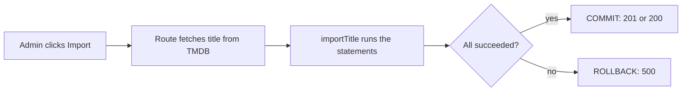

# Person A: Tejasva — catalogue, admin & accounts

Tejasva, this is your complete spec. You own three things:

- **Who the user is**: accounts, sessions, profiles, onboarding picks, and the auth guards (the checks that say "you must be signed in" or "this profile is yours") that everyone else relies on.
- **Everything that reads the catalogue**: search, title pages, genres, "More like this".
- **Everything the admin panel does**: dashboard, TMDB import, and the content table (list, edit, remove).

Read [README.md](README.md) first (architecture, setup, conventions, curl testing). This file is the full spec for your five services. For the tables, see [`../schema/SCHEMA.md`](../schema/SCHEMA.md) ("Account & billing", plus the catalogue tables).

The Neon database already has the migration and the seeded data (500 titles, 12.9k episodes, 2.9k people, 2 users, 3 profiles). Every query below can run against real rows as soon as you write it.

**Order matters.** `users` + `profiles` + the auth-guard swap come first (day 1 to 2), because every other service depends on them. Yash (B) and Sahil (C) keep working against the mock-backed guards until you merge them. You also write `profile_genre_preference` (onboarding), which Sahil's cold start reads.

## Table of contents

1. [Scope](#1-scope)
2. [Dependencies on B and C, and what to stub](#2-dependencies-on-b-and-c-and-what-to-stub)
3. [Ordered checklist](#3-ordered-checklist)
4. [`users.service.ts`](#4-usersservicets)
5. [`profiles.service.ts`](#5-profilesservicets)
6. [Deep dive: auth guards and hardening](#6-deep-dive-auth-guards-and-hardening)
7. [Catalogue service (`catalog.service.ts`)](#7-catalogue-service-catalogservicets)
8. [Admin services (`admin.service.ts`, `admin-content.service.ts`)](#8-admin-services-adminservicets-admin-contentservicets)
9. [Deep dive: the TMDB import transaction](#9-deep-dive-the-tmdb-import-transaction)
10. [Deep dive: the dashboard queries](#10-deep-dive-the-dashboard-queries)
11. [Implementation notes (Drizzle, mapping, pitfalls)](#11-implementation-notes-drizzle-mapping-pitfalls)
12. [Definition of done](#12-definition-of-done)

---

## 1. Scope

This section lists exactly which files and routes are yours, which tables you read and write, and what is already done so you do not rewrite it.

### Files you own

- `src/server/services/users.service.ts`: `findUserById`, `findUserCredentialsByEmail`, `createUser`.
- `src/server/services/profiles.service.ts`: `listProfiles`, `getOwnedProfile`, `createProfile`, `updateProfile`, `deleteProfile`, `getGenrePreferences`, `saveGenrePreferences`.
- `src/server/services/catalog.service.ts`: `ContentSearch` (type), `searchContent`, `getContentDetail`, `listGenres`, `getSimilarTitles`.
- `src/server/services/admin-content.service.ts`: `listContentForAdmin`, `getContentDeletionImpact`, `deleteContent`, `updateContent` (the admin content table, remove and edit dialogs; sections 8.5 to 8.8).
- `src/server/services/admin.service.ts`: `getDashboard`, `markInCatalog`, `findCatalogueId`, `importTitle` (plus the `QUERIES` constant).
- `src/app/api/_lib/auth.ts`: the auth guards (`requireUser`, `requireAdmin`, `requireOwnedProfile`, `getSelectedProfile`). They go from mock-backed to real queries once your user and profile functions are real (section 6.1).
- `src/app/api/auth/sign-up/route.ts` and `src/components/auth/sign-up-flow.tsx`: start the session after sign-up and go to `/profiles` (section 4.4).
- `src/server/auth/*` and `src/server/session/*`: hardening (section 6.2).
- `src/app/api/admin/content/import/route.ts`: wire the server-side TMDB fetch (section 9.4).
- `.env.example`: add `DATABASE_URL` (shared).
- A custom migration `drizzle/NNNN_dashboard_indexes.sql` (optional): the dashboard indexes from README section 7.3, if the queries get slow. `unaccent` is already enabled by `drizzle/0000_schema.sql`.

### Routes and the function behind each

- `POST /api/auth/sign-up`: `hashPassword` then `createUser`.
- `POST /api/auth/sign-in`, `POST /api/auth/sign-out`, `GET /api/auth/me`: the route code is already real; you make `findUserCredentialsByEmail` and `findUserById` real.
- `GET, POST /api/profiles`: `listProfiles`; `createProfile`.
- `GET, PATCH, DELETE /api/profiles/:profileId`: `getOwnedProfile` (guard); `updateProfile`; `deleteProfile` (plus the cookie clear in the route).
- `GET, PUT /api/profiles/:profileId/onboarding`: `getGenrePreferences`; `saveGenrePreferences`.
- `GET /api/genres`: `listGenres`.
- `GET /api/content`: `searchContent`.
- `GET /api/content/:contentId`: `getContentDetail`.
- `GET /api/content/:contentId/similar`: `getSimilarTitles`.
- `GET /api/admin/dashboard`: `getDashboard`.
- `GET /api/admin/tmdb/search`: `markInCatalog` (the live TMDB call is already real).
- `GET /api/admin/tmdb/:type/:tmdbId`: `findCatalogueId` (live fetch and SQL preview already real).
- `POST /api/admin/content/import`: `importTitle`.
- `GET /api/admin/content`: `listContentForAdmin`.
- `GET /api/admin/content/:contentId/impact`: `getContentDeletionImpact`.
- `PATCH /api/admin/content/:contentId`: `updateContent`.
- `DELETE /api/admin/content/:contentId`: `deleteContent` (the route answers 204).

### Why you go first

Every other service depends on yours for **authentication and ownership**:

- `requireUser` calls `findUserById`.
- `requireOwnedProfile` and `getSelectedProfile` call `getOwnedProfile`.

Land those first (checklist 1 to 3). Yash (B) and Sahil (C) keep working against the mock-backed guards until you merge them. Also, `saveGenrePreferences` is the only writer of `profile_genre_preference` and `profile.onboarded_at`, which Sahil's (C) cold start reads.

### Already real, do not rewrite

- The admin content routes under `src/app/api/admin/content/` (thin: they only call the four `admin-content.service.ts` functions).
- The SQL display builders in `src/lib/sql/admin-content.ts`.
- `src/app/api/_lib/tmdb.ts` (`getTmdbClient`, `parseMediaType`, `tmdbErrorResponse`).
- `src/lib/tmdb/*` (client, mappers, `fetchTitle`, `toSearchResult`).
- `src/lib/sql/import-title.ts` (`buildImportScript`).

The catalogue is created **only** by `importTitle`. `updateContent` and `deleteContent` edit and remove what it created.

### Tables you read and write

- **Read**: `content`, `genre`, `content_genre`, `person`, `content_credit`, `season`, `episode`, `watch_history` (search popularity). For the dashboard: `users`, `subscription`, `subscription_plan`, `payment`. For onboarding: `genre`. For the admin content table and delete preview: `watch_history`, `my_list`, `rating` (counts only).
- **Write**: `users`, `profile`, `profile_genre_preference` (accounts); `content`, `genre`, `content_genre`, `person`, `content_credit`, `season`, `episode` (import); and `content` again (`updateContent` runs an UPDATE; `deleteContent` runs a DELETE, which cascades, meaning it automatically removes the dependent rows, to `content_genre`, `content_credit`, `season`, `episode`, `watch_history`, `my_list`, `rating`).

### Maturity rule

Maturity is never stored. Filter with `maturity_of(c.age_rating) <= $level` (enum order KIDS < TEEN < ADULT; a NULL certificate counts as TEEN). A `null` `maturityLevel` argument means "no profile selected, no filter".

---

## 2. Dependencies on B and C, and what to stub

This section lists what you need from Yash (B) and Sahil (C), and what to do until their parts land. Mostly the answer is "nothing to stub": the seed data is enough.

### What you need from others

- **`genre` rows for `saveGenrePreferences`**
  - From: seeded (your own `listGenres` is only the read API).
  - Until it lands: query `genre` directly; no stub needed.
- **Profile deletion cascades to `watch_history`, `my_list`, `rating`**
  - From: Sahil's (C) tables already exist.
  - Until it lands: the FKs are `ON DELETE CASCADE`; nothing to stub.
- **Recommendations after onboarding**
  - From: Sahil (C). Home is computed on every request from `profile_genre_preference` and the activity tables, so there is nothing to refresh.
  - Until it lands: nothing for you to do; you only save the picks and stamp `onboarded_at`.
- **`getSimilarTitles`**
  - It depends on no one: it is a self-join of `content_genre` and `content` (ties break on release date), so it works on the seeded data from day one.
- **Activity rows for the popularity ranking and dashboard**
  - From: Sahil (C) writes them later; the seed provides 15 history rows.
  - Until it lands: real data from the seed is enough.
- **Payments and subscriptions for dashboard widgets**
  - From: Yash (B) writes them later; the seed provides 8 payments and 2 subscriptions.
  - Until it lands: real data from the seed is enough.

### Who depends on you

- **Everything behind a guard**: Yash's (B) account routes (`requireUser`) and Sahil's (C) profile routes (`requireOwnedProfile`), plus your own admin routes (`requireAdmin`).
  - While your user/profile functions are still mocks, the seed's ids match the mock ids. So Yash and Sahil keep working against the mock-backed guards with users 1/2 and profiles 1-3 until you merge.
  - As soon as `findUserById` and `getOwnedProfile` are real, tell them.
- **Sahil's (C) cold start** reads `profile_genre_preference` and `profile.onboarded_at`, which only your `saveGenrePreferences` writes (onboarding).
- `activity.getTitleActivity` calls `getContentDetail` (Sahil, C). `recommendations` reads the same tables, and the "Because you liked X" row (Sahil, C) uses the same shared-genre idea as `getSimilarTitles`, but with its own query (it also hides titles the profile has seen). Keep `getContentDetail`'s `NotFoundError("Title not found.")` message stable.

---

## 3. Ordered checklist

Work top to bottom. Accounts come first: everyone depends on `users` + `profiles` + the guards, so steps 1 to 4 are due on day 1 to 2. Yash (B) and Sahil (C) keep working against the mock-backed guards until you merge them; tell them when `findUserById` and `getOwnedProfile` are real.

- [ ] **0. Prep**: branch `feat/catalogue-admin-accounts`, `.env` with your Neon branch `DATABASE_URL`, `npm run dev`, open `npm run db:studio` and look at `users`, `profile`, `content`, `content_genre`, `content_credit`.
- [ ] **1. `findUserById`, `findUserCredentialsByEmail`** (sign-in and every guard become real). curl sign-in + `/api/auth/me`.
- [ ] **2. `getOwnedProfile`, `listProfiles`** (guards and "Who's watching?"). curl `/api/profiles`, another user's id -> 404.
- [ ] **3. Auth-guard swap** (section 6.1): confirm `requireUser`, `requireAdmin`, `requireOwnedProfile` and `getSelectedProfile` in `src/app/api/_lib/auth.ts` hit the real queries and import nothing from `@/server/mocks`; then merge and tell Yash and Sahil.
- [ ] **4. `createUser`** + sign-up route starts the session + `sign-up-flow.tsx` goes to `/profiles`. Sign up in the UI; duplicate email 409.
- [ ] **5. `createProfile`, `updateProfile`, `deleteProfile`** (limit 5, unique name, last-profile rule, cookie clear).
- [ ] **6. `getGenrePreferences`, `saveGenrePreferences`** (onboarding; writes `profile_genre_preference`, which C's cold start reads). Mini's onboarding flow in the UI.
- [x] **7. `unaccent` extension**: already enabled by `drizzle/0000_schema.sql`. (Optional, later: the README 7.3 dashboard indexes in a custom migration.)
- [ ] **8. `listGenres`** (simplest catalogue query). curl `/api/genres`.
- [ ] **9. `getContentDetail`**: six small queries, assemble `ContentDetail`. curl a movie, a series, and `/api/content/999999` (404).
- [ ] **10. `searchContent`**: filters, ranking, genres json. curl each filter; Mini's profile (KIDS) must not see R-rated titles.
- [ ] **11. `getSimilarTitles`**: shared-genre query with the release-date tie-break. curl `/api/content/1/similar` as KIDS and ADULT.
- [ ] **12. `markInCatalog` and `findCatalogueId`** (natural-key lookups). Test through the admin import page search and preview.
- [ ] **13. `getDashboard`**: run the nine `QUERIES`, map rows. Open `/admin`.
- [ ] **14. `importTitle`** + wire the route to fetch the title server-side (section 9.4). Import a new title twice: first 201 `created: true`, then 200 `created: false`; check row counts in Studio; force an error and confirm nothing was written.
- [ ] **15. Admin content management** (sections 8.5 to 8.8): `listContentForAdmin`, `getContentDeletionImpact`, `deleteContent`, `updateContent`. Open `/admin/content` and check each of these:
  - Search (try `100%`), filter by type and genre, page through.
  - Remove shows the live cascade counts; confirm, and check in Studio that the child rows are gone and the `person` / `genre` rows stay.
  - Remove it again -> 404.
  - Edit a title (rename to an existing title + type + date -> 409 `CONTENT_EXISTS`).
  - Add the three FK indexes from 8.6.
- [ ] **16. Auth hardening** (section 6.2): dummy hash, rate limit, hashing upgrade decision, session table decision.
- [ ] **17. Cleanup**: remove `getMockDb`/`find*`/`withPlan`/`findContent`/`toSummary` imports from your five service files, `npm run lint`, `npm run build`, run the whole UI (sign-up, profiles, onboarding, browse, search, title page, admin dashboard, content and import); update route comments that changed (sign-up "No session is started yet", import route header).
- [ ] **18. Optional**: `REPEATABLE READ READ ONLY` snapshots for `getContentDetail` and `getDashboard`; a `pg_trgm` index if search (or the admin title search) is slow; a full-sync option for re-imports.

---

## 4. `users.service.ts`

This service owns the `users` table: `users (user_id, name, email, password_hash, phone, role, created_at)`. It is how the app looks up and creates accounts.

**Never return `password_hash`**, except from `findUserCredentialsByEmail`, which only sign-in uses.

### 4.1 `findUserById(userId: number): Promise<User | null>`

**What it does:** Returns the user with this id, without `password_hash`, or `null` when there is none (for example the account was deleted while a session cookie is still around: callers treat that as signed out).

**Steps:**

1. Select by primary key, **listing the columns explicitly** so `password_hash` is never read.
2. Map snake_case to `User` (`userId`, `createdAt` as an ISO string).

**SQL:**

```sql
SELECT user_id, name, email, phone, role, created_at FROM users WHERE user_id = $1;
```

**Rules to respect:**

- Table and key: `users`; PK `users_pkey`.
- No transaction. Idempotent (safe to repeat): yes, it is a read.
- This runs on **every authenticated request**: keep it a single indexed select.

**Errors:** None (returns `null` when missing).

**Mock today:** Looks the user up in `data/mock/users.json` via `src/server/mocks`.

**Used by:** `requireUser` (`src/app/api/_lib/auth.ts`) and so every guarded route; `GET /api/auth/me`.

### 4.2 `findUserCredentialsByEmail(email: string): Promise<{ user: User; passwordHash: string } | null>`

**What it does:** Returns the user plus the stored password hash for this email, for sign-in; `null` when no account has that email. The hash never leaves the server: sign-in verifies it with `verifyPassword` (`src/server/auth/password.ts`, scrypt, stored as `"scrypt$<salt>$<hash>"`, compared with `timingSafeEqual`) and returns only `user`.

**Steps:**

1. Trim the email.
2. Look it up case-insensitively.
3. Split the row into `{ user, passwordHash }`.

**SQL:**

```sql
SELECT user_id, name, email, phone, role, created_at, password_hash
FROM users WHERE lower(email) = lower($1);
```

**Rules to respect:**

- Table and key: `users`; UNIQUE INDEX `users_email_key ON users (lower(email))`. The query uses the same expression, so the index serves it and at most one row matches.
- No transaction. Idempotent: yes.
- An unknown email returns `null`; the route answers with the **same** 401 message as a wrong password (so nobody can probe which emails exist).

**Errors:** None.

**Mock today:** Case-insensitive lookup in `data/mock/users.json` via `findUserCredentials`.

**Used by:** `POST /api/auth/sign-in`.

### 4.3 `createUser(input: NewUser): Promise<User>`

**What it does:** Registers an account **together with its first profile**, and nothing else. No plan and no payment: after signing in, the user buys a plan from the account page, which starts Razorpay checkout through `POST /api/account/subscriptions`. `NewUser = { name, email, phone: string | null, passwordHash }`.

**Steps** (all in **one transaction**, so a failure leaves no half-created account):

1. `INSERT` the `users` row. The password is already hashed by the route (`hashPassword()` from `src/server/auth/password.ts`, or bcrypt/argon2 after the upgrade). `role` is left to its default `'USER'`: sign-up never creates admins. A `UNIQUE lower(email)` violation (SQLSTATE 23505, the Postgres code for "unique violation"; constraint `users_email_key`) becomes a `ConflictError`.
2. `INSERT` the first profile: `name` = first word of the user's name, `avatar` `'lamp'`, `maturity_level` `'ADULT'`, `onboarded_at` NULL (onboarding not done yet). Same shape as `POST /api/profiles`, but skip the profile-limit check (it is the first one).
3. Return the `User` (without `password_hash`).

**SQL:**

```sql
INSERT INTO users (name, email, phone, password_hash)
VALUES ($1, $2, $3, $4)
RETURNING user_id, name, email, phone, role, created_at;
INSERT INTO profile (user_id, name, avatar, maturity_level)
VALUES ($userId, split_part($1, ' ', 1), 'lamp', 'ADULT');       -- onboarded_at stays NULL
```

**Rules to respect:**

- Tables and keys: `users`, `profile`; UNIQUE INDEX `users_email_key (lower(email))` (23505 means "email taken"); `users.role DEFAULT 'USER'`; FK `profile.user_id`.
- Transaction: yes (`db.transaction`). Idempotent: no.
- The email is stored lower-cased by the route's zod schema (`z.string().trim().toLowerCase().pipe(z.email())`).
- The first word of the name must fit `profile.name VARCHAR(24)`: truncate to 24 characters (`left(split_part(...), 24)`).
- A name that is only spaces cannot occur (the route requires >= 2 chars after trim).

**Errors:**

- `ConflictError("That email is already registered.")` -> 409.

**Mock today:** Returns a plausible `User` (`userId` = number of mock users + 1, role `'USER'`, `createdAt` now) and persists nothing; the route does not start a session for it.

**Used by:** `POST /api/auth/sign-up`.

Drizzle sketch:

```ts
return db.transaction(async (tx) => {
  try {
    const [row] = await tx.insert(users).values({ name, email, phone, passwordHash }).returning();
    await tx
      .insert(profile)
      .values({ userId: row.userId, name: firstWord(name).slice(0, 24), avatar: "lamp", maturityLevel: "ADULT" });
    return mapUser(row);
  } catch (error) {
    if (pgError(error).code === "23505") throw new ConflictError("That email is already registered.");
    throw error; // inside a transaction the failed statement already aborted it; rethrow to roll back
  }
});
```

### 4.4 Sign-up route and form changes (part of this task)

Making `createUser` real is not enough: the route and the form also need small changes so a new user is signed in and lands on `/profiles`.

- `src/app/api/auth/sign-up/route.ts`: after `createUser`, call `await startSession(user.userId)` (`@/server/auth/session`, as sign-in does). Update the header comment ("No session is started yet ...").
- `src/components/auth/sign-up-flow.tsx`: remove the "Demo mode: accounts aren't saved yet" toast and `router.push("/sign-in")`; go to `/profiles`. (`proxy.ts` redirects signed-in visitors of `/sign-up` to `/profiles` already.)
- `README.md` (root) mentions "Sign-up is still a stub": the owner of the final cleanup updates it.

---

## 5. `profiles.service.ts`

This service owns the profiles ("Who's watching?") and each profile's onboarding genre picks. It owns `profile (profile_id, user_id, name, avatar, maturity_level, onboarded_at)` and `profile_genre_preference (profile_id, genre_id; PK (profile_id, genre_id))`.

**Column mapping:** `Profile.onboardingCompleted` is `onboarded_at IS NOT NULL`. Select it as `(onboarded_at IS NOT NULL) AS onboarding_completed` (JSDoc) or `AS "onboardingCompleted"`. Every function that returns a `Profile` returns that exact shape: `{ profileId, userId, name, avatar, maturityLevel, onboardingCompleted }`.

### 5.1 `listProfiles(userId: number): Promise<Profile[]>`

**What it does:** Returns the account's profiles in creation order, for the "Who's watching?" screen.

**Steps:**

1. Select the user's profiles ordered by `profile_id`.

**SQL:**

```sql
SELECT profile_id, user_id, name, avatar, maturity_level, (onboarded_at IS NOT NULL) AS onboarding_completed
FROM profile WHERE user_id = $1 ORDER BY profile_id;
```

**Rules to respect:**

- Table and key: `profile`; FK `profile.user_id` -> `users`.
- No transaction. Idempotent: yes.
- Never empty for a real account (sign-up creates the first profile); admin accounts may have none.

**Errors:** None.

**Mock today:** The mock profiles whose `userId` matches, in file order.

**Used by:** `GET /api/profiles`.

### 5.2 `getOwnedProfile(userId: number, profileId: number): Promise<Profile>`

**What it does:** Returns the profile only if it belongs to `userId`. A profile that exists but is someone else's is reported exactly like a missing one: never reveal other accounts' profiles.

**Steps:**

1. Select by `profile_id` and `user_id` together.
2. No row -> `NotFoundError`.

**SQL:**

```sql
SELECT profile_id, user_id, name, avatar, maturity_level, (onboarded_at IS NOT NULL) AS onboarding_completed
FROM profile WHERE profile_id = $1 AND user_id = $2;
```

**Rules to respect:**

- Table and key: `profile`; PK `profile_pkey`.
- No transaction. Idempotent: yes.
- Hot path (runs on every profile route and every catalogue request with a `profileId` cookie): one indexed select.

**Errors:**

- `NotFoundError("Profile not found.")` -> 404, when the profile is missing or not the user's.

**Mock today:** Finds the profile in `data/mock/profiles.json` and checks its `userId`.

**Used by:** `requireOwnedProfile` / `getSelectedProfile` (`src/app/api/_lib/auth.ts`), so **every** `/api/profiles/:profileId/**` route; also `GET /api/profiles/:profileId`.

### 5.3 `createProfile(userId: number, input: ProfileInput): Promise<Profile>`

**What it does:** Adds a profile. The route has already validated the shape (`name` 1-24 chars after trim, `avatar` in `AVATAR_KEYS`, `maturityLevel` KIDS | TEEN | ADULT). The client sends new profiles through `/onboarding` afterwards, so `onboarded_at` starts NULL.

**Steps:**

1. Lock the user row and count the user's profiles; at the current plan's `max_profiles` (`NO_PLAN_MAX_PROFILES` = 1 without a plan) -> `ConflictError`.
2. `INSERT ... RETURNING`. Names are unique per account, case-insensitively: the unique index violation (23505, `profile_user_name_key`) -> `ConflictError`.

**SQL:**

```sql
SELECT user_id FROM users WHERE user_id = $1 FOR UPDATE;            -- serialises concurrent creates for this user
SELECT COUNT(*) FROM profile WHERE user_id = $1;                    -- must be < 5
INSERT INTO profile (user_id, name, avatar, maturity_level)
VALUES ($1, $2, $3, $4)
RETURNING profile_id, user_id, name, avatar, maturity_level, (onboarded_at IS NOT NULL) AS onboarding_completed;
```

**Rules to respect:**

- Table and key: `profile`; UNIQUE INDEX `profile_user_name_key (user_id, lower(name))`.
- The profile limit (`subscription_plan.max_profiles`) is checked here, not in the schema.
- Transaction: yes, so two concurrent creates cannot both pass the count. Lock the `users` row with `SELECT ... FOR UPDATE` (a row lock that makes other transactions wait), or accept the small race. Idempotent: no.
- `onboardingCompleted` is `false` for the new row.

**Errors:**

- `ConflictError` -> 409 at the limit (code `"PROFILE_LIMIT"`, message e.g. "Your plan allows up to 3 profiles.").
- `ConflictError` -> 409 when the name is already used on this account.

**Mock today:** Returns `{ ...input, profileId: number of mock profiles + 1, userId, onboardingCompleted: false }` and persists nothing (the limit and name checks are not run).

**Used by:** `POST /api/profiles`.

### 5.4 `updateProfile(userId, profileId, changes: Partial<ProfileInput>): Promise<Profile>`

**What it does:** Renames a profile or changes its avatar or maturity. A lower `maturity_level` applies at once, since every catalogue query filters by it.

**Steps:**

1. Confirm the profile belongs to `userId` (`getOwnedProfile`) -> `NotFoundError`.
2. `UPDATE` only the given columns, with `RETURNING`.
3. When the name changes, uniqueness is checked excluding the row itself. Renaming "Sam" to "sam" is fine: the unique index is on `lower(name)` per user, and the row's own entry does not conflict with itself. A unique index violation (23505) -> `ConflictError`.

**SQL:**

```sql
UPDATE profile
SET name = COALESCE($3, name), avatar = COALESCE($4, avatar), maturity_level = COALESCE($5, maturity_level)
WHERE profile_id = $1 AND user_id = $2
RETURNING profile_id, user_id, name, avatar, maturity_level, (onboarded_at IS NOT NULL) AS onboarding_completed;
-- build the SET list from the fields present in `changes`; $3-$5 are the given values
```

**Rules to respect:**

- Table and key: `profile`; UNIQUE INDEX `profile_user_name_key (user_id, lower(name))`.
- No transaction (single statement). Idempotent: yes (same changes give the same row).
- Empty `changes` just returns the current row.
- `onboarded_at` is never touched here.

**Errors:**

- `NotFoundError("Profile not found.")` -> 404.
- `ConflictError` -> 409 when the name is taken on this account.

**Mock today:** Merges `changes` into the found profile (keeping its ids) and persists nothing.

**Used by:** `PATCH /api/profiles/:profileId`.

### 5.5 `deleteProfile(userId, profileId): Promise<void>`

**What it does:** Removes a profile and all of its activity. The route clears the `profileId` cookie if it pointed at this profile.

**Steps:**

1. Confirm the profile belongs to `userId` -> `NotFoundError`.
2. Refuse when it is the user's only profile -> `ConflictError`.
3. `DELETE` the row. The `watch_history`, `my_list`, `rating` and `profile_genre_preference` rows go with it through `ON DELETE CASCADE`.

**SQL:**

```sql
SELECT user_id FROM users WHERE user_id = $1 FOR UPDATE;            -- optional: serialise concurrent deletes
SELECT COUNT(*) FROM profile WHERE user_id = $1;                    -- must be > 1
DELETE FROM profile WHERE profile_id = $1 AND user_id = $2;
```

**Rules to respect:**

- Table: `profile`, which cascades to `watch_history`, `my_list`, `rating`, `profile_genre_preference` (`ON DELETE CASCADE` on every `profile_id` foreign key).
- Transaction: yes (count + delete, so two concurrent deletes cannot both pass the check). Idempotent: no (a second delete is a 404).
- Deleting the profile the user is currently watching as is the route's cookie concern.

**Errors:**

- `NotFoundError("Profile not found.")` -> 404.
- `ConflictError` -> 409 when it is the account's last profile.

**Mock today:** Does nothing (the profile stays in the mock data).

**Used by:** `DELETE /api/profiles/:profileId`.

### 5.6 `getGenrePreferences(profileId: number): Promise<number[]>`

**What it does:** Returns the profile's saved onboarding genre picks, to pre-fill the onboarding screen. The caller has already verified ownership.

**Steps:**

1. Select the profile's `genre_id` values, ordered.

**SQL:**

```sql
SELECT genre_id FROM profile_genre_preference WHERE profile_id = $1 ORDER BY genre_id;
```

**Rules to respect:**

- Table and key: `profile_genre_preference`; PK `(profile_id, genre_id)`.
- Returns an empty array before onboarding.

**Errors:** None.

**Mock today:** The genre ids of the mock preference rows for this profile.

**Used by:** `GET /api/profiles/:profileId/onboarding`.

### 5.7 `saveGenrePreferences(profileId: number, genreIds: number[]): Promise<Profile>`

**What it does:** Saves the cold-start genre picks (the first taste signals for a new profile) and finishes onboarding by setting `onboarded_at`. It replaces earlier picks.

Cold-start effect: in the home feed each picked genre adds +1 to that genre's taste. With no other activity yet, Home is the picked genres' titles, ties broken by release date, newest first (Sahil's (C) engine, which reads these rows). This is why onboarding requires at least 3 picks (`ONBOARDING_MIN_GENRES`): a new profile always reaches Home with a genre taste.

**Steps:**

1. De-duplicate `genreIds`. Require at least `ONBOARDING_MIN_GENRES` (3, from `@/lib/constants`) distinct ids that all exist in `genre` -> `ValidationError`.
2. In one transaction: delete the old picks, insert the new ones, stamp `onboarded_at`.

**SQL:**

```sql
SELECT COUNT(*) FROM genre WHERE genre_id IN ($2, $3, ...);  -- one $n per id; must equal the distinct count
DELETE FROM profile_genre_preference WHERE profile_id = $1;
INSERT INTO profile_genre_preference (profile_id, genre_id) VALUES ($1, $2), ($1, $3), ...;  -- one row per id
UPDATE profile SET onboarded_at = now() WHERE profile_id = $1
RETURNING profile_id, user_id, name, avatar, maturity_level, (onboarded_at IS NOT NULL) AS onboarding_completed;
```

**Rules to respect:**

- Tables and keys: `profile_genre_preference`, `profile`, `genre`; PK `(profile_id, genre_id)`; FK `genre_id` -> `genre`.
- Transaction: yes (`db.transaction`). Idempotent: yes (re-saving the same picks gives the same rows; `onboarded_at` is re-stamped).
- Duplicates in the input count once.
- Unknown genre ids are a 422, not silently dropped.
- Lists of ids: see section 11 (`IN ${ids}` in the `sql` template, or `inArray`).

**Errors:**

- `ValidationError` -> 422 when there are fewer than 3 distinct genres, or an id is not a known genre (e.g. "Pick at least 3 genres.").

**Mock today:** Returns the profile with `onboardingCompleted` true; persists nothing and does not validate the genre ids.

**Used by:** `PUT /api/profiles/:profileId/onboarding`.

---

## 6. Deep dive: auth guards and hardening

This section covers two things: how the guards switch from mocks to real queries (easy, because the guards already call your services), and a prioritised list of security hardening items.

### 6.1 Swapping the guards from mocks to real queries

`src/app/api/_lib/auth.ts` already calls the services, so the swap is done by making the service functions real, not by rewriting the guards.

- `requireUser` (and `requireAdmin` on top of it) calls `findUserById`. It becomes real at checklist 1.
- `requireOwnedProfile` and `getSelectedProfile` call `getOwnedProfile`. They become real at checklist 2.

**How to check it worked:**

- `grep -n "server/mocks" src/app/api/_lib/auth.ts src/server/services/{users,profiles}.service.ts` prints nothing.
- A deleted user's old cookie answers 401.
- Another account's profile id answers 404.
- `requireAdmin` still gives 403 to the demo user and lets the seeded admin through.

Until this merges, Yash and Sahil run against the mock-backed guards (the seed's ids match the mock ids), so merge it early and announce it.

### 6.2 Hardening

**Real today:**

- A signed cookie: `session=<userId>.<HMAC-SHA256(userId)>` (HMAC is a keyed hash that proves the cookie was not tampered with). It is httpOnly, `sameSite=lax`, `secure` in production, lasts 30 days, `path=/`.
- scrypt password hashing (`hashPassword`/`verifyPassword`, 16-byte random salt, 64-byte key, `timingSafeEqual`).
- The proxy and the guards.

**Not yet:** the items below, in recommended order.

#### Item 1: Dummy hash for unknown emails

In `POST /api/auth/sign-in`, when `findUserCredentialsByEmail` returns `null`, still run `verifyPassword(body.password, DUMMY_HASH)` (a constant valid `scrypt$...` string). That way the unknown-email path takes as long as the wrong-password path, so timing does not reveal which emails exist. Keep the same 401 message.

#### Item 2: Rate limiting

Limit sign-in attempts per IP and per email (e.g. 5 per 15 minutes -> 429 `RATE_LIMITED`).

- It needs state: either a `login_attempt (key text, attempted_at timestamptz)` table (count rows in the window), or an in-memory Map for the demo (resets on restart, per instance).
- Count failures only; clear on success.
- Apply the same to sign-up (per IP).

#### Item 3: Stronger password hashing

scrypt (current: Node defaults N=16384, r=8, p=1) is acceptable. Pick one:

- Keep it and make the cost explicit and tunable, or
- Move to **argon2id** (`argon2` package) or bcrypt.

Keep the stored value self-describing (`scrypt$...`, `argon2id$...`): `verifyPassword` dispatches on the prefix, and sign-in rehashes to the new scheme on a successful login (`UPDATE users SET password_hash = $1 WHERE user_id = $2`). Regenerate seed hashes only if you drop scrypt entirely.

#### Item 4: Session table

The stateless cookie cannot be revoked and never expires early. A table `session (session_id uuid pk, user_id fk, created_at, expires_at, last_seen_at)` gives you:

- Expiry.
- "Sign out everywhere".
- Revocation on password change.
- Sign-out that deletes the row, so a copied cookie stops working.

How it would work:

- The cookie holds a random opaque id (or `session_id.hmac`).
- `getSessionUserId` looks the row up (valid and not expired, and slides `expires_at` forward).
- `startSession` inserts; `endSession` deletes.
- It touches `src/server/auth/session*.ts`, `src/proxy.ts` and the sign-out route. `src/proxy.ts` only verifies the signature; it cannot query the database in the Edge/proxy runtime, so keep the HMAC-signed id there and do the row check in `requireUser`.

Decision: README 9.3.

#### Item 5: Cookie flags

Keep httpOnly + sameSite=lax. Make sure `secure` is on in production. Consider the `__Host-` prefix.

#### Item 6: Password change / reset

Not in the UI. If added, revoke other sessions (requires item 4).

#### Item 7: Login enumeration on sign-up

`createUser` reveals "email already registered" (409). Acceptable for the project; note it.

#### How to verify each item

- Item 1: timing. Use `curl -w '%{time_total}'` for an unknown email vs a wrong password; the times should be the same order of magnitude.
- Item 2: a loop of 6 bad attempts -> 429.
- Item 3: sign in with the old hash and check the rehash.
- Item 4: sign out, then replay the old cookie -> 401.

---

## 7. Catalogue service (`catalog.service.ts`)

This service reads the catalogue for everything a viewer sees: genre lists, search and browse, the title page, and "More like this". Every query here respects the selected profile's maturity level.

### 7.1 Types and mapping

```ts
export interface ContentSearch {
  q?: string; // trimmed free text; undefined/empty = browse
  type?: ContentType; // 'MOVIE' | 'SERIES'
  genreId?: number; // genre.genre_id
  limit: number; // 1-100, default 60 (the route has clamped it)
  maturityLevel: MaturityLevel | null; // selected profile's level; null = no filter
}
```

Return types come from `@/types`:

- `ContentSummary` = `Content` minus `cast`/`directors`: `contentId, title, description, releaseDate, contentType, durationMinutes, ageRating, maturityLevel, posterUrl, backdropUrl, genres: Genre[]`.
- `ContentDetail` = `Content` + `seasons: Season[]`.
- `Genre { genreId, name }`.

Row mapping:

- `maturity_of(c.age_rating) AS maturity_level` gives `maturityLevel`.
- `release_date` must come back as the string `YYYY-MM-DD` (the pg DATE parser in src/server/db/index.ts keeps it as text).
- `genres` come from the `json_agg(json_build_object('genreId', ..., 'name', ...))` subquery, already in camelCase.

### 7.2 `listGenres(): Promise<Genre[]>`

**What it does:** Returns every genre, alphabetically (used by the search filter, onboarding and genre pages).

**Steps:**

1. Select all genres ordered by name.

**SQL:**

```sql
SELECT genre_id, name FROM genre ORDER BY name;
```

Drizzle: `db.select({ genreId: genre.genreId, name: genre.name }).from(genre).orderBy(genre.name)`.

**Rules to respect:**

- Table and key: `genre`; `genre.name UNIQUE`.
- No transaction. Idempotent: yes (read).
- Genres no title uses are still listed.

**Errors:** None.

**Mock today:** Returns the mock genre list as stored (not re-sorted).

**Used by:** `GET /api/genres`.

### 7.3 `getContentDetail(contentId: number): Promise<ContentDetail>`

**What it does:** Returns one title with everything the title page and player need: genres, billed cast with character names, directors and, for series, every season with its episodes (`seasons` is `[]` for movies).

**Steps:**

1. Load the content row; no row -> `NotFoundError("Title not found.")`.
2. Attach genres, cast, directors and seasons (queries below; run them in parallel with `Promise.all`).
3. Maturity is **not** checked here: the page checks it against the selected profile and shows "not available on this profile" instead of a 404.

**SQL:**

```sql
SELECT content_id, title, description, release_date, content_type, duration_minutes, age_rating,
       maturity_of(age_rating) AS maturity_level, poster_url, backdrop_url
FROM content WHERE content_id = $1;

-- genres
SELECT g.genre_id, g.name FROM content_genre AS cg JOIN genre AS g ON g.genre_id = cg.genre_id
WHERE cg.content_id = $1 ORDER BY g.name;

-- cast: top-billed first; characterName = COALESCE(character_name, '')
SELECT p.person_id, p.name, p.date_of_birth, p.photo_url, COALESCE(cc.character_name, '') AS character_name
FROM content_credit AS cc JOIN person AS p ON p.person_id = cc.person_id
WHERE cc.content_id = $1 AND cc.role = 'ACTOR' ORDER BY cc.credit_order;

-- directors (the response keeps cast and directors as two lists; both come from content_credit)
SELECT p.person_id, p.name, p.date_of_birth, p.photo_url
FROM content_credit AS cc JOIN person AS p ON p.person_id = cc.person_id
WHERE cc.content_id = $1 AND cc.role = 'DIRECTOR' ORDER BY cc.credit_order;

-- seasons (season 0, "Specials", is skipped), series only
SELECT season_id, content_id, season_number, name, release_date
FROM season WHERE content_id = $1 AND season_number > 0 ORDER BY season_number;

-- their episodes, grouped by season_id in code
SELECT episode_id, season_id, episode_number, title, description, release_date, duration_minutes, still_url
FROM episode WHERE season_id IN ($2, $3, ...) ORDER BY season_id, episode_number;  -- one $n per season_id
```

**Rules to respect:**

- Tables: `content`, `content_genre`, `genre`, `content_credit`, `person`, `season`, `episode`.
- Keys relied on: `content` PK; `content_credit` PK `(content_id, person_id, role)`; `season` UNIQUE `(content_id, season_number)`; `episode` UNIQUE `(season_id, episode_number)`.
- Transaction: no. For one consistent snapshot, run them in a `REPEATABLE READ READ ONLY` transaction (a mode where every query sees the same frozen view of the data). Idempotent: yes.
- A movie has no seasons (skip the season and episode queries).
- A series season with no episodes keeps `episodes: []`; no seasons for a series is fine.
- NULL `character_name` comes back as `''`.

**Errors:**

- `NotFoundError("Title not found.")` -> 404 when the id does not exist.

**Mock today:** Returns the mock catalogue entry, or throws `NotFoundError`.

**Used by:** `GET /api/content/:contentId`; `getSimilarTitles` (existence check); `activity.service` `getTitleActivity`.

Assembly sketch (Drizzle `sql` + `db.execute`, or the builder with `inArray(episode.seasonId, ids)`):

```ts
const [row] = (await db.execute(sql`SELECT ... FROM content WHERE content_id = ${contentId}`)).rows;
if (!row) throw new NotFoundError("Title not found.");
const [genres, cast, directors, seasons] = await Promise.all([...]);
const episodes = seasons.length ? await ... : [];            // season_id IN ${seasonIds}, or inArray()
return { ...mapContent(row), genres, cast: cast.map((r) => ({ person: mapPerson(r), characterName: r.character_name })),
         directors: directors.map(mapPerson), seasons: seasons.map((s) => ({ ...mapSeason(s), episodes: bySeason.get(s.season_id) ?? [] })) };
```

### 7.4 `searchContent(query: ContentSearch): Promise<ContentSummary[]>`

**What it does:** Searches and browses the catalogue: filters by maturity / type / genre / text, ranks the results, and returns the card shape (no cast, directors or seasons).

**Steps:**

1. Maturity: keep titles with `maturity_of(c.age_rating) <= $maturityLevel`; `null` = no filter.
2. `type` -> `content_type = $type`. `genre` -> `EXISTS (SELECT 1 FROM content_genre WHERE content_id = c.content_id AND genre_id = $genre)`.
3. `q` -> an unaccented, case-insensitive `ILIKE '%' || $q || '%'` on the title, **or** an `EXISTS` over `content_credit` joined to `person` whose name matches, any role. (`EXISTS` means a title is not repeated per matching person or role.) **Escape `%`, `_` and `\` in `q` before binding** (`q.replace(/[\\%_]/g, "\\$&")`). `unaccent` is enabled by `drizzle/0000_schema.sql`.
4. Rank: exact title (4) > title prefix (3) > title contains (2) > person match (1). Then most watched (distinct profiles in `watch_history` over the last 30 days, the popularity prior). Then `release_date DESC`. With no `q` it is just most watched, then `release_date DESC` ("most popular first"). Apply `LIMIT $limit`.
5. Genres per row come from `content_genre` joined to `genre` via `json_agg` (a correlated subquery, meaning one that is re-evaluated for each row).

**SQL:**

```sql
WITH popularity AS (
  SELECT content_id, COUNT(DISTINCT profile_id) AS viewers
  FROM watch_history
  WHERE watched_at > now() - interval '30 days'
  GROUP BY content_id
)
SELECT c.content_id, c.title, c.description, c.release_date, c.content_type, c.duration_minutes,
       c.age_rating, maturity_of(c.age_rating) AS maturity_level, c.poster_url, c.backdrop_url,
       COALESCE((SELECT json_agg(json_build_object('genreId', g.genre_id, 'name', g.name) ORDER BY g.name)
                 FROM content_genre AS cg JOIN genre AS g ON g.genre_id = cg.genre_id
                 WHERE cg.content_id = c.content_id), '[]') AS genres
FROM content AS c
LEFT JOIN popularity AS pop ON pop.content_id = c.content_id
WHERE ($1::maturity_level IS NULL OR maturity_of(c.age_rating) <= $1)
  AND ($2::content_type   IS NULL OR c.content_type = $2)
  AND ($3::int            IS NULL OR EXISTS (SELECT 1 FROM content_genre AS cg
                                              WHERE cg.content_id = c.content_id AND cg.genre_id = $3))
  AND ($4::text           IS NULL
       OR unaccent(c.title) ILIKE '%' || unaccent($4) || '%'
       OR EXISTS (SELECT 1 FROM content_credit AS cc JOIN person AS p ON p.person_id = cc.person_id
                  WHERE cc.content_id = c.content_id AND unaccent(p.name) ILIKE '%' || unaccent($4) || '%'))
ORDER BY CASE WHEN $4::text IS NULL                                  THEN 0
              WHEN unaccent(c.title) ILIKE unaccent($4)              THEN 4   -- exact
              WHEN unaccent(c.title) ILIKE unaccent($4) || '%'       THEN 3   -- prefix
              WHEN unaccent(c.title) ILIKE '%' || unaccent($4) || '%' THEN 2  -- contains
              ELSE 1 END DESC,                                                -- person match
         COALESCE(pop.viewers, 0) DESC,
         c.release_date DESC NULLS LAST
LIMIT $5;
-- $1 maturityLevel | null, $2 type | null, $3 genreId | null, $4 q (LIKE-escaped) | null, $5 limit
```

**Rules to respect:**

- Tables: `content`, `content_genre`, `genre`, `content_credit`, `person`, `watch_history`.
- Relies on: `content_genre` PK + `content_genre_genre_idx`, `content_credit_person_idx`, `watch_history_recent_idx`, `maturity_of()`.
- No transaction. Idempotent: yes (read).
- No matches -> `[]`.
- A title with several matching cast members appears once.
- A title with no release date sorts last.
- The route has already clamped `limit` to 1-100 and dropped an unknown `type`.
- An empty string `q` arrives as `undefined` (bind `null`).
- `sql` template note: bind each optional value as `${value ?? null}` with an explicit cast on every occurrence (`${maturityLevel ?? null}::maturity_level`). Drizzle creates a separate `$n` per occurrence, which is fine.

**Errors:** None.

**Mock today:** The first `limit` catalogue items as summaries, ignoring q / type / genre / maturity.

**Used by:** `GET /api/content`.

### 7.5 `getSimilarTitles(contentId, maturityLevel, limit = 12): Promise<ContentSummary[]>`

```ts
export async function getSimilarTitles(
  contentId: number,
  maturityLevel: MaturityLevel | null,
  limit = 12,
): Promise<ContentSummary[]>;
```

**What it does:** "More like this": returns up to `limit` titles that share the most genres with the given title. Ties break on newest `release_date`. Titles above the profile's maturity level are filtered out, and the title itself is never returned. It reads only `content_genre` and `content` (no views, no activity tables).

**Steps:**

1. `getContentDetail(contentId)` -> `NotFoundError` for an unknown id (so the route answers 404). A cheaper `SELECT 1 FROM content WHERE content_id = $1` with the same error message is acceptable.
2. Self-join `content_genre`: `a` is the given title's genres, `b` is every other title that has one of them. `COUNT(*)` per other title is `shared_genres`.
3. Filter on `maturity_of(age_rating) <= $maturityLevel` (null = no filter).
4. `ORDER BY shared_genres DESC, release_date DESC NULLS LAST` `LIMIT $limit` (12 on the title page).
5. Hydrate the ids into `ContentSummary` with their genres, as in `searchContent`, and keep the order from step 4.

**SQL:**

```sql
SELECT c.content_id, COUNT(*) AS shared_genres
  FROM content_genre AS a
  JOIN content_genre AS b ON b.genre_id = a.genre_id AND b.content_id <> a.content_id
  JOIN content AS c ON c.content_id = b.content_id
 WHERE a.content_id = $1
   AND ($2::maturity_level IS NULL OR maturity_of(c.age_rating) <= $2)
 GROUP BY c.content_id, c.release_date
 ORDER BY shared_genres DESC, c.release_date DESC NULLS LAST
 LIMIT $3;
```

Then load the `ContentSummary` for those ids (one query with `WHERE c.content_id = ANY($ids)`, genres as a `json_agg` subquery as in `searchContent`) and sort the result in the order of the ids above.

**Rules to respect:**

- Tables: `content_genre`, `content`, `genre` (hydration).
- Relies on: `content_genre` PK; `maturity_of()`. It reads the base tables directly (not the `genre_taste` view), so there is no refresh step.
- No transaction. Idempotent: yes (read).
- A title with no genres returns an empty list.
- Fewer than `limit` titles may qualify (small genres, or a strict maturity level).
- `b.content_id <> a.content_id` keeps the title itself out. `shared_genres` is internal: do not put it in `ContentSummary`.
- This does not depend on Sahil (C). The "Because you liked X" row in `recommendations.service` uses the same self-join idea with its own query (it also hides titles the profile has seen).

**Errors:**

- `NotFoundError("Title not found.")` -> 404.

**Mock today:** The first `limit` other titles in catalogue order (default 12), ignoring maturity.

**Used by:** `GET /api/content/:contentId/similar`.

---

## 8. Admin services (`admin.service.ts`, `admin-content.service.ts`)

These services power the admin panel: the dashboard, the TMDB import, and the content table with its remove and edit dialogs.

The live TMDB calls (search, `fetchTitle`) are **not** here; they are real code in the admin routes (`src/app/api/_lib/tmdb.ts`, `src/lib/tmdb`). These functions only touch the database.

- Sections 8.1 to 8.4 are `admin.service.ts` (dashboard and import).
- Sections 8.5 to 8.8 are `admin-content.service.ts` (the content table, remove and edit dialogs).

### 8.1 `markInCatalog(results: Omit<TmdbSearchResult, "alreadyInCatalog">[]): Promise<TmdbSearchResult[]>`

**What it does:** Flags which TMDB search results are already in the catalogue. The database stores no TMDB ids, so a result counts as "in the catalogue" when a `content` row has the same natural key (the combination of real-world fields that identifies a row) `(title, content_type, release_date)`, taken from the result's `title`, `contentType` and `releaseDate`.

**Steps:**

1. Empty input -> `[]` without a query.
2. One query for the whole page (not one per row): the page's titles, types and dates go in as three parallel arrays. It returns the 1-based positions (`ord`) of the results that exist.
3. Copy each result with `alreadyInCatalog = (its position is in that set)`. Order unchanged.

**SQL:**

```sql
SELECT v.ord
FROM unnest($1::text[], $2::content_type[], $3::date[]) WITH ORDINALITY AS v (title, content_type, release_date, ord)
JOIN content AS c ON c.title = v.title AND c.content_type = v.content_type
                 AND c.release_date IS NOT DISTINCT FROM v.release_date;
-- served by the UNIQUE NULLS NOT DISTINCT (title, content_type, release_date) index
```

**Rules to respect:**

- Table and key: `content`; UNIQUE NULLS NOT DISTINCT `(title, content_type, release_date)`. `IS NOT DISTINCT FROM` lets a NULL release date match, like the key does.
- No transaction. Idempotent: yes.
- A title TMDB later renames or re-dates does not match its imported row and shows as new.
- Two results with the same key are both flagged.
- `$3::date[]` binds `null` entries fine (`(string | null)[]`). Pass arrays with `sql.param([...])` or via `db.$client.query(text, values)`.

**Errors:** None.

**Mock today:** Flags a result when the mock catalogue's `findByKey(contentType, title, releaseDate)` hits.

**Used by:** `GET /api/admin/tmdb/search`.

### 8.2 `findCatalogueId(contentType: ContentType, title: string, releaseDate: string | null): Promise<number | null>`

**What it does:** Returns the `content_id` of the catalogue row with this natural key, or `null`. It feeds the import preview's `alreadyInCatalog` / `existingContentId`: non-null means an import refreshes the row (its SQL is an upsert, an insert-or-update, on the same key).

**Steps:**

1. Look up the row by title, type and release date (NULL-safe).

**SQL:**

```sql
SELECT content_id FROM content
WHERE title = $1 AND content_type = $2 AND release_date IS NOT DISTINCT FROM $3;
```

**Rules to respect:**

- Table and key: `content`; UNIQUE NULLS NOT DISTINCT `(title, content_type, release_date)`. At most one row can match, even with a NULL release date.
- No transaction. Idempotent: yes.
- A title TMDB renamed or re-dated will not match (an import would add a new row).

**Errors:** None.

**Mock today:** `findByKey(contentType, title, releaseDate)?.contentId ?? null`.

**Used by:** `GET /api/admin/tmdb/:type/:tmdbId`.

### 8.3 `getDashboard(): Promise<AdminDashboard>`

**What it does:** Returns every admin dashboard widget, each with the query that produces it (and a one-line explanation), plus the time it was generated. The nine `QUERIES[*].sql` strings in the file **are** the queries to run (the page shows them under "View SQL"): keep the two in step. Full list and mapping in [section 10](#10-deep-dive-the-dashboard-queries).

**Steps:**

1. Run the nine statements in parallel (`Promise.all` over `db.execute(sql.raw(QUERIES.x.sql))`; they are parameter-free so `sql.raw` is safe). For one consistent snapshot, run them sequentially on one connection inside `BEGIN ISOLATION LEVEL REPEATABLE READ READ ONLY` instead.
2. Map snake_case columns to the camelCase fields of `src/types/admin.ts`. `COUNT`/`SUM` are cast to `int`/`numeric` in SQL because node-postgres returns `bigint` as a string, and numeric amounts need `Number()` in TS.
3. Return `{ widgets: { [key]: { ...QUERIES[key], data } }, generatedAt: new Date().toISOString() }`.

**SQL:** The nine statements live in the `QUERIES` constant; they are listed in section 10.

**Rules to respect:**

- Tables: `users`, `subscription`, `subscription_plan`, `payment`, `watch_history`, `content`, `content_genre`, `genre`, `episode`.
- Keys relied on: none for correctness; indexes for speed are in 10.3.
- Transaction: optional (`REPEATABLE READ READ ONLY`). Idempotent: yes.
- An empty database gives zeros and empty lists.
- Genres and plans nobody uses stay in their lists with 0 (LEFT JOIN).

**Errors:** None (`requireAdmin` already ran).

**Mock today:** Counts and groups the mock rows in memory with the same shapes. `activeSubscriptions` counts status ACTIVE only (no `end_date` check), and revenue sums this calendar month's SUCCESS payments.

**Used by:** `GET /api/admin/dashboard`.

### 8.4 `importTitle(input: ImportTitleInput, title?: TmdbTitleData): Promise<ImportTitleResult>`

**What it does:** Adds (or refreshes) one TMDB title in the catalogue, in one transaction: the content row with its genres, people, credits and, for series, seasons and episodes. Full walk-through in [section 9](#9-deep-dive-the-tmdb-import-transaction).

**Steps:** See section 9.2 (statement order) and 9.3 (skeleton).

**SQL:** Generated by `buildImportScript`; see section 9.2.

**Rules to respect:**

- Tables: `content`, `genre`, `content_genre`, `person`, `content_credit`, `season`, `episode`.
- Transaction: yes (`BEGIN ... COMMIT` on one connection). Idempotent: yes (every write is an upsert on a natural key).

**Errors:**

- Nothing typed. A failed statement rolls back and rethrows -> 500.
- The route owns the TMDB 404 / 502 / 503 answers since it does the fetch.

**Mock today:** Persists nothing and fetches nothing (`title` is not passed yet). If the mock catalogue already has a title with that TMDB id and type, returns `{ contentId: <its id>, created: false }`, else `{ contentId: <catalogue size + 1>, created: true }`.

**Used by:** `POST /api/admin/content/import`.

### 8.5 `listContentForAdmin(filters: AdminContentFilters): Promise<AdminPage<AdminContentRow>>`

(`admin-content.service.ts`.)

**What it does:** Returns one page of the catalogue for the admin content table, with each title's genres and, for series, its season and episode counts. It is alphabetical by title (then `content_id`), not by recency. The generated display copy of the query is `buildListContentSql` in `src/lib/sql/admin-content.ts`.

**Steps:**

1. Normalise the filters:
   - `q` trimmed (empty = no filter), with LIKE wildcards escaped (`\`, `%`, `_` get a leading backslash), then bound as `'%' || q || '%'`.
   - `page >= 1` (default 1).
   - `pageSize` 1 to 100 (default 20, `ADMIN_PAGE_SIZE`).
   - `offset = (page - 1) * pageSize`.
   - Bind `null` for absent filters, never `undefined`.
2. Run the page query and a `COUNT(*)` with the same `WHERE` (parallel is fine; read-only, no transaction needed).
3. `pageCount = max(1, ceil(total / pageSize))`. A page past the end answers with the **last** page (re-run with the clamped offset) and reports the page it returned.
4. Map to `AdminContentRow`. `release_date` already arrives as `'YYYY-MM-DD'` text; `genres` arrives as parsed JSON.

**SQL:**

```sql
SELECT
  c.content_id, c.title, c.content_type, c.release_date, c.age_rating, c.poster_url,
  COALESCE((SELECT json_agg(json_build_object('genreId', g.genre_id, 'name', g.name) ORDER BY g.name)
            FROM content_genre AS cg JOIN genre AS g ON g.genre_id = cg.genre_id
            WHERE cg.content_id = c.content_id), '[]') AS genres,
  CASE WHEN c.content_type = 'SERIES'
       THEN (SELECT COUNT(*) FROM season AS s WHERE s.content_id = c.content_id) END AS season_count,
  CASE WHEN c.content_type = 'SERIES'
       THEN (SELECT COUNT(*) FROM episode AS e JOIN season AS s ON s.season_id = e.season_id
             WHERE s.content_id = c.content_id) END AS episode_count
FROM content AS c
WHERE c.title ILIKE $1 ESCAPE '\'                                         -- only when q is set
  AND c.content_type = $2                                                 -- only when type is set
  AND EXISTS (SELECT 1 FROM content_genre AS cg
              WHERE cg.content_id = c.content_id AND cg.genre_id = $3)    -- only when genre is set
ORDER BY c.title, c.content_id
LIMIT $4 OFFSET $5;

SELECT COUNT(*) AS total FROM content AS c WHERE <same filters>;
```

The subqueries run only for the rows that survive `LIMIT`. A `LEFT JOIN` + `GROUP BY` would multiply rows (genres x seasons x episodes) before `COUNT DISTINCT` could fix it.

**Rules to respect:**

- Tables: `content`, `content_genre`, `genre`, `season`, `episode`.
- Keys: `content_genre` PK `(content_id, genre_id)`; `season` UNIQUE `(content_id, season_number)`; `episode` UNIQUE `(season_id, episode_number)`; `content_genre_genre_idx` (titles of a genre).
- Indexes: the `ILIKE '%...%'` search is a sequential scan (reads every row) until you add a trigram index (fine below a few thousand titles): `CREATE EXTENSION pg_trgm; CREATE INDEX content_title_trgm_idx ON content USING gin (title gin_trgm_ops);` (custom migration, optional).
- No transaction. Idempotent: yes (read-only).
- No match -> `{ items: [], total: 0, page: 1, pageSize, pageCount: 1 }`.
- A title with no genres has `genres: []` (the `COALESCE`).
- A movie has `seasonCount` and `episodeCount` `null`; a series with no seasons has 0 and 0.
- A `q` made only of wildcards (`%`, `_`) matches those characters literally.

**Errors:** None (the route's `parseWith` already rejected a bad `type`, `genre`, `page` or `pageSize` with 422).

**Mock today:** Filters `getMockDb().contents` in memory (case-insensitive substring on title, type, genre id), sorts by title then id, clamps the page into `1..pageCount` and slices.

**Used by:** `GET /api/admin/content`.

### 8.6 `getContentDeletionImpact(contentId: number): Promise<ContentDeletionImpact>`

**What it does:** Counts how many rows in each child table `DELETE FROM content WHERE content_id = $1` would remove through `ON DELETE CASCADE`, so the admin sees the blast radius before confirming (the remove dialog shows it as a table).

**Steps:**

1. One query: the title row with one scalar subquery per child table (one round trip, one statement snapshot).
2. No row -> `NotFoundError`. Otherwise return `{ contentId, title, contentType, counts }`, with `counts` keyed by the child table name.

**SQL:**

```sql
SELECT
  c.content_id, c.title, c.content_type,
  (SELECT COUNT(*) FROM content_genre  WHERE content_id = c.content_id) AS content_genre,
  (SELECT COUNT(*) FROM content_credit WHERE content_id = c.content_id) AS content_credit,
  (SELECT COUNT(*) FROM season         WHERE content_id = c.content_id) AS season,
  (SELECT COUNT(*) FROM episode AS e JOIN season AS s ON s.season_id = e.season_id
    WHERE s.content_id = c.content_id)                                    AS episode,
  (SELECT COUNT(*) FROM watch_history  WHERE content_id = c.content_id) AS watch_history,
  (SELECT COUNT(*) FROM my_list        WHERE content_id = c.content_id) AS my_list,
  (SELECT COUNT(*) FROM rating         WHERE content_id = c.content_id) AS rating
FROM content AS c
WHERE c.content_id = $1;
```

**Rules to respect:**

- Tables: `content` and the seven child tables. Every FK to `content` is `ON DELETE CASCADE` (`episode` through `season`).
- `watch_history` carries both `content_id` and `episode_id`, so an episode's history is counted once, by `content_id`.
- Indexes (custom migration): `watch_history` and `my_list` are keyed by `profile_id` first, so lookups by `content_id` scan. Add:
  `CREATE INDEX watch_history_content_idx ON watch_history (content_id); CREATE INDEX my_list_content_idx ON my_list (content_id);`
  They also make the cascading DELETE itself fast (Postgres finds child rows through the FK column).
- `content_genre`, `content_credit`, `season` and `rating` (`rating_content_idx`) are already covered.
- No transaction. Idempotent: yes (read-only).
- The counts are a preview: rows added between this call and the delete are removed too.
- A movie has `season` 0 and `episode` 0; zero everywhere is valid.

**Errors:**

- `NotFoundError("Title not found.")` -> 404.

**Mock today:** Counts the mock title's genres, cast plus directors, seasons and episodes, and the `watchHistory` / `myList` / `ratings` rows with its id.

**Used by:** `GET /api/admin/content/:contentId/impact`.

### 8.7 `deleteContent(contentId: number): Promise<void>`

**What it does:** Permanently removes one title and everything that hangs off it.

**Steps:**

1. Run the statement.
2. `rowCount` 0 -> `NotFoundError`; otherwise return (the route answers `204`, no body).

One statement is atomic in Postgres, so the content row and every cascaded child row go together or not at all.

**SQL:**

```sql
DELETE FROM content WHERE content_id = $1;
```

**Rules to respect:**

- Tables: `content`, and by `ON DELETE CASCADE` from `content_genre`, `content_credit`, `season` (and `episode` through `season_id`), `watch_history` (by `content_id` and by `episode_id`), `my_list`, `rating`.
- **Not deleted**: `person` rows (someone credited only on this title stays as an orphan) and `genre` rows (shared lookups; a genre may end up with no titles).
- No explicit transaction (one statement). Idempotent: no, but safe to repeat: the second call finds nothing and answers 404.
- Every profile loses that title's history, list entry and rating.
- There is no soft delete.
- A later TMDB import adds the title again as a **new** row with a new `content_id` and none of the old history.

**Errors:**

- `NotFoundError("Title not found.")` -> 404 (unknown or just-deleted id).

**Mock today:** `NotFoundError` for an unknown id, otherwise a no-op (the mock database is read-only; the UI removes the row optimistically and says so in the toast).

**Used by:** `DELETE /api/admin/content/:contentId` (204).

### 8.8 `updateContent(contentId: number, input: UpdateContentInput): Promise<AdminContentRow>`

**What it does:** Edits a title's details; only the fields present in `input` change.

- **Editable**: `title`, `description`, `releaseDate`, `ageRating`, `posterUrl`, `backdropUrl`.
- **Not editable**: `content_type` (turning a series into a movie would orphan its seasons and break the `duration_minutes` CHECK) and `duration_minutes`.

**Steps:**

1. No keys in `input` -> `ValidationError("Send at least one field to change.")`. The route's zod schema already rejects it; keep the check so the SQL never has an empty `SET`.
2. Build the `SET` list from a fixed allow-list map, never from request keys: `title` -> `title`, `description` -> `description`, `releaseDate` -> `release_date`, `ageRating` -> `age_rating`, `posterUrl` -> `poster_url`, `backdropUrl` -> `backdrop_url`. A key present with `null` (`releaseDate`, `ageRating`, `posterUrl`, `backdropUrl`) sets the column to `NULL`; an absent key is left out. Bind every value.
3. Run the `UPDATE` inside a CTE (a named sub-query in a `WITH` clause) and read the row back in the list shape (same projection as 8.5), so the table can swap the row in place without a refetch.
4. No row -> `NotFoundError`. Postgres error `23505` on the `(title, content_type, release_date)` key -> `ConflictError("A title with this name, type and release date already exists.", "CONTENT_EXISTS")` (409).

**SQL:**

```sql
WITH c AS (
  UPDATE content
  SET title = $1, description = $2, release_date = $3, age_rating = $4, poster_url = $5, backdrop_url = $6
  WHERE content_id = $7                      -- only the assignments for the fields sent
  RETURNING content_id, title, content_type, release_date, age_rating, poster_url
)
SELECT c.*, <genres and season/episode count subqueries, as in 8.5> FROM c;
```

**Rules to respect:**

- Tables: `content`, then read-only `content_genre`, `genre`, `season`, `episode`.
- Key: `content` UNIQUE NULLS NOT DISTINCT `(title, content_type, release_date)`. Renaming or re-dating onto an existing title raises `23505`.
- Constraints:
  - `description` is `NOT NULL DEFAULT ''`: the API never sends `null` for it (a blank string stores `''`).
  - The `age_rating` CHECK (12 US certificate codes, or `NULL`) would raise `23514` for any other string. The zod schema enum-checks `AGE_RATINGS`, so a `23514` here is a bug, not a user error: let it be a 500.
- No explicit transaction (one statement, the read-back is inside it). Idempotent: yes (the same values again change nothing and return the same row).
- Editing the natural key (title, release date) detaches the row from TMDB matching: importing the **original** title again creates a second row (the seasons, credits and history stay attached, since they key on `content_id`).
- Changing `age_rating` changes the title's `maturity_of()` level for every profile immediately.
- Two requests racing to the same new key: one wins, the other gets the 409.
- The UNIQUE is case-sensitive ("dune" and "Dune" are different keys).

**Errors:**

- `ValidationError` (nothing to change) -> 422.
- `NotFoundError("Title not found.")` -> 404.
- `ConflictError(..., "CONTENT_EXISTS")` -> 409.

**Mock today:** Merges `input` over the mock title and returns the list row; nothing is persisted. Throws the same `ConflictError` when another mock title already has the merged `(title, type, release date)`.

**Used by:** `PATCH /api/admin/content/:contentId` (200 `{ content }`).

#### Keeping the admin UI in step

The UI (`src/components/admin/content/*`) shows the display SQL from `src/lib/sql/admin-content.ts` (`buildListContentSql`, `buildDeleteContentSql`, `buildUpdateContentSql`, `CASCADE_RULES`). When you change a statement here, change the builder and its explanation text together.

The hooks in `src/hooks/queries/admin-content.ts` update the table optimistically and mark it stale without refetching, because the mocks persist nothing. Once these functions are real, drop `refetchType: "none"` there so the visible page refetches.

---

## 9. Deep dive: the TMDB import transaction

This section explains how `importTitle` works. The SQL is already generated for you by `buildImportScript`; your job is to run those statements, in order, on one database connection so they succeed or fail together.



1. The admin clicks Import in the UI.
2. The route fetches the title from TMDB on the server (never trusting a payload from the browser).
3. `importTitle` runs the generated statements one by one on a single connection, from `BEGIN` to `COMMIT`.
4. If every statement succeeds, the route answers 201 (new title) or 200 (existing title refreshed).
5. If any statement fails, `ROLLBACK` undoes everything and the route answers 500.

### 9.1 What is already real

- `GET /api/admin/tmdb/search?q=&type=movie|tv`: live TMDB search, mapped by `toSearchResult()`. Only `markInCatalog` is yours.
- `GET /api/admin/tmdb/:type/:tmdbId`: `fetchTitle(tmdb, type, tmdbId)` (`src/lib/tmdb/catalog.ts`, the same mapper as `scripts/import-tmdb.mts`) returns `{ content, people, genres }` in the `data/tmdb` snapshot shape. The route adds `alreadyInCatalog`/`existingContentId` (your `findCatalogueId`) and `buildImportScript(title)` = `{ statements, rowCounts }`.
- `buildImportScript(title)` (`src/lib/sql/import-title.ts`) generates the exact statements for the SQL panel. Each `SqlStatement` is `{ step, title, explanation, sql, params, inlinedSql, table, rowCount }`. **`importTitle` runs the same statements**: send `sql` + `params`, never `inlinedSql` (that one is for display).

### 9.2 Statement order

The statements are generated and nothing is carried between them. `$1,$2,$3` = `title, content_type, release_date` of the content row. Every dependent statement finds the content row with `c.title = $1 AND c.content_type = $2 AND c.release_date IS NOT DISTINCT FROM $3` (written `<content key>` below). A statement is skipped when it has nothing to write.

Most writes are **upserts**: `INSERT ... ON CONFLICT ... DO UPDATE` (insert the row, or update it if the key already exists) or `ON CONFLICT DO NOTHING` (skip it if it already exists). That is what makes the import safe to repeat.

1. **`BEGIN;`**
2. **Upsert `content`.**
   - `INSERT INTO content (title, content_type, release_date, description, duration_minutes, age_rating, poster_url, backdrop_url) VALUES ($1..$8) ON CONFLICT (title, content_type, release_date) DO UPDATE SET description, duration_minutes, age_rating, poster_url, backdrop_url = EXCLUDED.* RETURNING content_id, (xmax = 0) AS created;`
   - Idempotency: natural key `UNIQUE NULLS NOT DISTINCT`; `xmax = 0` is true only for a freshly inserted row.
3. **Insert genres.**
   - `INSERT INTO genre (name) VALUES ($1), ($2), ... ON CONFLICT (name) DO NOTHING;`
   - Idempotency: `genre.name UNIQUE` (TV-only genres were folded into movie genres by the mapper).
4. **Link genres to the title.**
   - `INSERT INTO content_genre (content_id, genre_id) SELECT c.content_id, g.genre_id FROM content c JOIN genre g ON g.name IN ($4, $5, ...) WHERE <content key> ON CONFLICT DO NOTHING;`
   - Idempotency: PK `(content_id, genre_id)`.
5. **Upsert `person`** (cast + directors/creators de-duplicated by `(name, date_of_birth)`).
   - `INSERT INTO person (name, date_of_birth, photo_url) VALUES ... ON CONFLICT (name, date_of_birth) DO UPDATE SET photo_url = EXCLUDED.photo_url;`
   - Idempotency: `UNIQUE NULLS NOT DISTINCT (name, date_of_birth)`; namesakes without a birth date share a row (accepted).
6. **Cast credits.**
   - `INSERT INTO content_credit (...) SELECT c.content_id, p.person_id, 'ACTOR'::credit_role, NULLIF(v.character_name, ''), v.credit_order FROM content c CROSS JOIN (VALUES ...) AS v (name, date_of_birth, character_name, credit_order) JOIN person p ON p.name = v.name AND p.date_of_birth IS NOT DISTINCT FROM v.date_of_birth WHERE <content key> ON CONFLICT (content_id, person_id, role) DO UPDATE SET character_name, credit_order;`
   - Idempotency: PK `(content_id, person_id, role)`; `credit_order` 0 = top billed.
7. **Director credits** (for series, creators stand in).
   - Same shape as step 6, with `'DIRECTOR'::credit_role`, a `NULL` character, and `ON CONFLICT ... DO UPDATE SET credit_order`.
   - Idempotency: CHECK: `character_name` only for actors.
8. **Seasons and episodes** (series only).
   - **8a. Seasons:** `INSERT INTO season (content_id, season_number, name, release_date) SELECT c.content_id, v.* FROM content c CROSS JOIN (VALUES ...) v (season_number, name, release_date) WHERE <content key> ON CONFLICT (content_id, season_number) DO UPDATE SET name, release_date;` (season 0 and empty seasons are skipped). Idempotency: `UNIQUE (content_id, season_number)`.
   - **8b. Episodes:** one statement **per season**: `INSERT INTO episode (season_id, episode_number, title, description, release_date, duration_minutes, still_url) SELECT s.season_id, v.* FROM season s JOIN content c ON c.content_id = s.content_id CROSS JOIN (VALUES ...) v (...) WHERE <content key> AND s.season_number = $4 ON CONFLICT (season_id, episode_number) DO UPDATE SET title, description, release_date, duration_minutes, still_url;`. Idempotency: `UNIQUE (season_id, episode_number)`.
9. **`COMMIT;`**

**Tables and constraints relied on:**

- `content` UNIQUE NULLS NOT DISTINCT `(title, content_type, release_date)` (constraint `content_title_type_release_key`).
- `genre` UNIQUE `(name)`.
- `person` UNIQUE NULLS NOT DISTINCT `(name, date_of_birth)` (`person_name_dob_key`).
- `content_genre` PK; `content_credit` PK.
- `season` UNIQUE `(content_id, season_number)`; `episode` UNIQUE `(season_id, episode_number)`.
- FKs `ON DELETE CASCADE`.
- CHECKs: `age_rating` in the US codes (or NULL); `content_credit.character_name` NULL unless ACTOR; `duration_minutes` NULL for series; `season_number > 0`.

**Edge cases** (copied from the service):

- Two admins importing the same title at once serialise on those unique indexes (the second waits, then updates).
- If TMDB has since renamed or re-dated the title, its key no longer matches and the import adds a **new** content row.
- Re-imports add and refresh but never remove: a genre or cast credit TMDB dropped stays linked. For a full sync, run `DELETE FROM content_genre WHERE content_id = $1` and `DELETE FROM content_credit WHERE content_id = $1` right after the content upsert, inside the same transaction (open decision).
- Multi-row upserts may not touch one row twice, which is why the generator de-duplicates people by key.

### 9.3 Implementation skeleton

```ts
import { db } from "@/server/db";
import { buildImportScript } from "@/lib/sql/import-title";

export async function importTitle(input: ImportTitleInput, title?: TmdbTitleData): Promise<ImportTitleResult> {
  if (!title) throw new ServiceError("The title must be fetched before importing.", 500); // route always passes it
  const { statements } = buildImportScript(title); // [BEGIN, content upsert, ..., COMMIT]
  const client = await db.$client.connect(); // ONE pooled connection: a transaction belongs to a connection
  let created: { content_id: number; created: boolean } | undefined;
  try {
    for (const statement of statements) {
      const result = await client.query(statement.sql, statement.params); // $n placeholders verbatim
      if (statement.table === "content") created = result.rows[0]; // RETURNING content_id, created
    }
  } catch (error) {
    await client.query("ROLLBACK").catch(() => {}); // BEGIN was statement 1
    throw error; // route answers 500
  } finally {
    client.release(); // always
  }
  return { contentId: created!.content_id, created: created!.created };
}
```

Notes:

- If `db.$client` is not reachable through the lazy proxy in `db/index.ts`, export the `Pool` next to `db` in a PR.
- Alternatively, run `statements.filter((s) => s.table !== null)` inside `db.transaction` with `tx.execute(...)`, but then the `$n` placeholders need converting. The dedicated client is simpler.
- The `input` argument says which title it was; nothing stores the TMDB id.

### 9.4 Route wiring (`src/app/api/admin/content/import/route.ts`)

The route currently calls `importTitle(input.data)` without a title. With the real service it must fetch on the server first (never trust a payload from the browser), reusing the helpers of the preview route:

```ts
const tmdb = getTmdbClient(); // 503 TMDB_KEY_MISSING as a Response
if (tmdb instanceof Response) return tmdb;
let title: Awaited<ReturnType<typeof fetchTitle>>;
try {
  title = await fetchTitle(tmdb, input.data.type, input.data.tmdbId);
} catch (error) {
  return tmdbErrorResponse(error);
} // 404 / 502
const result = await importTitle(input.data, title);
return Response.json(result, { status: result.created ? 201 : 200 });
```

Update the route's header comment (remove the TODO paragraph) in the same PR.

### 9.5 Verify

1. `curl -b jar-admin -H 'content-type: application/json' -d '{"type":"movie","tmdbId":<a title not in the snapshot>}' .../api/admin/content/import` -> 201 `created: true`. The title appears in `/api/content` and the admin search shows `alreadyInCatalog: true`.
2. Same call again -> 200 `created: false`; row counts unchanged (Studio).
3. Import a series: seasons and episodes present, season 0 absent.
4. Break step 6 on purpose (temporarily pass a bad enum) -> 500 and the `content` row from step 2 is not there (rollback).
5. As the demo user -> 403; signed out -> 401; bad body -> 400.

---

## 10. Deep dive: the dashboard queries

The admin dashboard shows nine widgets. All nine statements are parameter-free and live in the `QUERIES` constant of `admin.service.ts` (each with an `explanation`). This section lists each widget's SQL and how rows map to `AdminDashboard["widgets"]`.

### 10.0 The nine widgets

Simple ones first (SQL verbatim from `QUERIES`):

- **`totalUsers`** maps to `{ count }`.

  ```sql
  SELECT COUNT(*) AS count FROM users WHERE role = 'USER';
  ```

- **`activeSubscriptions`** maps to `{ count }`.

  ```sql
  SELECT COUNT(*) AS count FROM subscription WHERE status = 'ACTIVE' AND end_date > now();
  ```

- **`titles`** maps to `{ movies, series }`.

  ```sql
  SELECT COUNT(*) FILTER (WHERE content_type = 'MOVIE') AS movies, COUNT(*) FILTER (WHERE content_type = 'SERIES') AS series FROM content;
  ```

- **`episodes`** maps to `{ count }`.

  ```sql
  SELECT COUNT(*) AS count FROM episode;
  ```

- **`revenueThisMonth`** maps to `{ amount: Number(amount), payments, month }`.

  ```sql
  SELECT COALESCE(SUM(amount), 0) AS amount, COUNT(*) AS payments, to_char(now(), 'YYYY-MM') AS month FROM payment WHERE status = 'SUCCESS' AND payment_date >= date_trunc('month', now()) AND payment_date < date_trunc('month', now()) + interval '1 month';
  ```

The other four, with comments:

- **`recentPayments`** maps to `RecentPaymentRow[]`.
- **`mostWatched`** maps to `MostWatchedRow[]`.
- **`genreDistribution`** maps to `GenreCountRow[]`.
- **`subscriptionsByPlan`** maps to `PlanSubscriptionRow[]`.

```sql
-- recentPayments: the ten newest payments, joined through subscription to the paying user and the plan
SELECT p.payment_id, p.payment_date, p.amount, p.payment_mode, p.status, p.transaction_ref,
       u.name AS user_name, u.email AS user_email, sp.name AS plan_name
FROM payment AS p
JOIN subscription      AS s  ON s.subscription_id = p.subscription_id
JOIN users             AS u  ON u.user_id = s.user_id
JOIN subscription_plan AS sp ON sp.plan_id = s.plan_id
ORDER BY p.payment_date DESC
LIMIT 10;

-- mostWatched: ranks titles by how many different profiles watched them; plays counts history rows (one per episode for series)
SELECT c.content_id, c.title, c.content_type, c.poster_url,
       COUNT(DISTINCT wh.profile_id) AS viewers,
       COUNT(*)                      AS plays
FROM watch_history AS wh
JOIN content AS c ON c.content_id = wh.content_id
GROUP BY c.content_id
ORDER BY viewers DESC, plays DESC, c.title
LIMIT 10;

-- genreDistribution: titles per genre through the content_genre bridge; LEFT JOIN keeps genres with no titles at 0
SELECT g.genre_id, g.name, COUNT(cg.content_id) AS titles
FROM genre AS g
LEFT JOIN content_genre AS cg ON cg.genre_id = g.genre_id
GROUP BY g.genre_id
ORDER BY titles DESC, g.name;

-- subscriptionsByPlan: every plan with its active and all-time subscription counts; LEFT JOIN keeps plans nobody has chosen
SELECT sp.plan_id, sp.name AS plan_name, sp.price_monthly,
       COUNT(s.subscription_id) FILTER (WHERE s.status = 'ACTIVE') AS active,
       COUNT(s.subscription_id)                                    AS total
FROM subscription_plan AS sp
LEFT JOIN subscription AS s ON s.plan_id = sp.plan_id
GROUP BY sp.plan_id
ORDER BY sp.price_monthly;
```

### 10.1 Row mapping

- **`revenueThisMonth`**: `amount` is `numeric` -> `Number(row.amount)`.
- **`recentPayments`**: `paymentId`, `paymentDate` -> ISO string, `amount` -> `Number`, `paymentMode`, `status`, `transactionRef`, `userName`, `userEmail`, `planName`.
- **`mostWatched`**: `contentId`, `title`, `contentType`, `posterUrl`, `viewers`, `plays`.
- **`genreDistribution`**: `genreId`, `name`, `titles`.
- **`subscriptionsByPlan`**: `priceMonthly` -> `Number`.

`activeSubscriptions` intentionally adds `end_date > now()` (the mock counts status only). The `GROUP BY c.content_id` / `g.genre_id` / `sp.plan_id` forms are valid because the grouped column is the primary key.

### 10.2 Check

`curl -b jar-admin .../api/admin/dashboard | jq '.widgets | keys'` -> nine keys. With the seed: `totalUsers.count = 1`, 8 payments in `recentPayments`, `genreDistribution` has 18 rows. Each widget's `sql` field must equal what actually ran.

### 10.3 Indexes (custom migration, optional but recommended as data grows)

```sql
CREATE INDEX payment_date_idx        ON payment (payment_date DESC);
CREATE INDEX payment_status_date_idx ON payment (status, payment_date);
CREATE INDEX subscription_plan_status_idx ON subscription (plan_id, status);
CREATE INDEX watch_history_content_idx    ON watch_history (content_id);
```

(`content_genre_genre_idx` already exists. Add the matching `index()` entries to the Drizzle schema in the same PR.)

---

## 11. Implementation notes (Drizzle, mapping, pitfalls)

A short list of gotchas you will hit while turning the SQL above into code.

- **Raw vs builder.** The SQL above is long; use ``db.execute(sql`...`)`` and read `result.rows`. The builder is fine for `listGenres` and the small lookups.
- **Lists (`IN`).** In the `sql` template a JS array expands to `($1, $2, ...)`, so ``sql`... WHERE genre_id IN ${ids}` `` just works (or use `inArray()`). Skip the query when the array is empty: `IN ()` is a syntax error.
- **Types from the driver.** src/server/db/index.ts parses `bigint` (COUNT) and `numeric` (raw SQL) to numbers and keeps `date` as `'YYYY-MM-DD'`, so no casts are needed; Drizzle-typed `numeric` columns still come back as strings -> `Number()`; timestamps -> `new Date(v).toISOString()`.
- **Escape LIKE input** and bind `null` (not `undefined`) for absent filters.
- **Don't leak `shared_genres`** (an internal column of `getSimilarTitles`) into `ContentSummary`.
- **No `server/mocks` import** may remain in `catalog.service.ts` / `admin.service.ts` when you are done (`toSummary`, `findContent`, `getMockDb`, `findByKey`).
- Keep `NotFoundError` messages exactly: `"Title not found."`.
- The generated import SQL and the dashboard SQL are shown in the UI: if you change either, change the code that renders it and the text together.

---

## 12. Definition of done

You are finished when every box below is ticked.

- [ ] `users`, `profiles`, `catalog`, `admin` and `admin-content` services (and `src/app/api/_lib/auth.ts`) import nothing from `@/server/mocks`; `grep -n "server/mocks" src/app/api/_lib/auth.ts src/server/services/{users,profiles,catalog,admin,admin-content}.service.ts` is empty.
- [ ] Every function above matches its SQL, errors, transaction and idempotency notes.
  - Transaction on `createUser`, `createProfile`, `deleteProfile`, `saveGenrePreferences` and `importTitle` (plus optional read-only snapshots).
  - `deleteContent` and `updateContent` are single statements, no explicit transaction.
  - Typed errors only (`ConflictError`, `NotFoundError`, `ValidationError`, `ServiceError`).
  - No `password_hash` leaks (grep responses).
- [ ] `unaccent` is enabled (it is in `drizzle/0000_schema.sql`) and the optional indexes, if added, are applied on `main` and in `drizzle/`; `.env.example` has `DATABASE_URL`.
- [ ] curl checks pass (README section 4):
  - Sign-in/me/sign-out.
  - Sign-up (201, duplicate 409, 422s), and the new user can sign in and sees one profile named after them.
  - Profiles CRUD: 6th -> 409 `PROFILE_LIMIT`, duplicate name 409, rename `sam`->`Sam` ok, delete last -> 409, other user's profile -> 404.
  - Onboarding: 2 genres -> 422, 3 -> `onboardingCompleted: true`.
  - `/api/genres` is alphabetical.
  - `/api/content` filters work, and a KIDS profile sees no R/TV-MA titles.
  - `/api/content/:id` for a movie (seasons `[]`), a series (seasons + episodes) and a missing id (404).
  - `/api/content/:id/similar`: never the title itself, <= 12, respects maturity.
  - Admin dashboard: 9 widgets (403 for the demo user, 401 signed out).
  - Admin content:
    - `GET /api/admin/content`: filters `q` with a literal `%`, `type`, `genre`; `page` past the end -> last page; bad `type` -> 422.
    - `GET /api/admin/content/:id/impact`: counts match Studio, 404 for an unknown id.
    - `PATCH`: only sent fields change, duplicate title + type + date -> 409 `CONTENT_EXISTS`, empty body -> 422.
    - `DELETE`: 204, child rows gone, `person` and `genre` rows stay, repeat -> 404.
    - 401/403 for non-admins on all four.
  - Admin search flags `alreadyInCatalog`.
  - Import twice (201 then 200); a failure rolls back.
- [ ] UI works:
  - Sign-up -> profiles -> onboarding; profile manage dialog.
  - Browse/search/genre pages, title page ("More like this", cast, seasons, episodes), the command palette.
  - `/admin` dashboard (all "View SQL" panels), `/admin/import` end to end.
  - `/admin/content`: search, filters, pagination, remove dialog with live cascade counts and the SQL, edit dialog. The optimistic row removal now persists after a refetch, so drop `refetchType: "none"` in `src/hooks/queries/admin-content.ts`.
- [ ] The guards are real (section 6.1) and Yash and Sahil were told; hardening items 1 and 2 done; 3 and 4 decided (documented in README section 9).
- [ ] `npm run lint` and `npm run build` pass; route comments updated (sign-up session, `POST /api/admin/content/import` header); the `watch_history` and `my_list` `content_id` indexes from 8.6 are in a custom migration.
- [ ] PR(s) reviewed by Yash or Sahil with their curl evidence.
