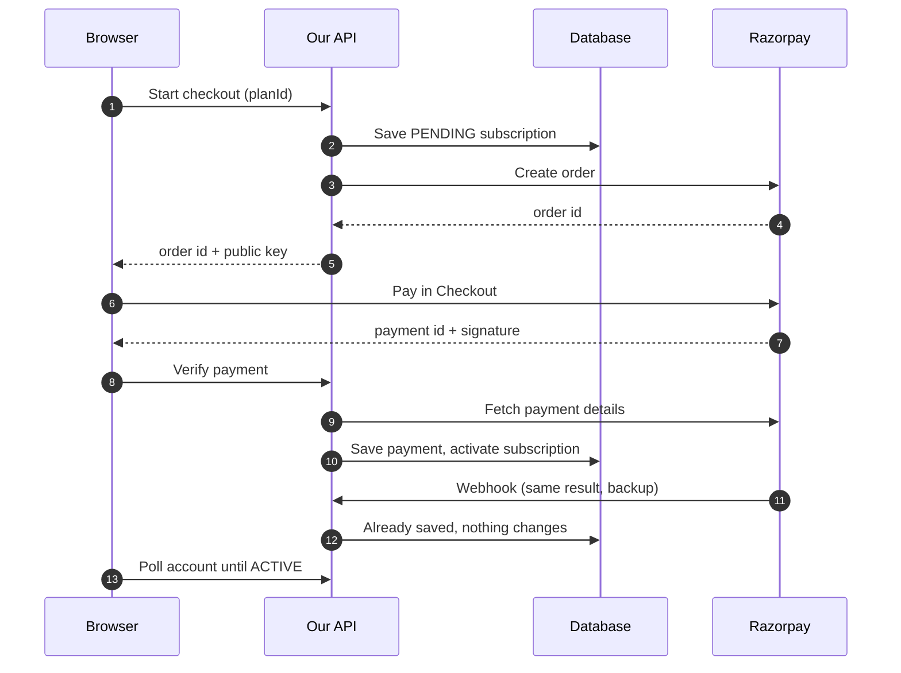

# Person B: Yash — billing & payments

Yash, you own **what the user pays for**: plans, subscriptions, the full Razorpay flow (checkout order, verify, webhook, payment history) and the admin pages that manage plans and subscriptions.

Read [README.md](README.md) first (architecture, setup, conventions, curl testing). This file is the complete spec for your three services: `billing`, `payments` and the admin-only `admin-billing`. The schema is in [`../schema/SCHEMA.md`](../schema/SCHEMA.md) (see "Account & billing" and "Payment flow").

Good to know before you start:

- The Neon database already has the migrations and the seeded data: 3 plans, 2 subscriptions, 8 payments, plus the 2 users and 3 profiles they belong to. Your queries can run against real rows as soon as you write them.
- The mock files now also hold 7 extra demo customers and 8 more subscriptions, so the admin Subscriptions table has something to show. Re-seeding Neon from `data/mock` picks them up.
- Plan 3 "Premiere" deliberately has no subscription. It is the one the admin can delete.
- Accounts, sessions, profiles and onboarding are Tejasva's (A). You use them through the guards.

## Table of contents

1. [Scope](#1-scope)
2. [Dependencies on A and C, and what to stub](#2-dependencies-on-a-and-c-and-what-to-stub)
3. [Ordered checklist](#3-ordered-checklist)
4. [`billing.service.ts`](#4-billingservicets)
5. [`payments.service.ts`](#5-paymentsservicets)
6. [`admin-billing.service.ts`](#6-admin-billingservicets)
7. [Deep dive: the Razorpay flow end to end](#7-deep-dive-the-razorpay-flow-end-to-end)
8. [Definition of done](#8-definition-of-done)

---

## 1. Scope

This section lists what you own: the files, the routes they serve, and the tables you may write. Knowing the boundary up front keeps you from touching Tejasva's or Sahil's code.

### Files you own

- `src/server/services/billing.service.ts`: `listPlans`, `getPlan`, `getActiveSubscription`, `listSubscriptions`, `listPayments`, `createPendingSubscription`.
- `src/server/services/payments.service.ts`: `createRazorpayOrder`, `verifyPaymentSignature`, `fetchPayment`, `verifyWebhookSignature`, `parseWebhookEvent`, `recordFailedPayment`, `recordCapturedPayment`.
- `src/server/services/admin-billing.service.ts`: `listPlansWithStats`, `createPlan`, `updatePlan`, `deletePlan`, `listAllSubscriptions`, `adminCancelSubscription`, `adminExtendSubscription`, `adminChangeSubscriptionPlan` (admin panel only; section 6).
- `.env.example`: add the Razorpay keys (`RAZORPAY_KEY_ID`, `RAZORPAY_KEY_SECRET`, `RAZORPAY_WEBHOOK_SECRET`). `DATABASE_URL` is Tejasva's.

### Routes and the functions they call

- `GET /api/plans` calls `listPlans`
- `GET /api/account` calls `getActiveSubscription`
- `GET, POST /api/account/subscriptions` calls `listSubscriptions`; POST: `getPlan` -> `createPendingSubscription` -> `createRazorpayOrder`
- `GET /api/account/payments` calls `listPayments`
- `POST /api/payments/verify` calls `verifyPaymentSignature` -> `fetchPayment` -> `recordCapturedPayment`
- `POST /api/payments/webhook` calls `verifyWebhookSignature` -> `parseWebhookEvent` -> `recordFailedPayment` / `recordCapturedPayment`
- `GET, POST /api/admin/plans` calls `listPlansWithStats`; POST: `createPlan` (201, 409 `PLAN_NAME_TAKEN`)
- `PATCH, DELETE /api/admin/plans/:planId` calls `updatePlan`; DELETE: `deletePlan` (204, 409 `PLAN_IN_USE`)
- `GET /api/admin/subscriptions` calls `listAllSubscriptions` (`?status=&q=&page=&pageSize=`)
- `PATCH /api/admin/subscriptions/:subscriptionId` uses the body `action`: `cancel` -> `adminCancelSubscription`, `extend` -> `adminExtendSubscription`, `change_plan` -> `adminChangeSubscriptionPlan`

### Tables and guards

- You **write** `subscription`, `payment` and `subscription_plan` (the last one for admin plan management).
- You **read** `users` and `profile`. They are Tejasva's tables, read-only for you.
- Your customer routes sit behind Tejasva's guards (`requireUser`, backed by `users.service`). The `/api/admin/**` routes sit behind `requireAdmin`.
- You do not own sign-up, sign-in, profiles, onboarding or auth hardening. Those are Tejasva's (A).

---

## 2. Dependencies on A and C, and what to stub

This section says what you need from the other two people and what to do until it arrives. Short version: nothing blocks you.

- **`requireUser`** (the user lookup, needed by every account and checkout route).
  - Comes from Tejasva (A): `users.service` and the guards in `src/app/api/_lib/auth.ts`.
  - Until it lands: the mock lookup finds the seeded users 1 and 2, because the seed uses the same ids. Keep working against the mock-backed guards until Tejasva merges the real ones. Nothing to stub on your side.
- **`users` / `profile` rows** for the foreign keys of `subscription`.
  - Tejasva (A) writes new accounts later. The seed provides 2 users and 3 profiles.
  - Until then: the real seeded rows are enough. Test with users 1 and 2.
- **Nothing from Sahil (C).** Your tables do not depend on C's.

Who depends on you: the dashboard's revenue and plan widgets (Tejasva's admin dashboard) read the `subscription` and `payment` rows you write. The seed's 8 payments and 2 subscriptions are enough until yours land. Sahil (C) does not depend on you.

---

## 3. Ordered checklist

Work through these in order. Each step builds on the one before it.

- [ ] **0. Prep**: branch `feat/billing-payments`, own Neon branch in `.env`, `npm run dev`, `db:studio` to look at `subscription_plan`, `subscription`, `payment`. Sign in as the seeded users (mock-backed guards are fine until Tejasva's merge).
- [ ] **1. Billing reads**: `listPlans`, `getPlan`, `getActiveSubscription`, `listSubscriptions`, `listPayments`. Account page shows seeded plan and history.
- [x] **2. Schema CHECK fixed** (migration `0002`): `subscription_dates_check` now allows a CANCELLED row without dates, so cancelling unpaid checkouts works.
- [ ] **3. `createPendingSubscription`** (transaction, renewal rule).
- [ ] **4. Razorpay test-mode setup** (section 7.7): keys, webhook secret, tunnel.
- [ ] **5. `createRazorpayOrder`**: real order; the UI now opens Checkout (`keyId` non-null).
- [ ] **6. `verifyPaymentSignature`, `fetchPayment`**.
- [ ] **7. `recordCapturedPayment`** (the core transaction) and `recordFailedPayment`.
- [ ] **8. `verifyWebhookSignature`, `parseWebhookEvent`**; end-to-end test with test cards and UPI; replay a webhook (idempotency).
- [ ] **9. Admin plans** (section 6): `listPlansWithStats`, `createPlan`, `updatePlan`, `deletePlan`. The admin Plans page lists, adds, edits; delete answers 409 `PLAN_IN_USE` for plans 1 and 2 and 204 for an unused one.
- [ ] **10. Admin subscriptions list**: `listAllSubscriptions` (join, status filter, escaped email search, pagination with a separate count).
- [ ] **11. Admin subscription actions**: `adminCancelSubscription`, `adminExtendSubscription`, `adminChangeSubscriptionPlan` (ACTIVE only, 404 vs 409, no `payment` writes).
- [ ] **12. Cleanup**: remove `getMockDb`/`find*`/`withPlan` imports from your files (all four services); lint; build; update route comments that changed (`POST /api/account/subscriptions` 409 text).

---

## 4. `billing.service.ts`

This service reads plans, subscriptions and payments for the signed-in customer, and opens a new checkout. `payment` rows are _written_ by `payments.service` (verify and webhook), never here.

How the data fits together:

- One subscription = one Razorpay order. Many `payment` rows (attempts) point at it.
- A user has many subscriptions over time, but only one ACTIVE at once. That is enforced by a partial unique index (a unique index that only covers rows matching a condition) called `subscription_one_active_per_user`.
- Money: `price_monthly` and `amount` are `numeric(10,2)` rupees and arrive from the driver as strings, so the mapper turns them into numbers with `Number()` (README 3.6).

### 4.1 `listPlans(): Promise<SubscriptionPlan[]>`

**What it does:** returns every plan, cheapest first. It is public: the landing page, sign-up and the account page all use it.

**Steps:**

1. Select all rows of `subscription_plan`, ordered by monthly price.

**SQL:**

```sql
SELECT * FROM subscription_plan ORDER BY price_monthly;
```

**Rules to respect:**

- PK `plan_id`, UNIQUE `name`.
- Edge cases: none. The table is small and seeded.

**Errors:** None.

**Mock today:** every plan in `data/mock/plans.json` order (not re-sorted).

**Used by:** `GET /api/plans`.

### 4.2 `getPlan(planId: number): Promise<SubscriptionPlan>`

**What it does:** loads one plan by id. The checkout uses it so the amount charged always comes from this row.

**Steps:**

1. Select the plan with the given `plan_id`.
2. If no row comes back, throw a not-found error.

**SQL:**

```sql
SELECT * FROM subscription_plan WHERE plan_id = $1;
```

**Rules to respect:**

- **The amount charged always comes from this row, never from the client.**

**Errors:**

- No row -> `NotFoundError("Plan not found.")` -> 404.

**Mock today:** finds the plan in `plans.json`; throws `NotFoundError` when unknown.

**Used by:** `POST /api/account/subscriptions`.

### 4.3 `getActiveSubscription(userId: number): Promise<SubscriptionWithPlan | null>`

**What it does:** returns the user's current plan, or `null` when they have none (the account page then offers plans).

**Steps:**

1. Join `subscription` to `subscription_plan`.
2. Keep only this user's row with status ACTIVE.
3. Map it to `SubscriptionWithPlan = Subscription & { plan: SubscriptionPlan }`, with `startDate` / `endDate` as ISO strings or `null`.

**SQL:**

```sql
SELECT s.*, p.*
FROM subscription s
JOIN subscription_plan p USING (plan_id)
WHERE s.user_id = $1 AND s.status = 'ACTIVE';
```

**Rules to respect:**

- Tables and keys: `subscription`, `subscription_plan`. The partial UNIQUE index `subscription_one_active_per_user ON subscription (user_id) WHERE status = 'ACTIVE'` means at most one row.
- Transaction: no. Idempotent (safe to repeat with the same result): yes.
- An ACTIVE row whose `end_date` has passed is still returned until an expiry job (or the next capture) flips it to EXPIRED. The page shows `end_date`. This is an open decision: lazy expiry, README 9.8.
- The `s.*, p.*` select returns duplicate column names (`plan_id`). Select explicit columns or use the query builder.

**Errors:** None.

**Mock today:** the first ACTIVE subscription of the user in `subscriptions.json`, with its plan.

**Used by:** `GET /api/account`.

### 4.4 `listSubscriptions(userId: number): Promise<SubscriptionWithPlan[]>`

**What it does:** returns the user's subscription history, newest first. Checkouts that were never paid (PENDING, or CANCELLED before a capture, so `start_date` is still NULL) are **not** billing history and are left out.

**Steps:**

1. Join `subscription` to `subscription_plan` for this user.
2. Drop rows with no `start_date`.
3. Order by `start_date`, newest first.

**SQL:**

```sql
SELECT s.*, p.*
FROM subscription s
JOIN subscription_plan p USING (plan_id)
WHERE s.user_id = $1 AND s.start_date IS NOT NULL
ORDER BY s.start_date DESC;
```

**Rules to respect:**

- Tables and keys: `subscription`, `subscription_plan`.
- CHECK `subscription_dates_check`: every paid subscription has dates; PENDING ones have none; PENDING or CANCELLED-before-payment rows have none (migration `0002`).
- A subscription that was never paid stays PENDING, is cancelled at the next checkout, and is never shown here.

**Errors:** None.

**Mock today:** every subscription of the user in file order (no `start_date` filter, no sort), with its plan.

**Used by:** `GET /api/account/subscriptions`.

### 4.5 `listPayments(userId: number): Promise<PaymentWithPlan[]>`

**What it does:** returns the user's payment history, newest first, with the plan name each payment bought. FAILED and REFUNDED payments are included.

**Steps:**

1. Join `payment` to `subscription` to `subscription_plan`.
2. Keep this user's rows only.
3. Order by `payment_date`, newest first.
4. Map to `Payment { paymentId, subscriptionId, paymentDate (ISO), amount (Number), paymentMode, transactionRef, gatewayOrderId, status }` plus `planName`.

**SQL:**

```sql
SELECT pay.*, p.name AS plan_name
FROM payment pay
JOIN subscription s      ON s.subscription_id = pay.subscription_id
JOIN subscription_plan p ON p.plan_id = s.plan_id
WHERE s.user_id = $1
ORDER BY pay.payment_date DESC;
```

**Rules to respect:**

- Tables and keys: `payment`, `subscription`, `subscription_plan`. Index `payment_subscription_idx (subscription_id, payment_date DESC)`.
- `payment` has no `user_id` or `plan_id` of its own (third normal form, 3NF), which is why the joins are needed.
- A failed attempt on an abandoned (PENDING or CANCELLED) subscription still shows up.

**Errors:** None.

**Mock today:** payments of the user's subscriptions in file order, each with `planName`.

**Used by:** `GET /api/account/payments`.

### 4.6 `createPendingSubscription(userId: number, planId: number): Promise<Subscription>`

**What it does:** opens a checkout. It creates a new PENDING subscription for the plan (the local counterpart of the Razorpay order). The row becomes ACTIVE later, when Razorpay reports the capture, in `recordCapturedPayment` in `payments.service`.

**Steps** (all in **one transaction**, meaning they succeed or fail together):

1. Check for a renewal: if the user's ACTIVE subscription is already on this plan, return that ACTIVE row and stop (see "Renewal" below).
2. Cancel the user's earlier abandoned checkouts. (A capture that still arrives for one of them is honoured by `recordCapturedPayment`: the money was taken.)
3. Insert the new PENDING row. `start_date` and `end_date` stay NULL until payment.

**Renewal instead:** if the user's ACTIVE subscription is already on this plan, no new row is created. The function returns that ACTIVE row; the renewal order's notes carry its `subscription_id`, and a capture extends `end_date`.

Open point from the service: the old route comment said "409 already ACTIVE on that plan (unless renewing)". Since the account page offers renewal, the same plan is treated as a renewal. Update the route comment (README 9.7).

**SQL:**

```sql
BEGIN;
-- renewal check, before the UPDATE/INSERT:
SELECT * FROM subscription WHERE user_id = $1 AND plan_id = $2 AND status = 'ACTIVE';
UPDATE subscription SET status = 'CANCELLED' WHERE user_id = $1 AND status = 'PENDING';
INSERT INTO subscription (user_id, plan_id, status) VALUES ($1, $2, 'PENDING') RETURNING *;
COMMIT;
```

**Rules to respect:**

- Tables and keys: `subscription`.
- CHECK `subscription_dates_check`: a PENDING row with NULL dates is legal, and so is a CANCELLED row that was never paid (migration `0002`).
- FK `user_id` / `plan_id` are `ON DELETE RESTRICT` (the database refuses to delete a referenced parent row). `subscription_one_active_per_user` is untouched, because PENDING rows do not count.
- Transaction: yes (`db.transaction`). Idempotent: no, each call is a new checkout.
- If creating the Razorpay order fails afterwards, the PENDING row is harmless (history filters on `start_date`, and the next checkout cancels it).
- Nothing else is written here. `payment` rows are created by verify and the webhook, failed attempts included.

**Errors:**

- `planId` or `userId` does not exist (FK violation 23503) -> `NotFoundError`.
- `ConflictError` only if the renewal rule is tightened.

**Mock today:** returns a PENDING row with id = (number of mock subscriptions + 1) and NULL dates; persists nothing.

**Used by:** `POST /api/account/subscriptions`.

---

## 5. `payments.service.ts`

This service talks to Razorpay and records payments. It owns writes to `payment` and the status and date changes of `subscription` on capture. The whole flow, with a diagram, is in [section 7](#7-deep-dive-the-razorpay-flow-end-to-end).

Environment variables:

- `RAZORPAY_KEY_ID`: public, sent to the browser.
- `RAZORPAY_KEY_SECRET`: server only. Used for Orders and Payments API basic auth and for Checkout signatures.
- `RAZORPAY_WEBHOOK_SECRET`: used for the webhook signature.
- Use **test mode** keys.

The browser side is `src/lib/razorpay/checkout.ts` plus `src/components/account/change-plan.tsx`.

Two small helpers to add, private to the file:

- `razorpayAuthHeader()` returns `Basic base64(key_id:key_secret)`, or throws `new ServiceError("Payments aren't configured.", 503, "PAYMENTS_NOT_CONFIGURED")`.
- `signaturesEqual(a, b)` uses `crypto.timingSafeEqual` (a comparison that takes the same time however many characters match, so attackers cannot guess byte by byte) on equal-length buffers. Different lengths mean not equal.

### 5.1 `createRazorpayOrder(subscription: Subscription, plan: SubscriptionPlan): Promise<CheckoutOrder>`

**What it does:** creates the Razorpay order that a PENDING subscription is paid through.

**Steps:**

1. Read `RAZORPAY_KEY_ID` and `RAZORPAY_KEY_SECRET`. If either is unset, throw `ServiceError` 503 `"PAYMENTS_NOT_CONFIGURED"`.
2. `POST https://api.razorpay.com/v1/orders` with HTTP basic auth (`key_id:key_secret`) and this JSON body:
   ```json
   {
     "amount": "<price_monthly x 100, paise>",
     "currency": "INR",
     "receipt": "sub_<subscriptionId>",
     "notes": { "subscription_id": "<subscriptionId>" }
   }
   ```
   Razorpay returns `{ id: "order_...", amount, currency, ... }`.
3. Respond `{ subscriptionId, orderId: order.id, amount: order.amount, currency, keyId: RAZORPAY_KEY_ID }`.

Notes on step 2 and 3:

- The amount comes from our `subscription_plan` row, **never from the client**.
- `notes.subscription_id` is how verify and the webhook find the subscription again. A renewal order carries the ACTIVE subscription's id.
- `receipt` has a maximum of 40 characters. For renewals, append a suffix such as `_<Date.now()>` if you want it unique.
- The key id is public by design. The secret never leaves the server.

**SQL:** None. Nothing is written here.

```ts
const paise = Math.round(plan.priceMonthly * 100); // plan.priceMonthly is already a number (mapped)
const response = await fetch("https://api.razorpay.com/v1/orders", {
  method: "POST",
  headers: { Authorization: razorpayAuthHeader(), "Content-Type": "application/json" },
  body: JSON.stringify({
    amount: paise,
    currency: "INR",
    receipt: `sub_${subscription.subscriptionId}`,
    notes: { subscription_id: subscription.subscriptionId },
  }),
});
if (!response.ok) throw new ServiceError("Couldn't start the payment. Try again.", 502, "RAZORPAY_ERROR");
const order = (await response.json()) as { id: string; amount: number; currency: string };
```

No SDK is needed (the three Razorpay calls are small). The `razorpay` npm package is optional.

**Rules to respect:**

- Transaction: no. Idempotent: no, each call creates a new Razorpay order.
- If the order call fails, the PENDING subscription is harmless.

**Errors:**

- Keys not set -> `ServiceError` 503.
- Razorpay fails (non-2xx, network error, or a malformed body) -> `ServiceError` 502.

**Mock today:** no Razorpay call. It returns `orderId` `order_MOCK<Date.now()>`, `amount` = `round(priceMonthly x 100)`, `currency` `"INR"`, and `keyId` `null`, which makes the client skip Checkout and go straight to the "payment received" state. **Keep `keyId` null until the real call exists.**

**Used by:** `POST /api/account/subscriptions`.

### 5.2 `verifyPaymentSignature(input: VerifyPaymentInput): Promise<void>`

**What it does:** verifies the response from Checkout's success handler. A match proves Razorpay issued this payment for this order. It does not carry the amount or the method (see `fetchPayment`).

**Steps:**

1. Compute `expected = HMAC-SHA256(key = RAZORPAY_KEY_SECRET, message = `${razorpay_order_id}|${razorpay_payment_id}`)` as hex. (HMAC is a keyed hash: only someone who knows the secret can produce the right value.)
2. Compare with `razorpay_signature` using `crypto.timingSafeEqual`. Check equal-length buffers first; different lengths are a mismatch.
3. On a mismatch throw the error below. On a match, return.

**SQL:** None.

```ts
import { createHmac, timingSafeEqual } from "node:crypto";
const expected = createHmac("sha256", process.env.RAZORPAY_KEY_SECRET!).update(`${orderId}|${paymentId}`).digest("hex");
```

**Rules to respect:**

- Pure (no database or network) and idempotent.
- A missing field is rejected earlier by the route's zod schema.
- The mismatch is 400, not 422: it is a forged or corrupted callback, not a form error.

**Errors:**

- Mismatch -> `ServiceError(400, "INVALID_SIGNATURE")`.
- `RAZORPAY_KEY_SECRET` not set -> `ServiceError` 503.

**Mock today:** accepts everything.

**Used by:** `POST /api/payments/verify`.

### 5.3 `fetchPayment(paymentId: string, expectedOrderId?: string): Promise<RazorpayPayment>`

**What it does:** fetches a payment from Razorpay for the details the Checkout callback does not carry: amount, currency, method, status and `notes.subscription_id`.

**Steps:**

1. `GET https://api.razorpay.com/v1/payments/:paymentId` with basic auth.
2. Map the entity:
   - `id` -> `paymentId`
   - `order_id` -> `orderId`
   - `amount` (paise), `currency`, `status`
   - `method` -> `paymentMode`: `card` -> CARD, `upi` -> UPI, `netbanking` -> NET_BANKING, `wallet` -> WALLET. Other methods -> `ServiceError` 422, or add them to the `payment_mode` enum.
   - `notes.subscription_id` -> `subscriptionId` (`Number(...)`)
3. If `expectedOrderId` is given, `order_id` must equal it, otherwise throw `ServiceError` 400.

The caller acts only on `status === 'captured'`. For `'authorized'` (not captured yet) the route answers 200 and leaves it to the webhook's `payment.captured`.

**SQL:** None.

**Rules to respect:**

- Idempotent (it is a read).

**Errors:**

- Razorpay fails -> `ServiceError` 502.
- Order mismatch -> 400.
- Keys not set -> 503.

**Mock today:** no Razorpay call. It returns a plausible captured card payment of 49900 paise INR for subscription 1 (`orderId` = `expectedOrderId` when given).

**Used by:** `POST /api/payments/verify`.

### 5.4 `verifyWebhookSignature(rawBody: string, signature: string | null): Promise<void>`

**What it does:** authenticates a webhook call. The signature is the **only** authentication: the route has no session, and `src/proxy.ts` skips `/api`.

**Steps:**

1. `rawBody` must be the RAW request text (`await request.text()`), read **before** any `JSON.parse`. Re-serialised JSON would not match.
2. Compute `expected = HMAC-SHA256(key = RAZORPAY_WEBHOOK_SECRET, message = rawBody)` as hex.
3. Compare with the `X-Razorpay-Signature` header using `timingSafeEqual` (equal-length buffers first).
4. A missing header or a mismatch throws `ServiceError(400, "INVALID_SIGNATURE")`. Razorpay will not retry those usefully.

**SQL:** None.

**Rules to respect:**

- Read the raw text first; never verify against re-serialised JSON.

**Errors:**

- Bad or missing signature -> `ServiceError(400, "INVALID_SIGNATURE")`.
- `RAZORPAY_WEBHOOK_SECRET` not set -> `ServiceError` 503.

**Mock today:** accepts everything.

**Used by:** `POST /api/payments/webhook`.

### 5.5 `parseWebhookEvent(rawBody: string): Promise<WebhookEvent>`

**What it does:** parses a webhook body into a typed event.

`WebhookEvent = { type: "payment.captured" | "payment.failed"; payment: RazorpayPayment } | { type: "ignored"; event: string }`

**Steps:**

1. `JSON.parse(rawBody)`. Malformed -> `ServiceError(400, "MALFORMED_WEBHOOK")`.
2. Read the event name. `payment.captured` and `payment.failed` are handled (subscribe to both in the Razorpay dashboard). Anything else -> `{ type: "ignored", event }` (the route answers 200).
3. Map `payload.payment.entity = { id: "pay_...", order_id: "order_...", amount (paise), currency, method: "card" | "upi" | "netbanking" | "wallet", notes: { subscription_id } }` to `RazorpayPayment`.
   - `method` -> `payment_mode`: card -> CARD, upi -> UPI, netbanking -> NET_BANKING, wallet -> WALLET.
   - Other methods (`emi`, `paylater`, ...) -> log and return `{ type: "ignored" }`, or add them to the enum.
4. `notes.subscription_id` -> `subscriptionId`. If it is missing, the payment did not come from our checkout -> `{ type: "ignored" }` (200).

**SQL:** None.

**Rules to respect:**

- Pure (no database or network).
- `X-Razorpay-Event-Id` is unique per event, but we dedupe on `payment.transaction_ref` instead, so the event id is only useful for logs.

**Errors:**

- Malformed body -> `ServiceError(400, "MALFORMED_WEBHOOK")`.

**Mock today:** ignores the body and returns `{ type: "ignored", event: "mock" }` (the route answers 200 `{}`).

**Used by:** `POST /api/payments/webhook`.

### 5.6 `recordFailedPayment(payment: RazorpayPayment): Promise<void>`

**What it does:** records a failed attempt (webhook event `payment.failed`). The subscription stays PENDING so the user can retry on the same order.

**Steps:**

1. Insert a FAILED `payment` row built from the Razorpay payment.
2. If a row with the same `transaction_ref` already exists, do nothing (an "upsert-style" insert: `ON CONFLICT ... DO NOTHING` skips the insert when the unique key is already taken).

**SQL:**

```sql
INSERT INTO payment (subscription_id, amount, payment_mode, transaction_ref, gateway_order_id, status)
VALUES ($subscriptionId, $amount::numeric / 100, $mode, $payId, $orderId, 'FAILED')
ON CONFLICT (transaction_ref) DO NOTHING;
```

**Rules to respect:**

- Tables and keys: `payment`. UNIQUE `(transaction_ref)` is the idempotency key. FK `subscription_id`. CHECK `amount > 0`. `payment_mode` and `payment_status` are enums.
- Transaction: no (single statement). Idempotent: yes, thanks to `ON CONFLICT (transaction_ref) DO NOTHING`.
- Events can arrive more than once or out of order. A failed attempt may be followed by a successful retry on the same order: different `pay_` id, same `gateway_order_id`.
- This function never touches `subscription`.
- **Cast `$amount::numeric / 100`**, otherwise you get integer division. Or pass `(amount / 100).toFixed(2)`.
- An unknown `subscription_id` (FK 23503) should be logged and swallowed (200 to Razorpay) rather than retried forever.

**Errors:**

- Nothing for a duplicate.
- Any other failure propagates: the route answers 500, and Razorpay retries, which is safe.

**Mock today:** writes nothing.

**Used by:** `POST /api/payments/webhook` (`payment.failed`).

### 5.7 `recordCapturedPayment(payment: RazorpayPayment, options: { expectedUserId?: number } = {}): Promise<void>`

**What it does:** records a captured payment and activates or extends the subscription. The **same** function serves `POST /api/payments/verify` (Checkout's success handler) and the webhook's `payment.captured`: one shared module, not a copy. Whichever arrives first writes the payment and activates the subscription. The other finds the payment row (via `ON CONFLICT`) and stops.

**Steps** (all in **one transaction**):

1. Lock the subscription row so events for it are handled one at a time (`FOR UPDATE` locks the selected row until the transaction ends). If there is no row, the payment did not come from our checkout: log it, nothing to record.
2. Ownership check (verify only): when `options.expectedUserId` is given, `subscription.user_id` must equal it (the session user). Otherwise do not write (the webhook will still record it) and log it.
3. Insert the payment with `ON CONFLICT (transaction_ref) DO NOTHING RETURNING payment_id`. If no row is returned, this capture was already processed: COMMIT and stop. Verify and the webhook race safely, and Razorpay redelivery is a no-op.
4. Check the amount and currency (see the rule below). On a mismatch keep the payment row, do not activate, and log it for a manual refund.
5. If the subscription is PENDING (or CANCELLED as an abandoned checkout: the money was taken, so honour it), cancel the user's other ACTIVE row, then activate this one. If it is already ACTIVE (a renewal order on the same subscription), extend `end_date` instead.
6. COMMIT.

**SQL:**

Step 1, lock and read:

```sql
SELECT s.*, p.price_monthly FROM subscription s JOIN subscription_plan p USING (plan_id)
WHERE s.subscription_id = $1 FOR UPDATE;
```

Step 3, insert the payment:

```sql
INSERT INTO payment (subscription_id, amount, payment_mode, transaction_ref, gateway_order_id, status)
VALUES ($1, $amount::numeric / 100, $mode, $payId, $orderId, 'SUCCESS')
ON CONFLICT (transaction_ref) DO NOTHING RETURNING payment_id;
```

Step 5, PENDING (or abandoned CANCELLED) subscription:

```sql
UPDATE subscription SET status = 'CANCELLED', end_date = now()
  WHERE user_id = $user AND status = 'ACTIVE' AND subscription_id <> $1;
  -- plan change: must run first, the partial UNIQUE (user_id) WHERE status = 'ACTIVE' index allows only one ACTIVE row per user
UPDATE subscription SET status = 'ACTIVE', start_date = now(), end_date = now() + interval '1 month'
  WHERE subscription_id = $1;
```

Step 5, already ACTIVE (renewal):

```sql
UPDATE subscription SET end_date = GREATEST(end_date, now()) + interval '1 month'
  WHERE subscription_id = $1;
```

Reading the locked row in Drizzle:

```ts
(
  await tx.execute(
    sql`SELECT s.subscription_id, s.user_id, s.status, p.price_monthly FROM subscription s JOIN subscription_plan p USING (plan_id) WHERE s.subscription_id = ${id} FOR UPDATE`,
  )
).rows[0];
```

**Rules to respect:**

- Tables and keys: `subscription` (FOR UPDATE, UPDATE), `subscription_plan` (price), `payment` (INSERT). UNIQUE `(transaction_ref)`. Partial UNIQUE `subscription_one_active_per_user`. CHECK `subscription_dates_check`. FK `subscription_id`.
- Transaction: yes (`db.transaction`). Idempotent: yes (`ON CONFLICT (transaction_ref) DO NOTHING`).
- The UNIQUE constraint is the last line of defence. If two deliveries of the same capture race, the second INSERT fails and its whole transaction rolls back. The row lock normally makes it wait and then find the conflict.
- Amount check (step 4): compare in paise, `payment.amount === Math.round(Number(price_monthly) * 100)`, and `currency = 'INR'`.
- Out-of-order events: a capture for a CANCELLED abandoned checkout is honoured.
- A failed verify-side ownership check leaves everything to the webhook.
- Amount mismatch: payment kept, plan not activated.
- ACTIVE with `end_date` in the past is extended from now (`GREATEST`).
- Only set the dates if the status was PENDING or CANCELLED-unpaid. Never reactivate a paid CANCELLED or EXPIRED row (it has a `start_date`).
- The plan-change UPDATE (cancel the old ACTIVE row) must run first, because the partial unique index allows only one ACTIVE row per user.

**Errors:**

- Any database failure propagates. The route answers 500, and the webhook is retried by Razorpay, which is safe.

**Mock today:** writes nothing.

**Used by:** `POST /api/payments/verify` (with `options.expectedUserId`), `POST /api/payments/webhook` (`payment.captured`).

---

## 6. `admin-billing.service.ts`

This service holds the admin-side writes to `subscription_plan` and `subscription`, plus the admin read of every customer's subscriptions. Everything here is behind `requireAdmin`.

How it connects to the rest of the code:

- Frontend: `/admin/plans` and `/admin/subscriptions` (`src/components/admin/plans/*`, `src/components/admin/subscriptions/*`).
- Each write dialog shows the SQL it will run. That SQL is generated by `src/lib/sql/admin-plans.ts` and `src/lib/sql/admin-subscriptions.ts`, so **keep those builders and the statements below in step**.
- Inputs are already validated by the zod schemas in `src/lib/validation/admin.ts` (`planSchema`, `updatePlanSchema`, `adminSubscriptionQuerySchema`, `subscriptionActionSchema`). The database constraints are the backstop.

Two business rules to keep in mind:

- **Admin actions never write `payment`.** `payment.amount` is "what was charged, not a copy of the plan price" (SCHEMA.md). Editing a price, extending a period or moving a plan changes what the customer has going forward, never the record of what they paid. Refunds are a Razorpay action plus a `payment.status` change in `payments.service`.
- **Every subscription action is one `UPDATE ... WHERE status = 'ACTIVE'`.** The `WHERE` both checks and writes in one atomic statement (all-or-nothing, no gap for another request to slip in). If it matches no row, a follow-up `SELECT` tells "no such subscription" (404) from "not ACTIVE" (409). Wrap the `UPDATE` in a CTE (a named sub-query: `WITH updated AS (UPDATE ... RETURNING *) SELECT ... FROM updated JOIN users JOIN subscription_plan`) so the same round trip returns the `AdminSubscriptionRow`.

Other conventions:

- Shape of a row (`AdminSubscriptionRow`): `subscriptionId, userId, userName, userEmail, planId, planName, planPriceMonthly, startDate, endDate (ISO or null while PENDING), status, createdAt`.
- Money arrives as `numeric` strings, so use `Number()` in the mapper (README 3.6).
- Counts: plain `COUNT(*)`; the pg parser in src/server/db/index.ts already returns it as a number.

Constraints these functions rely on (a copy of the real definitions from `drizzle/0002_fix_subscription_check.sql`):

```sql
-- subscription_dates_check
CHECK ((status IN ('PENDING', 'CANCELLED') AND start_date IS NULL AND end_date IS NULL)
       OR (start_date IS NOT NULL AND end_date > start_date))
-- at most one ACTIVE subscription per user
CREATE UNIQUE INDEX subscription_one_active_per_user ON subscription (user_id) WHERE status = 'ACTIVE';
-- subscription.plan_id REFERENCES subscription_plan ON DELETE RESTRICT   (and user_id -> users, RESTRICT)
```

### 6.1 `listPlansWithStats(): Promise<AdminPlan[]>`

**What it does:** returns every plan with its subscriber counts, cheapest first.

**Steps:**

1. Left join `subscription_plan` to `subscription` (so plans nobody chose still appear).
2. Group by plan and count active subscribers and total subscriptions.
3. Order by price, then plan id.

**SQL:**

```sql
SELECT p.plan_id, p.name, p.price_monthly, p.video_quality, p.max_devices,
       COUNT(s.subscription_id) FILTER (WHERE s.status = 'ACTIVE') AS active_subscribers,
       COUNT(s.subscription_id)                                    AS total_subscriptions
FROM subscription_plan AS p
LEFT JOIN subscription AS s ON s.plan_id = p.plan_id
GROUP BY p.plan_id
ORDER BY p.price_monthly, p.plan_id;
```

**Rules to respect:**

- Tables and keys: `subscription_plan`, `subscription`. PK `plan_id`, so `GROUP BY p.plan_id` needs no aggregate for the other plan columns. An index on `subscription (plan_id, status)` keeps the join cheap.
- Transaction: no. Idempotent: yes (read).
- A plan nobody chose still appears with 0 and 0 (`LEFT JOIN` plus `COUNT(column)`, not `COUNT(*)`).

**Errors:** None.

**Mock today:** `db.plans` with counts computed from `db.subscriptions`, sorted by price.

**Used by:** `GET /api/admin/plans` (and the Plans page, server-side, through `serverApi.getAdminPlans`).

### 6.2 `createPlan(input: CreatePlanInput): Promise<AdminPlan>`

**What it does:** adds a new plan.

**Steps:**

1. Insert the plan and return the new row.
2. Return it as an `AdminPlan` with `activeSubscribers: 0, totalSubscriptions: 0`.

**SQL:**

```sql
INSERT INTO subscription_plan (name, price_monthly, video_quality, max_devices)
VALUES ($1, $2, $3, $4)
RETURNING plan_id, name, price_monthly, video_quality, max_devices;
```

**Rules to respect:**

- Tables and keys: `subscription_plan`. UNIQUE `name`, CHECK `price_monthly >= 0`, CHECK `max_devices > 0`. `name` is VARCHAR(50), `video_quality` is VARCHAR(10).
- The constraint decides, not a `SELECT` first: two admins adding "Family" at once cannot both win.
- Transaction: no (one statement). Idempotent: no, a repeat answers 409.
- The UNIQUE is **case-sensitive**: "feature" and "Feature" can coexist in the database, which reads as a duplicate to an admin. Either also reject a case-insensitive match first (`SELECT 1 FROM subscription_plan WHERE lower(name) = lower($1)`), or add `UNIQUE INDEX ON subscription_plan (lower(name))` in a migration. Keep the 23505 catch either way.
- Trim the name (the schema already does).

**Errors:**

- Unique violation (23505) on the name -> `ConflictError("A plan with this name already exists.", "PLAN_NAME_TAKEN")` -> 409.

**Mock today:** `ConflictError` when a mock plan has the same name, case-insensitive. Otherwise a plan with `planId` = highest id + 1 and 0 subscribers; persists nothing.

**Used by:** `POST /api/admin/plans` (201 `{ plan }`).

### 6.3 `updatePlan(planId: number, input: UpdatePlanInput): Promise<AdminPlan>`

**What it does:** changes some fields of a plan. Send only the changed fields.

**Steps:**

1. Build the `SET` list from the keys present in `input`, mapped through a fixed whitelist: `name`, `priceMonthly -> price_monthly`, `videoQuality -> video_quality`, `maxDevices -> max_devices`. Never interpolate request keys.
2. Run the UPDATE.
3. Re-count the plan's subscribers (the query of 6.1 for one `plan_id`, or a CTE) for the response.

**SQL:**

```sql
UPDATE subscription_plan
SET name = $1, price_monthly = $2          -- only the changed columns
WHERE plan_id = $3
RETURNING plan_id, name, price_monthly, video_quality, max_devices;
```

**Rules to respect:**

- Tables and keys: `subscription_plan` (write), `subscription` (read, for the counts). UNIQUE `name` (23505), CHECK `price_monthly >= 0`, CHECK `max_devices > 0`, PK `plan_id`.
- Transaction: no (one statement; the count is a read). Idempotent: yes (same input, same row).
- **A price change affects future charges only.** Past `payment.amount` values are never touched: that column is the historical record of what was charged.
- Existing subscribers keep their plan (`subscription.plan_id` does not change). The new price applies from their next renewal or checkout, when `createPendingSubscription` and the amount check in `recordCapturedPayment` read `subscription_plan.price_monthly` again.
- Video quality and max devices are read live from the plan, so a change to them applies to everyone on it immediately.
- Renaming a plan to its own current name is not a conflict (UNIQUE ignores the row itself).
- A no-op change returns the row unchanged.
- Lowering `max_devices` below what someone streams on is enforced at playback, not here.

**Errors:**

- Unknown plan -> `NotFoundError("Plan not found.")` -> 404.
- 23505 on the name -> `ConflictError("A plan with this name already exists.", "PLAN_NAME_TAKEN")` -> 409.

**Mock today:** `NotFoundError` for an unknown plan, `ConflictError` when another mock plan has the new name. Otherwise the merged plan with real counts; persists nothing.

**Used by:** `PATCH /api/admin/plans/:planId` (200 `{ plan }`).

### 6.4 `deletePlan(planId: number): Promise<void>`

**What it does:** deletes a plan, but only if no subscription has ever pointed at it.

**Steps:**

1. Run the `DELETE`. Let PostgreSQL refuse it if a subscription references the plan (foreign-key error 23503).
2. If it refused, count the subscriptions only to build the error message.
3. If no row was deleted and there was no FK error, the plan does not exist.

**SQL:**

```sql
DELETE FROM subscription_plan WHERE plan_id = $1;
-- only after a 23503, to build the message:
SELECT COUNT(*) AS subscriptions FROM subscription WHERE plan_id = $1;
```

**Rules to respect:**

- Tables and keys: `subscription_plan` (write), `subscription` (read for the message). FK `subscription.plan_id -> subscription_plan ON DELETE RESTRICT` (23503). PK `plan_id`.
- `ON DELETE RESTRICT` means PostgreSQL itself refuses to delete a plan that any subscription points at, in **any** status (an ACTIVE one, or one that expired two years ago). Billing history must keep its plan name, which is why the FK is RESTRICT and not CASCADE (delete the children too) or SET NULL.
- The implementation catches the foreign-key violation (pg `23503`) and answers 409. It does **not** pre-count and decide from the count, because a subscription created between "count = 0" and the `DELETE` would then surface as a 500. The count query only fills in the message and may be slightly stale.
- Transaction: no (the `DELETE` is atomic). Idempotent: yes in effect (a second call answers 404).
- A plan with only EXPIRED, CANCELLED or PENDING subscriptions is still blocked. Retire a plan by renaming it (or a future `archived` flag), not by deleting it.
- Deleting never touches `payment`.

**Errors:**

- No row deleted and no FK error -> `NotFoundError("Plan not found.")` -> 404.
- FK violation -> `ConflictError("This plan has N subscriptions, so it can't be deleted. ...", "PLAN_IN_USE")` -> 409.

**Mock today:** `NotFoundError` for an unknown plan. `ConflictError` `PLAN_IN_USE` with the real mock subscription count when any mock subscription references it (plans 1 and 2). Otherwise resolves (plan 3, Premiere); persists nothing.

**Used by:** `DELETE /api/admin/plans/:planId` (204, no body).

### 6.5 `listAllSubscriptions(filters: AdminSubscriptionFilters): Promise<AdminPage<AdminSubscriptionRow>>`

**What it does:** returns every customer's subscriptions with the user and the plan, newest first. Filterable and paginated.

**Steps:**

1. Join `subscription`, `users` and `subscription_plan`.
2. Apply the optional status filter and the optional email search.
3. Order by `created_at` then id (the id breaks ties so pages are stable), and apply `LIMIT` / `OFFSET`.
4. Run a second query with the same `FROM` / `JOIN` / `WHERE` to count the total.
5. Build the page: `pageSize` defaults to 20 (max 100), `pageCount = max(1, ceil(total / pageSize))`, `page` is 1-based.

**SQL:**

```sql
SELECT s.subscription_id, s.user_id, u.name AS user_name, u.email AS user_email,
       s.plan_id, p.name AS plan_name, p.price_monthly AS plan_price_monthly,
       s.start_date, s.end_date, s.status, s.created_at
FROM subscription AS s
JOIN users AS u ON u.user_id = s.user_id
JOIN subscription_plan AS p ON p.plan_id = s.plan_id
WHERE ($1::subscription_status IS NULL OR s.status = $1)
  AND ($2::text IS NULL OR u.email ILIKE '%' || $2 || '%' ESCAPE '\')
ORDER BY s.created_at DESC, s.subscription_id DESC
LIMIT $3 OFFSET $4;

-- same FROM / JOIN / WHERE, for the page count:
SELECT COUNT(*) AS total FROM subscription AS s JOIN users AS u ... JOIN subscription_plan AS p ... WHERE ...;
```

**Rules to respect:**

- Tables and keys: `subscription`, `users`, `subscription_plan`. Both FKs make the inner joins safe.
- Escape the search text before binding it (`\`, `%`, `_` each get a leading `\`), so "50%" or "a_b" match literally instead of acting as wildcards.
- `users` has the UNIQUE INDEX `users_email_key (lower(email))`. It serves equality but **not** a leading-wildcard `ILIKE`, so the search scans. That is fine at this size. A `pg_trgm` GIN index on `lower(email)` is the fix if it ever hurts.
- Transaction: optional (one read-only snapshot for rows and count). Idempotent: yes (read).
- A page beyond `pageCount` returns `items: []` with the real `total`.
- PENDING rows have NULL dates (the table shows a dash).
- An empty `q` means no email filter.

**Errors:** None. The query string is validated by `adminSubscriptionQuerySchema` in the route.

**Mock today:** filters by status and case-insensitive email substring, sorts by `createdAt` desc then id desc, and slices the mock subscriptions in memory.

**Used by:** `GET /api/admin/subscriptions`.

### 6.6 `adminCancelSubscription(subscriptionId: number): Promise<AdminSubscriptionRow>`

**What it does:** cancels an ACTIVE subscription on the customer's behalf, effective now. Access ends immediately.

**Steps:**

1. Run the CTE `UPDATE` that flips an ACTIVE row to CANCELLED and caps `end_date` at now, then joins the user and plan to return the row.
2. If no row comes back, run the follow-up `SELECT status` to decide between 404 and 409.

**SQL:**

```sql
WITH updated AS (
  UPDATE subscription
  SET status = 'CANCELLED', end_date = LEAST(end_date, now())
  WHERE subscription_id = $1 AND status = 'ACTIVE'
  RETURNING *
)
SELECT s.subscription_id, s.user_id, u.name AS user_name, u.email AS user_email, s.plan_id,
       p.name AS plan_name, p.price_monthly AS plan_price_monthly, s.start_date, s.end_date, s.status, s.created_at
FROM updated AS s
JOIN users AS u ON u.user_id = s.user_id
JOIN subscription_plan AS p ON p.plan_id = s.plan_id;
-- no row back:
SELECT status FROM subscription WHERE subscription_id = $1;      -- no row: 404; not ACTIVE: 409
```

**Rules to respect:**

- Tables and keys: `subscription` (write), `users`, `subscription_plan` (read).
- Why `end_date` is set (not nulled) and why that is legal: a CANCELLED row only passes the first branch of the dates CHECK if it has **no** dates (the never-paid case). A paid subscription has `start_date IS NOT NULL`, so it must satisfy the second branch: `start_date IS NOT NULL AND end_date > start_date`. Setting `end_date` to `now()` keeps that true as long as `start_date < now()`, which holds for any period that has started. Do not null the dates.
- `subscription_one_active_per_user`: cancelling only moves a row **out** of the index, so it can never create a second ACTIVE row.
- Transaction: no (one atomic statement; the follow-up `SELECT` only explains a miss). Idempotent: no, the second call is a 409.
- `LEAST(end_date, now())`, not a bare `now()`: an ACTIVE row whose period already lapsed (the expiry job has not flipped it yet) keeps its earlier `end_date` instead of being "extended" to now.
- **No refund** is issued and `payment` rows are untouched (a refund is a Razorpay action plus a `payment.status` change).

**Errors:**

- Unknown id -> `NotFoundError("Subscription not found.")` -> 404.
- Not ACTIVE -> `ConflictError("Only ACTIVE subscriptions can be cancelled.", "SUBSCRIPTION_NOT_ACTIVE")` -> 409.

**Mock today:** `NotFoundError` for an unknown id, `ConflictError` when the mock row is not ACTIVE. Otherwise the row as it would be afterwards (CANCELLED, `endDate` = earlier of the old end and now); persists nothing.

**Used by:** `PATCH /api/admin/subscriptions/:subscriptionId` with `{ "action": "cancel" }` (200 `{ subscription }`).

### 6.7 `adminExtendSubscription(subscriptionId: number, months: number): Promise<AdminSubscriptionRow>`

**What it does:** gives an ACTIVE subscription extra months at no charge (goodwill, a support fix). `months` is a whole number from 1 to 24 (`extendMonthsSchema`).

**Steps:**

1. Run the CTE `UPDATE` that adds `months` to `end_date` on an ACTIVE row and returns the joined row.
2. If no row comes back, run the follow-up `SELECT status` to decide between 404 and 409.

**SQL:**

```sql
WITH updated AS (
  UPDATE subscription
  SET end_date = end_date + make_interval(months => $2)
  WHERE subscription_id = $1 AND status = 'ACTIVE'
  RETURNING *
)
SELECT ... FROM updated AS s JOIN users ... JOIN subscription_plan ...;   -- same select list as 6.5
-- no row back:
SELECT status FROM subscription WHERE subscription_id = $1;
```

**Rules to respect:**

- Tables and keys: `subscription` (write). The dates CHECK holds (`start_date` is untouched and `end_date` only grows). `subscription_one_active_per_user` is unaffected (`user_id` and `status` do not change).
- Transaction: no (one atomic statement). Idempotent: **no**. Every call adds the months again, so the UI sends one request per click and never retries.
- `make_interval` is calendar-aware (Jan 31 + 1 month = Feb 28/29).
- Extending a **lapsed-but-still-ACTIVE** row (`end_date` in the past, expiry job not run) adds on top of the **old** `end_date`, so the customer may still be expired afterwards. The dialog shows the new end date first.
- No `payment` row: an extension is a gift, not revenue.

**Errors:**

- Unknown id -> `NotFoundError("Subscription not found.")` -> 404.
- Not ACTIVE -> `ConflictError("Only ACTIVE subscriptions can be extended.", "SUBSCRIPTION_NOT_ACTIVE")` -> 409.

**Mock today:** `NotFoundError` / `ConflictError` against the mock row. Otherwise the row with `endDate` moved forward by `months` calendar months; persists nothing (so a second extend in the same session starts from the original date again).

**Used by:** `PATCH /api/admin/subscriptions/:subscriptionId` with `{ "action": "extend", "months": n }`.

### 6.8 `adminChangeSubscriptionPlan(subscriptionId: number, planId: number): Promise<AdminSubscriptionRow>`

**What it does:** moves an ACTIVE subscription to another plan. This is an **admin override**, not the customer upgrade flow (that is a new checkout: PENDING subscription, Razorpay order, `payment`).

What it does and does not do:

- **No `payment` row is recorded**, and nobody is charged or refunded.
- `start_date` and `end_date` stay as they are (no proration).
- The new plan's price applies from the next renewal.
- The new plan's video quality and device limit apply immediately, because they are read from the plan.

**Steps:**

1. Run the CTE `UPDATE` that sets `plan_id` on an ACTIVE row whose plan is different, and returns the joined row.
2. If no row comes back, run the follow-up `SELECT status, plan_id` to decide which error to raise.

**SQL:**

```sql
WITH updated AS (
  UPDATE subscription
  SET plan_id = $2
  WHERE subscription_id = $1 AND status = 'ACTIVE' AND plan_id <> $2
  RETURNING *
)
SELECT ... FROM updated AS s JOIN users ... JOIN subscription_plan ...;   -- same select list as 6.5
-- no row back:
SELECT status, plan_id FROM subscription WHERE subscription_id = $1;
```

**Rules to respect:**

- Tables and keys: `subscription` (write). FK `plan_id -> subscription_plan`. The dates CHECK is unaffected (dates untouched).
- `subscription_one_active_per_user` is unaffected because `user_id` and `status` do not change. The other two actions respect it for the same reason: cancel only moves a row out of ACTIVE and extend only moves `end_date`, so **no admin action can ever create a second ACTIVE row for a user**.
- Transaction: no (one atomic statement). Idempotent: yes (a repeat is a 409 `PLAN_UNCHANGED`, and the state is the same).
- Downgrading mid-period gives a cheaper plan for the rest of the paid period (the admin chose that).
- Payment history still shows what was paid, under the plan name of the subscription row as it is now (payments join through `subscription`).
- Only the plan FK can fire here, because `user_id` is not written.

**Errors:**

- Missing subscription -> `NotFoundError("Subscription not found.")` -> 404.
- Not ACTIVE -> `ConflictError(..., "SUBSCRIPTION_NOT_ACTIVE")` -> 409.
- Same `plan_id` -> `ConflictError("The subscription is already on this plan.", "PLAN_UNCHANGED")` -> 409.
- Unknown `$2` fails the `plan_id` foreign key (pg `23503`) -> `NotFoundError("Plan not found.")` -> 404.

**Mock today:** the same four checks against the mock rows. Otherwise the row with the new plan's id, name and price; persists nothing.

**Used by:** `PATCH /api/admin/subscriptions/:subscriptionId` with `{ "action": "change_plan", "planId": n }`.

### 6.9 Testing with curl (admin session cookie)

These commands exercise every admin route with an admin session cookie in `cookies.txt`.

```bash
# plans: list, add (201), duplicate name (409), edit, delete an unused plan (204), delete a used one (409)
curl -b cookies.txt localhost:3000/api/admin/plans
curl -b cookies.txt -X POST localhost:3000/api/admin/plans -H 'content-type: application/json' \
  -d '{"name":"Family","priceMonthly":299,"videoQuality":"1080p","maxDevices":3}'
curl -b cookies.txt -X PATCH localhost:3000/api/admin/plans/2 -H 'content-type: application/json' -d '{"priceMonthly":449}'
curl -b cookies.txt -X DELETE -i localhost:3000/api/admin/plans/3     # 204 once Premiere has no subscriptions
curl -b cookies.txt -X DELETE -i localhost:3000/api/admin/plans/2     # 409 PLAN_IN_USE
# subscriptions: list with filters, then each action
curl -b cookies.txt 'localhost:3000/api/admin/subscriptions?status=ACTIVE&q=example&page=1'
curl -b cookies.txt -X PATCH localhost:3000/api/admin/subscriptions/4 -H 'content-type: application/json' -d '{"action":"extend","months":2}'
curl -b cookies.txt -X PATCH localhost:3000/api/admin/subscriptions/4 -H 'content-type: application/json' -d '{"action":"change_plan","planId":3}'
curl -b cookies.txt -X PATCH localhost:3000/api/admin/subscriptions/4 -H 'content-type: application/json' -d '{"action":"cancel"}'
curl -b cookies.txt -X PATCH localhost:3000/api/admin/subscriptions/4 -H 'content-type: application/json' -d '{"action":"cancel"}'   # 409
```

Two sanity checks:

- After any price edit, check that `SELECT amount FROM payment` is unchanged.
- After any subscription action, check that `SELECT COUNT(*) FROM payment` is the same as before.

---

## 7. Deep dive: the Razorpay flow end to end

This section explains how a payment travels from the "Pay" button to an ACTIVE subscription, and how to test it. Read it before writing `payments.service.ts`.

### 7.1 Model

One Razorpay **order** has many **payment attempts**. That maps onto one `subscription` with many `payment` rows.

- Razorpay order `order_...` -> our `subscription` (PENDING, then ACTIVE). Linked through `payment.gateway_order_id`.
- Razorpay payment `pay_...` -> our `payment` (one row per attempt: SUCCESS or FAILED). Identified by `payment.transaction_ref`, which is UNIQUE.

### 7.2 Sequence

The diagram shows the happy path. Two things confirm a payment: the browser calling verify, and Razorpay calling the webhook. Whichever arrives first does the work.



Walkthrough:

1. The customer clicks Pay. The browser sends the chosen plan to our API.
2. Our API saves a PENDING subscription in the database.
3. Our API asks Razorpay to create an order for the plan's price.
4. Razorpay returns an order id, and our API passes it back to the browser with the public key.
5. The browser opens Razorpay Checkout and the customer pays. Failures keep Checkout open for a retry.
6. Razorpay gives the browser a payment id and a signature.
7. The browser sends those to our API (verify). Our API checks the signature, fetches the payment details from Razorpay, then saves the payment and activates the subscription in one transaction.
8. Razorpay also calls our webhook. This is the source of truth and the backup if the browser never calls verify. Whichever of verify or the webhook arrives first writes the payment and activates the subscription. The other hits `ON CONFLICT` and stops.
9. Meanwhile the browser polls `GET /api/account` (up to 5 times, 2 seconds apart) until the subscription shows as ACTIVE.

Route details behind the diagram:

- Checkout: `POST /api/account/subscriptions { planId }`. `getPlan`, then a transaction that cancels the old PENDING row and inserts the new PENDING row. Razorpay is called with `POST /v1/orders { amount (paise), currency INR, receipt, notes.subscription_id }`. Response `201 { subscriptionId, orderId, amount, currency, keyId }`.
- Browser: `Checkout.open({ key, order_id, amount, handler })`. The handler receives `{ razorpay_order_id, razorpay_payment_id, razorpay_signature }`.
- Verify: `POST /api/payments/verify` with the same three fields. `verifyPaymentSignature` (HMAC of `order_id|payment_id`), `GET /v1/payments/:id` (amount, method, status, notes), then `recordCapturedPayment` (lock subscription, INSERT payment ON CONFLICT DO NOTHING, activate). Response `200 { verified: true }`.
- Webhook: `POST /api/payments/webhook` with `payment.captured` or `payment.failed` and the `X-Razorpay-Signature` header. `verifyWebhookSignature` (HMAC of the raw body), then `recordCapturedPayment` or `recordFailedPayment` (`ON CONFLICT (transaction_ref) DO NOTHING`). Answers `200 {}`, or 400 / 500 (Razorpay retries on 5xx).
- Poll: `GET /api/account` returns `{ subscription: ACTIVE? }`.

### 7.3 Step by step

1. **Checkout** (`POST /api/account/subscriptions`, body `{ planId }`): `requireUser` -> `getPlan` (404 unknown) -> `createPendingSubscription` (cancels earlier PENDING rows; returns the ACTIVE row for a same-plan renewal) -> `createRazorpayOrder` (amount from the plan row x 100). Response 201 `CheckoutOrder`.
2. **Browser** opens Checkout with `key`, `order_id`, `amount`, `currency` and prefill (name, email, phone), and posts the success response to `/api/payments/verify`. Then it polls `GET /api/account` 5 times, 2 seconds apart. While `keyId` is `null` (stub) the client skips Checkout and calls verify with a fake payload.
3. **Verify** (`requireUser` -> `verifyPaymentSignature` -> `fetchPayment` -> if `captured`: `recordCapturedPayment(payment, { expectedUserId })`). Authorized-only payments return 200 and wait for the webhook.
4. **Webhook** (public; signature only): `request.text()` first, `verifyWebhookSignature`, `parseWebhookEvent`, then `recordCapturedPayment(event.payment)` or `recordFailedPayment(event.payment)`. Answer `200 {}`.
5. **`recordCapturedPayment`** is the one place that changes subscription state (section 5.7).

### 7.4 Idempotency and concurrency

"Idempotent" means doing the same thing twice gives the same result as doing it once. That matters here because Razorpay can redeliver events and verify can race the webhook.

- `UNIQUE (transaction_ref)` plus `INSERT ... ON CONFLICT DO NOTHING RETURNING` makes verify, the webhook and every Razorpay redelivery a no-op after the first.
- `SELECT ... FOR UPDATE` on the subscription serialises racing events. The partial unique index `subscription_one_active_per_user` guarantees at most one ACTIVE plan per user even if code is wrong.
- Cancel the old ACTIVE row **before** activating the new one (the index allows only one).
- The webhook returns 5xx on unexpected failures so Razorpay retries (safe). It returns 200 for events it ignores or payments it cannot match, so Razorpay stops retrying.

### 7.5 Amount check, plan change, renewal, abandoned checkouts

These are the special cases `recordCapturedPayment` has to handle.

- **Amount check:** `payment.amount (paise) === round(price_monthly x 100)` and `currency === 'INR'`. Otherwise keep the payment row, do not activate, and log for a manual refund.
- **Plan change:** a new PENDING subscription on the new plan. On capture the old ACTIVE row becomes CANCELLED with `end_date = now()` (remaining days are not prorated: README 9.9), and the new one becomes ACTIVE for one month.
- **Renewal:** same plan. `createPendingSubscription` returns the ACTIVE row, and the order's `notes.subscription_id` is that id. Capture sets `end_date = GREATEST(end_date, now()) + 1 month`.
- **Abandoned checkout:** stays PENDING. The user's next checkout cancels it. It is never listed in billing history. A late capture for it (money taken) is still honoured.
- **Failed attempt:** a `payment` row with status FAILED; the subscription stays PENDING. The user may retry in the same Checkout (same order, new `pay_` id).
- **Refunds:** `REFUNDED` exists in the enum but nothing writes it (README 9.10).
- **Expiry:** nothing flips ACTIVE to EXPIRED automatically (README 9.8).

### 7.6 Signature algorithms

Both use HMAC-SHA256 with a hex digest, compared with `timingSafeEqual`.

- **Checkout success** (`/api/payments/verify`):
  - Key: `RAZORPAY_KEY_SECRET`.
  - Message: `razorpay_order_id + "|" + razorpay_payment_id`.
  - Compared with: `razorpay_signature`.
- **Webhook** (`/api/payments/webhook`):
  - Key: `RAZORPAY_WEBHOOK_SECRET`.
  - Message: the **raw request body** exactly as received.
  - Compared with: header `X-Razorpay-Signature`.

Shell versions for manual tests:

```bash
# Checkout signature
printf '%s' "order_XXXX|pay_YYYY" | openssl dgst -sha256 -hmac "$RAZORPAY_KEY_SECRET" -hex | sed 's/^.* //'

# Replay a webhook against your local server (body must be byte-identical to what you sign)
BODY='{"entity":"event","event":"payment.captured","payload":{"payment":{"entity":{"id":"pay_TEST1","order_id":"order_TEST1","amount":39900,"currency":"INR","status":"captured","method":"upi","notes":{"subscription_id":"3"}}}}}'
SIG=$(printf '%s' "$BODY" | openssl dgst -sha256 -hmac "$RAZORPAY_WEBHOOK_SECRET" -hex | sed 's/^.* //')
curl -i -X POST http://localhost:3000/api/payments/webhook -H 'content-type: application/json' -H "x-razorpay-signature: $SIG" -d "$BODY"
# run it twice: the second call changes nothing (idempotent); a wrong $SIG gives 400 INVALID_SIGNATURE
```

`notes.subscription_id` must be a real PENDING subscription id of yours, and `amount` the plan price in paise, or the amount check will refuse to activate.

### 7.7 Test-mode setup

Follow these steps once to get real (fake-money) payments flowing in test mode.

1. Razorpay Dashboard (<https://dashboard.razorpay.com>): switch the toggle to **Test Mode** (top). _Account & Settings -> API Keys -> Generate Test Key_. Put `RAZORPAY_KEY_ID` (`rzp_test_...`) and `RAZORPAY_KEY_SECRET` in `.env` (the secret is shown once). Never put live keys in `.env`.
2. Make sure payments are **auto-captured** (_Account & Settings -> Payment Capture_, default automatic) so `payment.captured` is sent.
3. Expose your local server for webhooks (section 7.8), then _Account & Settings -> Webhooks -> Add New Webhook_ (in test mode): URL `https://<tunnel-host>/api/payments/webhook`, a **secret you choose** (copy it into `RAZORPAY_WEBHOOK_SECRET`), active events `payment.captured` and `payment.failed`.
4. Restart `npm run dev` after editing `.env`.
5. Pay with Razorpay's test instruments (they change; use the docs):
   - Cards: <https://razorpay.com/docs/payments/payments/test-card-details/> (commonly `4111 1111 1111 1111` Visa / `5267 3181 8797 5449` Mastercard, any future expiry, any CVV; a test OTP/"Success"/"Failure" page follows).
   - UPI: <https://razorpay.com/docs/payments/payments/test-upi-details/> (commonly `success@razorpay` succeeds, `failure@razorpay` fails).
   - Net banking and wallets: a test bank page offers Success / Failure buttons.
6. Check: Studio shows a `payment` row (SUCCESS, `transaction_ref` = `pay_...`, `gateway_order_id` = `order_...`) and the subscription ACTIVE with dates. `GET /api/account` shows the plan. Replaying the webhook adds nothing. A failed card gives a FAILED row and the subscription stays PENDING.

### 7.8 Tunnel for webhooks

Razorpay has to reach your machine, so you need a tunnel (a public URL that forwards to localhost).

- Razorpay's guide <https://razorpay.com/docs/webhooks/validate-test/> suggests **zrok**.
- **ngrok** (`ngrok http 3000`) or **cloudflared** (`cloudflared tunnel --url http://localhost:3000`) work too.
- Use the `https://...` host they print in the webhook URL.
- The free tunnel hostnames change on every restart: update the webhook URL in the dashboard when they do.
- Without a tunnel you can still test verify (Checkout calls it from the browser) and replay webhooks by hand (section 7.6).

### 7.9 Frontend behaviour (already built, do not change)

This describes what the browser code already does, so your routes must match it.

- `src/components/account/change-plan.tsx` calls `api.startCheckout({ planId })` -> `CheckoutOrder`.
  - If `keyId` is `null` (the stub), it skips Razorpay and calls `api.verifyPayment` with a fake payload, then polls.
  - Once the route returns a real `keyId`, it loads `https://checkout.razorpay.com/v1/checkout.js` (`next/script`) and opens Checkout with `key/order_id/amount/currency`. It handles `payment.failed` (toast, Checkout stays open) and dismiss.
- The success `handler` posts `{ razorpay_order_id, razorpay_payment_id, razorpay_signature }` to `/api/payments/verify`. A 400 shows "Razorpay took the payment, but its signature didn't check out on our side. Don't pay again: the webhook records it on its own".
- Then `waitForActivation(subscriptionId)` polls `GET /api/account` every 2 s up to 5 times for `subscription.subscriptionId === subscriptionId && status === 'ACTIVE'`. If not found, it shows the "payment received" state (the webhook will activate shortly). So `GET /api/account` must reflect an activation within a few seconds of verify.

---

## 8. Definition of done

Tick every box before you ask for review.

- [ ] `billing`, `payments` and `admin-billing` services import nothing from `@/server/mocks` (`grep -n "server/mocks" src/server/services/{billing,payments,admin-billing}.service.ts` is empty; payments never did).
- [ ] Every function matches its SQL, errors, transaction and idempotency notes above; typed errors only (`ConflictError`, `NotFoundError`, `ValidationError`, `ServiceError`).
- [ ] Schema CHECK fix (README 7.3) merged; `.env.example` lists the Razorpay keys.
- [ ] curl checks pass (README section 4): plans; account; subscriptions/payments history order and filtering; checkout 201/404/422; verify 400 on a bad signature; webhook 400 on a bad signature, replay twice = same DB state.
- [ ] Razorpay test-mode run: card success, card failure, UPI success; plan change cancels the old plan; renewal extends `end_date`; abandoned checkout never shows in history.
- [ ] UI works: account page (current plan, history, billing history); buying a plan through Checkout ends in ACTIVE; admin Plans and Subscriptions pages behave as in section 6.
- [ ] `npm run lint` and `npm run build` pass; route comments updated (`POST /api/account/subscriptions` 409 text).
- [ ] Admin plans (section 6): list shows real counts; add 201 and duplicate name 409 `PLAN_NAME_TAKEN`; edit changes only the sent fields and **leaves every `payment.amount` as it was**; delete of a plan with any subscription (any status) is 409 `PLAN_IN_USE` from the FK error (not a pre-count), delete of an unused plan is 204.
- [ ] Admin subscriptions (section 6): list joins user and plan, filters by status and email (`50%` and `a_b` match literally), pages with a correct `total`; cancel / extend / change plan work on ACTIVE rows only (409 `SUBSCRIPTION_NOT_ACTIVE` otherwise, 404 for an unknown id or plan), change to the same plan is 409 `PLAN_UNCHANGED`; none of them writes `payment`; the dates CHECK and `subscription_one_active_per_user` never fire.
- [ ] The SQL shown in the admin dialogs (`src/lib/sql/admin-plans.ts`, `admin-subscriptions.ts`) matches the statements in section 6.
- [ ] PR(s) reviewed by Tejasva or Sahil with curl evidence.
