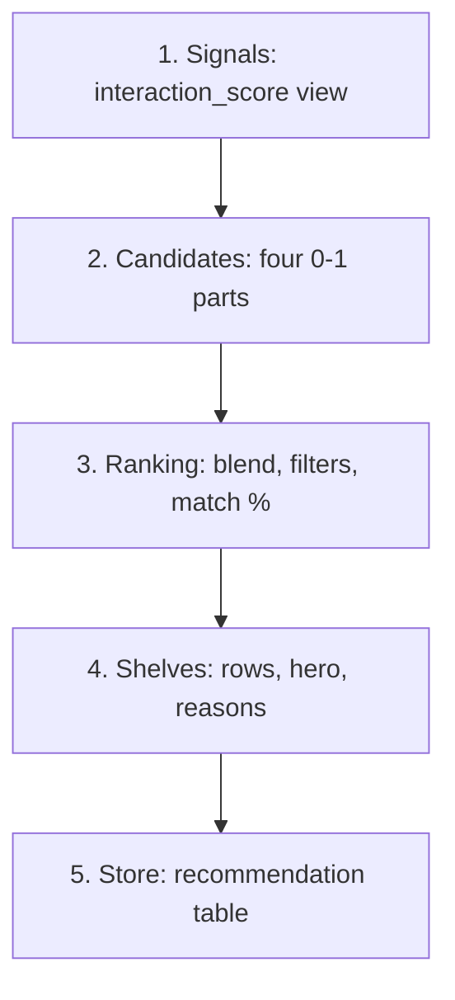

# Person C: Sahil — activity & recommendations

Sahil, you own two things. The first is **what a profile does**: watch progress, History, My List, ratings, and the state of a title page. The second is **what Home shows because of it**: the recommendation pipeline.

Read [README.md](README.md) first (architecture, setup, conventions, curl testing). This file is the complete spec for your two services and the pipeline behind them. The schema is in [`../schema/SCHEMA.md`](../schema/SCHEMA.md) (see "Viewing activity", "Recommendations" and "Ranking").

The Neon database already has the migrations and the seeded data. That includes the `interaction_score` view and the `content_similarity` materialized view. So you can run every query below against real rows right away.

Two terms you will see a lot:

- **View**: a saved query that behaves like a table. It is always up to date because it re-runs on every read.
- **Materialized view**: a saved query whose result is stored on disk like a table. It is fast to read but only changes when you refresh it.

## Table of contents

1. [Scope](#1-scope)
2. [Dependencies on A, and what to stub](#2-dependencies-on-a-and-what-to-stub)
3. [Ordered checklist](#3-ordered-checklist)
4. [`activity.service.ts`](#4-activityservicets)
5. [`recommendations.service.ts`](#5-recommendationsservicets)
6. [Deep dive: the recommendation pipeline](#6-deep-dive-the-recommendation-pipeline)
7. [Deep dive: refresh policy, `content_similarity` refresh, `rec_status` loop](#7-deep-dive-refresh-policy-content_similarity-refresh-rec_status-loop)
8. [Testing with the seeded data](#8-testing-with-the-seeded-data)
9. [Implementation notes and pitfalls](#9-implementation-notes-and-pitfalls)
10. [Definition of done](#10-definition-of-done)

---

## 1. Scope

This section lists exactly what is yours: the files, the routes, and the tables.

### Files you own

- `src/server/services/activity.service.ts`
  - Functions: `recordProgress`, `listHistory`, `removeHistoryEntry`, `listMyList`, `addToMyList`, `removeFromMyList`, `rateTitle`, `removeRating`, `getTitleActivity`, `isInMyList`, `getRating`, `getResumePoint`, `getNextEpisode`.
- `src/server/services/recommendations.service.ts`
  - Exports: `ROW_SIZE`, `WEIGHTS`, `getHomeFeed`, `shouldRefreshRecommendations`, `computeInteractionScores`, `generateCandidates`, `rankCandidates`, `buildHomeRows`, `storeRecommendations`, `refreshContentSimilarity`.
- A refresh trigger for `content_similarity`: an npm script and/or a guarded route (section 7.2).

### Routes you serve

All of these use `requireOwnedProfile` (the guard that checks the profile belongs to the signed-in user).

| Route                                                     | Service function            |
| --------------------------------------------------------- | --------------------------- |
| `POST /api/profiles/:profileId/progress`                  | `recordProgress`            |
| `GET /api/profiles/:profileId/history`                    | `listHistory`               |
| `DELETE /api/profiles/:profileId/history/:historyId`      | `removeHistoryEntry`        |
| `GET, POST /api/profiles/:profileId/my-list`              | `listMyList`, `addToMyList` |
| `DELETE /api/profiles/:profileId/my-list/:contentId`      | `removeFromMyList`          |
| `PUT, DELETE /api/profiles/:profileId/ratings/:contentId` | `rateTitle`, `removeRating` |
| `GET /api/profiles/:profileId/titles/:contentId`          | `getTitleActivity`          |
| `GET /api/profiles/:profileId/home`                       | `getHomeFeed`               |

### Tables

- **You own (you write them):** `watch_history`, `my_list`, `rating`, `recommendation`.
- **You only read:** `interaction_score` (view), `content_similarity` (materialized view), `profile_genre_preference`, `profile`, `content`, `content_genre`, `genre`, `content_credit`, `person`, `season`, `episode`.
- **Onboarding is not yours.** `PUT .../onboarding` belongs to Tejasva (A). You only read what it stores: `profile_genre_preference` and `profile.onboarded_at`.

### Two rules to remember

- **"Completed" is not a column.** A `watch_history` row is completed when `progress_percent >= 90`. In SQL write that out. In TypeScript use `isCompleted(progressPercent)` from `@/lib/content/progress`, which uses `COMPLETED_THRESHOLD`.
- **Ownership is already checked.** `requireOwnedProfile` runs before your functions, so `profileId` is always the signed-in user's profile. Still filter every query by `profile_id`.

---

## 2. Dependencies on A, and what to stub

Some of your work needs things Tejasva (A) is still building. For each one, this is what you need and what to do until it lands.

- **`requireOwnedProfile` -> `getOwnedProfile`, `findUserById`** (from Tejasva)
  - Until it lands: the mock lookups find the seeded profiles 1-3 (user 1) because the seed uses the same ids.
  - Keep working against the mock-backed guards and test only with those until Tejasva merges the real ones.
- **`getContentDetail(contentId)`** (from Tejasva, `catalog.service`; used for the existence check in `getTitleActivity`)
  - Until it lands: the mock catalogue has the same 500 ids, so it works unchanged.
- **Catalogue rows** (`content`, `content_genre`, credits, seasons, episodes)
  - Seeded. No stub needed.
- **`getSimilarTitles` SQL** (from Tejasva; used for "Because you liked X")
  - You can copy the SQL (Tejasva's file, section 7.5) into your own query. It must return `item_sim` and `content_sim` separately. Nothing blocks you.
- **`profile_genre_preference` / `onboarded_at` writes** (from Tejasva, `saveGenrePreferences`)
  - The seed has picks for profiles 1 and 2. Profile 3 has none, which gives you a cold start without picks.

Who depends on you:

- Tejasva's (A) `getSimilarTitles` reads `content_similarity`, which you keep fresh.
- The dashboard's `mostWatched` and the popularity ranking read the `watch_history` rows you write.

---

## 3. Ordered checklist

Work through these in order. Each step builds on the one before.

- [ ] **0. Prep**: branch `feat/activity-recs`, own Neon branch in `.env`, `npm run dev`, `db:studio` to look at `watch_history`, `my_list`, `rating`; run the stage-1 query (section 8.1) and compare with the list there.
- [ ] **1. My List**: `listMyList`, `addToMyList`, `removeFromMyList` (+ `isInMyList`). curl add twice (201 both), list, remove twice.
- [ ] **2. Ratings**: `rateTitle`, `removeRating` (+ `getRating`). curl 5, then 3, value 6 -> 422, unknown title -> 404.
- [ ] **3. History**: `listHistory`, `removeHistoryEntry`. History page; second delete -> 404.
- [ ] **4. Progress**: `recordProgress` (validation, upsert, feedback loop in one transaction). Player in the UI; movie and series; wrong episode -> 422; 95% twice -> one row.
- [ ] **5. Title activity**: `getTitleActivity`, `getResumePoint`, `getNextEpisode`. Title page labels "Resume · 62%", "Resume S1:E3", "Play S1:E4"; finale completed -> null.
- [ ] **6. Stage 1**: `computeInteractionScores` (+ verify the `interaction_score` view against section 8.1).
- [ ] **7. Stage 2**: `generateCandidates` (genre, people, kNN, prior; cold start).
- [ ] **8. Stage 3**: `rankCandidates` (blend, filters, match).
- [ ] **9. Stage 4**: `buildHomeRows` (rows in order, reasons, hero, anchors).
- [ ] **10. Stage 5 + policy**: `storeRecommendations`, `shouldRefreshRecommendations`, `getHomeFeed` wiring (stored vs recompute).
- [ ] **11. `refreshContentSimilarity`** + trigger (section 7.2); call it after you add test activity.
- [ ] **12. Tune** `WEIGHTS`, check the three demo profiles' Home pages, cold start (profile 3, a brand new profile).
- [ ] **13. Cleanup**: remove `getMockDb`/`toHistoryItem`/`toSummary`/`findContent` imports; update the route header comments that change; lint; build.

---

## 4. `activity.service.ts`

This service records what a profile does (progress, My List, ratings) and reads it back (History, title page state). Every function here is small. The only tricky one is `recordProgress`, because the player calls it constantly.

### Types used in this file

- `WatchHistory { historyId, profileId, contentId, episodeId | null, watchedAt (ISO), progressPercent }`
- `HistoryItem = WatchHistory & { content: ContentSummary; episode: (Episode & { seasonNumber }) | null }`
- `MyListItem = ContentSummary & { addedAt }`
- `Rating { profileId, contentId, value, ratedAt }`
- `ProgressInput { contentId, episodeId | null, progressPercent }`
- `TitleActivity { inMyList, rating, resume }`

`ContentSummary` needs two extra things:

- `genres`: use the `json_agg` subquery (it packs the rows into one JSON array) from Tejasva's (A) `searchContent`, copied.
- `maturityLevel`: `maturity_of(c.age_rating)`.

### SQL terms used below

- **Upsert**: insert a row, or update the existing one if it is already there.
- **`ON CONFLICT`**: the Postgres clause that turns an `INSERT` into an upsert. It says what to do when the key already exists.
- **Idempotent**: running the same call twice leaves the data the same as running it once.
- **Transaction**: several statements that either all succeed or all roll back.
- **FK (foreign key)**: a column that must point at a real row in another table.
- **CHECK**: a rule on a column that the database enforces (for example, "between 0 and 100").
- **PK (primary key)**: the column(s) that uniquely identify a row.

### 4.1 `recordProgress(profileId: number, input: ProgressInput): Promise<WatchHistory>`

**What it does:** Records how far a profile got in a title or episode. The player reports this on pause, seek, the 90% mark, the end, every 10 s while playing, and on page hide (`keepalive`, so the browser still sends the request while the page closes). This is the hot path (called very often): keep it to one round trip plus the cheap recommendation update.

**Steps:**

1. Validate. Clamp and round `progressPercent` to 0-100 (the CHECK is the backstop). The title must exist, otherwise `NotFoundError`.
2. A **movie** stores `episode_id = NULL`, whatever the client sent. A **series** needs an `episodeId` that belongs to the title (`episode` joined to `season` on `content_id`), otherwise `ValidationError` (422).
3. Upsert the single row for (profile, content, episode) and bump `watched_at`. Re-watching a finished title overwrites its progress (a fresh pass), so a re-watch moves to the top of History.
4. Feedback loop: if the title now counts as completed (progress >= 90), mark its recommendation `WATCHED`. Any progress write on a recommended title also moves `SHOWN` -> `CLICKED`.

**SQL:**

```sql
SELECT content_type FROM content WHERE content_id = $1;                       -- NotFoundError when no row
SELECT 1 FROM episode AS e JOIN season AS s ON s.season_id = e.season_id
 WHERE e.episode_id = $2 AND s.content_id = $1;                               -- series only; no row -> 422
INSERT INTO watch_history (profile_id, content_id, episode_id, progress_percent)
VALUES ($profile, $content, $episode, $percent)                              -- $episode NULL for movies
ON CONFLICT (profile_id, content_id, episode_id)
DO UPDATE SET progress_percent = EXCLUDED.progress_percent, watched_at = now()
RETURNING history_id, profile_id, content_id, episode_id, watched_at, progress_percent;
-- feedback loop (after the upsert; never touches DISMISSED):
UPDATE recommendation
   SET rec_status = CASE WHEN $percent >= 90 THEN 'WATCHED' ELSE 'CLICKED' END::rec_status
 WHERE profile_id = $1 AND content_id = $2
   AND rec_status IN ('SHOWN', 'CLICKED');
```

Drizzle version of the upsert:

```ts
await tx
  .insert(watchHistory)
  .values({ profileId, contentId, episodeId, progressPercent: percent })
  .onConflictDoUpdate({
    target: [watchHistory.profileId, watchHistory.contentId, watchHistory.episodeId],
    set: { progressPercent: percent, watchedAt: sql`now()` },
  })
  .returning();
```

**Rules to respect:**

- Tables and keys: `watch_history`, `content`, `episode`, `season`, `recommendation`.
- `watch_history` has UNIQUE NULLS NOT DISTINCT `(profile_id, content_id, episode_id)`, constraint `watch_history_profile_content_episode_key`. This needs PostgreSQL 15+. It makes the NULL episode of a movie still conflict with itself (normally two NULLs count as different).
- Other constraints: CHECK `progress_percent BETWEEN 0 AND 100`; FKs on `profile_id` / `content_id` / `episode_id`; PK `(profile_id, content_id)` on `recommendation`.
- Transaction: yes. The upsert and the `rec_status` update commit together.
- Idempotent: yes. The same input gives the same row; only `watched_at` moves.
- A non-finite `progressPercent` is rejected by the route's zod (the request-validation library).
- "The episode belongs to the title" is a rule the schema cannot declare (SCHEMA.md "Known limits"), so the service checks it.
- `ON CONFLICT (profile_id, content_id, episode_id)` works with the NULLS NOT DISTINCT key. If inference gives trouble, use `ON CONFLICT ON CONSTRAINT watch_history_profile_content_episode_key`.
- Episode rows also store `content_id`.

**Errors:**

- `NotFoundError("Title not found.")` -> 404.
- `ValidationError` when a series has no `episodeId`, or the episode belongs to another title -> 422.

**Mock today:** Returns a plausible row (clamped/rounded percent, `historyId` = row count + 1, `watchedAt` = now), persists nothing, and skips the title/episode checks.

**Used by:** `POST /api/profiles/:profileId/progress`. Return value: `{ historyId, profileId, contentId, episodeId, watchedAt (ISO), progressPercent }`.

### 4.2 `listHistory(profileId: number): Promise<HistoryItem[]>`

**What it does:** Powers the History page: everything the profile watched, newest first.

**Steps:**

1. Join each `watch_history` row with its title.
2. `LEFT JOIN episode` (`episode_id` is NULL for movies) and `season` for `season_number`. (A LEFT JOIN keeps rows that have no match on the right side.)
3. Shape the rows as `HistoryItem`: the row, plus `content` as a `ContentSummary` with genres, plus `episode` (Episode + `seasonNumber`, or `null`).

**SQL:**

```sql
SELECT w.history_id, w.profile_id, w.content_id, w.episode_id, w.watched_at, w.progress_percent,
       c.*, e.*, s.season_number
  FROM watch_history AS w
  JOIN content       AS c ON c.content_id = w.content_id
  LEFT JOIN episode  AS e ON e.episode_id = w.episode_id
  LEFT JOIN season   AS s ON s.season_id  = e.season_id
 WHERE w.profile_id = $1
 ORDER BY w.watched_at DESC;                       -- watch_history_recent_idx (profile_id, watched_at DESC)
-- (+ the content's genres, as catalog.service builds a ContentSummary.)
```

Note: `c.*, e.*` collide on `title`, `description`, `release_date`, `duration_minutes`. Select explicit aliased columns instead.

**Rules to respect:**

- Tables and keys: `watch_history`, `content`, `content_genre`, `genre`, `episode`, `season`; index `watch_history_recent_idx`.
- There is one row per (profile, content, episode), so a re-watch moves its row to the top instead of adding one.
- Transaction: no. Idempotent: yes (a read).
- No history -> `[]`.

**Errors:** None.

**Mock today:** The profile's rows from `data/mock/watch-history.json` (already newest first), joined in memory.

**Used by:** `GET /api/profiles/:profileId/history` (and the History page via `serverApi.getHistory`).

### 4.3 `removeHistoryEntry(profileId: number, historyId: number): Promise<void>`

**What it does:** Removes one entry from History. Its interaction signal and its Continue Watching card go with it.

**Steps:**

1. Delete the row for `historyId`, restricted to this `profileId`.
2. If zero rows were deleted, throw `NotFoundError`.

**SQL:**

```sql
DELETE FROM watch_history WHERE history_id = $2 AND profile_id = $1;       -- rowCount 0 -> 404
```

**Rules to respect:**

- The `profile_id` predicate is the ownership check.
- Zero rows deleted (unknown id, or someone else's) -> `NotFoundError("History entry not found.")`. The route uses that message for a bad id.
- Not idempotent: a second delete is 404. (The previous contract was a silent 204.)
- Deleting a series' episode row leaves the other episodes' rows and the title's other signals in place.

**Errors:**

- `NotFoundError("History entry not found.")` -> 404.

**Mock today:** Does nothing and never throws (the route answers 204).

**Used by:** `DELETE /api/profiles/:profileId/history/:historyId`.

### 4.4 `listMyList(profileId: number): Promise<MyListItem[]>`

**What it does:** Powers the My List page: saved titles, most recently added first.

**Steps:**

1. Join `my_list` with `content` for this profile.
2. Sort by `added_at` descending.
3. Attach genres per title.

**SQL:**

```sql
SELECT c.*, m.added_at
  FROM my_list AS m JOIN content AS c ON c.content_id = m.content_id
 WHERE m.profile_id = $1
 ORDER BY m.added_at DESC;
-- (+ genres per title.)
```

**Rules to respect:**

- Tables and keys: `my_list`, `content`, `content_genre`, `genre`; PK `(profile_id, content_id)`.
- Transaction: no. Idempotent: yes (a read).
- Empty list -> `[]`.

**Errors:** None.

**Mock today:** The profile's rows from `my-list.json` in file order (not re-sorted), joined in memory.

**Used by:** `GET /api/profiles/:profileId/my-list`.

### 4.5 `addToMyList(profileId: number, contentId: number): Promise<void>`

**What it does:** Saves a title for later. Adding the same title twice is a no-op.

**Steps:**

1. Insert `(profile_id, content_id)`. `added_at` defaults to `now()`.
2. If the pair already exists, do nothing.
3. If the title does not exist, translate the FK failure into `NotFoundError`.

**SQL:**

```sql
INSERT INTO my_list (profile_id, content_id) VALUES ($1, $2)       -- added_at defaults to now()
ON CONFLICT (profile_id, content_id) DO NOTHING;
```

**Rules to respect:**

- Idempotent: `added_at` keeps the first time.
- Not a transaction.
- An unknown `content_id` violates the FK (SQLSTATE **23503**, the Postgres error code for a foreign-key violation).
- The route answers 201 `{ contentId, inMyList: true }` either way.

**Errors:**

- FK violation 23503 -> `NotFoundError("Title not found.")` -> 404.

**Mock today:** Does nothing and never throws.

**Used by:** `POST /api/profiles/:profileId/my-list`.

### 4.6 `removeFromMyList(profileId: number, contentId: number): Promise<void>`

**What it does:** Removes a title from My List.

**Steps:**

1. Delete the `(profile_id, content_id)` row. If it was not there, nothing happens.

**SQL:**

```sql
DELETE FROM my_list WHERE profile_id = $1 AND content_id = $2;
```

**Rules to respect:**

- Idempotent: deleting nothing is fine.
- The title's other signals (rating, history) are untouched.
- The route answers 200 `{ contentId, inMyList: false }`.

**Errors:** None.

**Mock today:** Does nothing.

**Used by:** `DELETE /api/profiles/:profileId/my-list/:contentId`.

### 4.7 `rateTitle(profileId: number, contentId: number, value: number): Promise<Rating>`

**What it does:** Rates a title 1-5 stars; re-rating replaces the old value. The rating feeds the home signals as `(value - 3) x 2`.

**Steps:**

1. Upsert `(profile_id, content_id, value)`.
2. On a repeat, replace `value` and move `rated_at` to now.
3. Return the row. Nothing else needs updating (see the rules).

**SQL:**

```sql
INSERT INTO rating (profile_id, content_id, value) VALUES ($1, $2, $3)
ON CONFLICT (profile_id, content_id)
DO UPDATE SET value = EXCLUDED.value, rated_at = now()
RETURNING profile_id, content_id, value, rated_at;
```

**Rules to respect:**

- `value` is validated as an integer 1-5 by the route's zod. The CHECK `rating_value_check` is the backstop.
- Idempotent: the same value gives the same row; `rated_at` moves.
- Nothing else needs updating. `interaction_score` is a view, so it is always fresh. The `recommendation` table catches up on the next refresh (section 7.1).

**Errors:**

- Unknown `content_id` (FK 23503) -> `NotFoundError("Title not found.")` -> 404.
- A value outside 1-5 -> 422 (from the route's zod).

**Mock today:** Returns `{ profileId, contentId, value, ratedAt: now }`, persists nothing.

**Used by:** `PUT /api/profiles/:profileId/ratings/:contentId`.

### 4.8 `removeRating(profileId: number, contentId: number): Promise<void>`

**What it does:** Deletes this profile's rating for a title.

**Steps:**

1. Delete the `(profile_id, content_id)` row. If it was not there, nothing happens.

**SQL:**

```sql
DELETE FROM rating WHERE profile_id = $1 AND content_id = $2;
```

**Rules to respect:**

- Idempotent.
- The route answers 204.

**Errors:** None.

**Mock today:** Does nothing.

**Used by:** `DELETE /api/profiles/:profileId/ratings/:contentId`.

### 4.9 `getTitleActivity(profileId: number, contentId: number): Promise<TitleActivity>`

**What it does:** Reports what this profile has done with one title. It drives the title page (Play/Resume label, My List button, star rating) and where the player starts.

**Steps:**

1. Check the title exists. Use `getContentDetail` from `./catalog.service` -> `NotFoundError("Title not found.")`. A plain `SELECT 1 FROM content` with the same error is acceptable and cheaper.
2. Compute `inMyList = isInMyList`, `rating = getRating`, `resume = getResumePoint`. Run the three in parallel with `Promise.all` (JavaScript's "run these at the same time and wait for all").
3. Optional feedback loop: opening the title page moves a SHOWN recommendation to CLICKED.

**SQL:**

```sql
-- optional step 3 (a write on a GET, so only if the team wants page-view granularity):
UPDATE recommendation SET rec_status = 'CLICKED'
 WHERE profile_id = $1 AND content_id = $2 AND rec_status = 'SHOWN';
```

The other three queries are in the helpers (sections 4.10 to 4.12).

**Rules to respect:**

- Tables and keys: `my_list`, `rating`, `watch_history`, `episode`, `season` (+ `content` for the existence check). PKs of `my_list` and `rating`, index `watch_history_recent_idx`.
- Transaction: no. Idempotent: yes (a read).
- A profile that never touched the title gets `{ inMyList: false, rating: null, resume: null }`.
- Step 3 is a write on a GET, so do it only if the team wants page-view granularity. `recordProgress` already covers the player (README 9.14).

**Errors:**

- `NotFoundError("Title not found.")` -> 404.

**Mock today:** The same three answers read from the mock db. `resume` is only an unfinished latest row (completed rows give null: no "next episode" yet).

**Used by:** `GET /api/profiles/:profileId/titles/:contentId` (and the title/player pages via `serverApi.getTitleActivity`).

### 4.10 `isInMyList(profileId: number, contentId: number): Promise<boolean>`

This is the first of four exported helpers of `getTitleActivity` (4.10 to 4.13).

**What it does:** Says whether the title is on this profile's My List.

**Steps:**

1. Check whether a `my_list` row exists for the pair.

**SQL:**

```sql
SELECT EXISTS (SELECT 1 FROM my_list WHERE profile_id = $1 AND content_id = $2);
```

**Rules to respect:**

- A read; idempotent.

**Errors:** None.

**Mock today:** Looks the pair up in `my-list.json`.

**Used by:** `getTitleActivity`.

### 4.11 `getRating(profileId: number, contentId: number): Promise<number | null>`

**What it does:** Returns this profile's star rating for the title, or `null` if it has none.

**Steps:**

1. Select `value` from `rating` for the pair.

**SQL:**

```sql
SELECT value FROM rating WHERE profile_id = $1 AND content_id = $2;
```

**Rules to respect:**

- A read; idempotent.

**Errors:** None.

**Mock today:** Looks the pair up in `ratings.json`.

**Used by:** `getTitleActivity`.

### 4.12 `getResumePoint(profileId: number, contentId: number): Promise<TitleActivity["resume"]>`

**What it does:** Decides where Play should start for this title. The result is `{ episodeId: number | null, progressPercent: number, label: string }`, or `null`.

**Steps:**

1. Take the latest `watch_history` row for the title (most recent `watched_at`).
2. Decide by what that row was (see the list below).
3. "Completed" means `progress_percent >= 90` (`isCompleted`).

What to return for each kind of latest row:

- **Movie, unfinished:** `{ episodeId: null, progressPercent, label: "Resume · 62%" }`.
- **Movie, completed:** `null` (Play starts over).
- **Episode, unfinished:** that episode, label `"Resume S1:E3"`. Build the code with `formatEpisodeCode(seasonNumber, episodeNumber)` from `@/lib/format`.
- **Episode, completed:** `getNextEpisode(contentId, episodeId)` at 0%, label `"Play S1:E4"`. Return `null` after the finale.
- **Never watched:** `null`.

**SQL:**

```sql
SELECT w.episode_id, w.progress_percent, s.season_number, e.episode_number
  FROM watch_history AS w
  LEFT JOIN episode AS e ON e.episode_id = w.episode_id
  LEFT JOIN season  AS s ON s.season_id  = e.season_id
 WHERE w.profile_id = $1 AND w.content_id = $2
 ORDER BY w.watched_at DESC LIMIT 1;                -- watch_history_recent_idx
```

**Rules to respect:**

- A finale that is completed -> `null`.
- A series whose latest row is an unfinished earlier episode resumes that one. "Latest" means by `watched_at`, not by episode order.
- For the next-episode case, `progressPercent` is 0.
- A read; idempotent.

**Errors:** None.

**Mock today:** Only the unfinished case (latest row, newest first in the mock file, with `!isCompleted`). Completed titles return null, so "Play S1:E4" is not produced.

**Used by:** `getTitleActivity`.

### 4.13 `getNextEpisode(contentId: number, episodeId: number): Promise<Episode | null>`

**What it does:** Finds the episode that airs right after the given one, crossing into the next season when needed. Returns `null` after the finale.

**Steps:**

1. Look up the season number and episode number of the given episode.
2. Among this title's episodes, keep those whose (season number, episode number) pair is greater. (Postgres can compare two-column "row values" like this directly.)
3. Order by season then episode and take the first.

**SQL:**

```sql
SELECT e.*
  FROM episode AS e JOIN season AS s ON s.season_id = e.season_id
 WHERE s.content_id = $1
   AND (s.season_number, e.episode_number) >
       (SELECT s0.season_number, e0.episode_number
          FROM episode AS e0 JOIN season AS s0 ON s0.season_id = e0.season_id
         WHERE e0.episode_id = $2)
 ORDER BY s.season_number, e.episode_number
 LIMIT 1;
```

**Rules to respect:**

- Tables and keys: `episode`, `season`; UNIQUE `(content_id, season_number)`, UNIQUE `(season_id, episode_number)`.
- An `episodeId` of another title -> `null` (the row comparison finds nothing for this content).
- The label "Play S1:E4" needs the next episode's **season number**, which `Episode` lacks. Keep this exported signature, and have `getResumePoint` use an internal variant of the query that also returns `s.season_number`.

**Errors:** None.

**Mock today:** Returns `null`.

**Used by:** `getResumePoint`.

---

## 5. `recommendations.service.ts`

This service builds the Home page. It turns a profile's activity into a ranked list of titles, groups them into shelves ("rows") with a reason for each, and stores the result. Section 6 explains the ideas and the maths. This section is the contract for each function.

### Exports

Signatures are exact:

```ts
export const ROW_SIZE = 18;                        // items per row
export const WEIGHTS = {                           // the tunable numbers, in one place
  rating:    { centre: 3, scale: 2 },
  watch:     { completed: 3, half: 1.5, abandoned: -0.5 },
  myList:    1,
  genrePick: 2,
  blend:     { genre: 0.6, people: 0.4, affinity: 0.5, knn: 0.3, prior: 0.2 },
  match:     { floor: 55, span: 44 },
} as const;

getHomeFeed(profile: Profile): Promise<HomeFeed>
shouldRefreshRecommendations(profileId: number): Promise<boolean>
computeInteractionScores(profileId: number): Promise<InteractionScores>          // Map<contentId, score>
generateCandidates(profileId: number, scores: InteractionScores): Promise<Candidate[]>
rankCandidates(candidates: Candidate[], profile: Profile): Promise<RankedCandidate[]>
buildHomeRows(ranked: RankedCandidate[], profile: Profile, scores: InteractionScores): Promise<HomeBuild>
storeRecommendations(profileId: number, ranked: RankedCandidate[], rows: HomeRow[]): Promise<void>
refreshContentSimilarity(): Promise<void>
```

### Types (from `@/types`)

- `InteractionScores = Map<number, number>`
- `Candidate { contentId, genreAffinity, peopleAffinity, itemKnn, popularityPrior }` (all 0-1)
- `RankedCandidate = Candidate & { content: ContentSummary; affinity; score; match }`
- `HomeBuild { hero: HomeHero | null; rows: HomeRow[] }`
- `HomeRow { id, kind: HomeRowKind, title, reason, anchor?: { contentId, title }, items: RowItem[] }`
- `RowItem { content, match?, progress?: { progressPercent, episode } }`
- `HomeHero { content, reason, match? }`
- `HomeFeed { profileId, hero, rows, generatedAt }`

### Reason strings (`REASONS`)

`REASONS` is a private const in the file. It holds every row reason string, so `buildHomeRows` and the stub share one source.

- `continueWatching`: `Pick up where you left off.`
- `topPicks`: `Ranked from the genres and people you watch, what similar viewers enjoyed, and what's popular.`
- `topPicksPickedGenres`: `Popular in the genres you picked — rate a few to personalise this row.`
- `topPicksNoSignals`: `Popular titles to get you started — rate a few to personalise this row.`
- `becauseKnn(anchor)`: `Viewers who enjoyed ${anchor} also watched these.`
- `becauseSimilar(anchor)`: `Shares genres and people with ${anchor}.`
- `trending`: `The most-watched titles on Reelhouse right now.`
- `topRatedStrongest(genre)`: `${genre} is your strongest genre — sorted by audience rating.`
- `topRatedPicked(genre)`: `You picked ${genre} during setup — here are its best-reviewed titles.`
- `morePerson(count, name, role)`: `You've enjoyed ${count} titles ${role === "DIRECTOR" ? "by" : "featuring"} ${name}.`
- `genrePicked(genre)`: `You picked ${genre} during setup.`
- `genreWatched(genre)`: `You watch a lot of ${genre}.`
- `heroPick(name)`: `Our top pick for ${name} tonight`
- `heroPopular`: `Popular on Reelhouse`

The pipeline concept, formulas, worked example and row catalogue are in [section 6](#6-deep-dive-the-recommendation-pipeline). The per-function contracts follow.

### 5.1 `getHomeFeed(profile: Profile): Promise<HomeFeed>`

**What it does:** The orchestrator for the Home page of one profile (hero + shelves). It decides whether to rebuild the recommendations or serve the stored ones, runs the five stages, and returns the feed.

**Steps:**

1. Call `shouldRefreshRecommendations(profileId)`. If it is **false**, serve the stored rows: read `recommendation` (`rec_status <> 'DISMISSED'`) ordered by `relevance_score`, regroup by `row_type`, and run stage 4 again over them. Reasons and the because-you-liked row are computed per request. Then skip to step 7. (How to rebuild `ranked` from stored rows: section 9.2.)
2. `computeInteractionScores(profileId)`: stage 1.
3. `generateCandidates(profileId, scores)`: stage 2.
4. `rankCandidates(candidates, profile)`: stage 3.
5. `buildHomeRows(ranked, profile, scores)`: stage 4.
6. `storeRecommendations(profileId, ranked, rows)`: stage 5.
7. Return `{ profileId, hero, rows, generatedAt }`. `generatedAt` is the newest `recommendation.generated_at`, or `now()` right after a refresh.

**SQL:**

```sql
SELECT r.content_id, r.row_type, r.relevance_score, r.generated_at
  FROM recommendation AS r
 WHERE r.profile_id = $1 AND r.rec_status <> 'DISMISSED'
 ORDER BY r.relevance_score DESC;                       -- recommendation_rank_idx
```

**Rules to respect:**

- Tables and keys: `recommendation` (+ everything the stages read). PK `(profile_id, content_id)`, index `recommendation_rank_idx`.
- Transaction: no for the reads. `storeRecommendations` opens its own.
- Idempotent: yes. The same activity gives the same feed; only `generated_at` moves.
- A profile with no signals and no picked genres still gets the popularity-ranked fallback (cold start).
- A failed store must **not** fail the request: catch the error, `console.error` it, and still return the feed.

**Errors:** None of its own. The route has already 404'd an unknown profile.

**Mock today:** There is no pipeline. It returns fixed slices of the catalogue (18 each: top-picks 0, top-rated-genre 18, because-you-liked 36, trending 300, genre-picks 318). Continue-watching comes from the profile's history filtered with `!isCompleted`. Because-you-liked is anchored on `history[0]` (only when the profile has history). `genres[0]`/`genres[1]` are the top-rated/genre-picks genres. The hero is the first catalogue title and `generatedAt` is now.

**Used by:** `GET /api/profiles/:profileId/home` (and the Home page via `serverApi.getHome`).

### 5.2 `shouldRefreshRecommendations(profileId: number): Promise<boolean>`

**What it does:** Answers one question: should Home rerun the pipeline, or serve the stored recommendations? This is an **open decision** (README 9.1). The recommended default is chosen in the service and implemented as: regenerate on Home load when the newest `generated_at` is older than **15 minutes**, OR older than the profile's latest activity.

That default keeps Home fresh right after a rating/watch/My List change. It avoids recomputing on every request or on every 10-second progress ping, and it needs no background worker. `content_similarity` is refreshed separately and nightly.

**Steps:**

1. Get the newest `generated_at` for the profile. If none is stored, return `true`.
2. Compute the latest activity time: `greatest(max(watch_history.watched_at), max(rating.rated_at), max(my_list.added_at), profile.onboarded_at)`.
3. Return `true` when `now() - generated_at > 15 minutes`, or `generated_at < latest activity`.

**SQL:**

```sql
SELECT (SELECT max(generated_at) FROM recommendation WHERE profile_id = $1) AS generated_at,
       greatest(
         (SELECT max(watched_at) FROM watch_history WHERE profile_id = $1),
         (SELECT max(rated_at)   FROM rating        WHERE profile_id = $1),
         (SELECT max(added_at)   FROM my_list       WHERE profile_id = $1),
         (SELECT onboarded_at    FROM profile       WHERE profile_id = $1)
       ) AS latest_activity;
```

Evaluate the decision in TypeScript:

```ts
!generatedAt || Date.now() - generatedAt.getTime() > 15 * 60_000 || (latestActivity && generatedAt < latestActivity);
```

**Rules to respect:**

- Tables and keys: `recommendation`, `watch_history`, `rating`, `my_list`, `profile`. Uses `recommendation_rank_idx` / PK, `watch_history_recent_idx`, and the `rating` and `my_list` PKs.
- Transaction: no. Idempotent: yes (a read).
- Removing history/rating/My List rows lowers `max(...)` and does not trigger a refresh by itself. The 15-minute limit catches it.
- Progress pings on an unfinished title move `watched_at` every 10 seconds, so a profile mid-binge reruns the pipeline on each Home load. If that proves too costly, drop the "older than latest activity" rule for `watch_history` and keep it for ratings/My List/onboarding only.
- `greatest()` ignores NULLs in PostgreSQL.

**Errors:** None.

**Mock today:** Returns `false` (there is nothing stored).

**Used by:** `getHomeFeed`.

### 5.3 `computeInteractionScores(profileId: number): Promise<InteractionScores>`: stage 1

**What it does:** Produces one interaction score per title this profile touched. It reads the `interaction_score` view for the profile. The weights live in `WEIGHTS`, and the view (created by migration 0001) already encodes them.

**Steps:**

1. Select `content_id, score` from `interaction_score` for the profile.
2. Return `Map<contentId, Number(score)>`. The view's `score` is numeric, which arrives as a string unless typed `real`, hence `Number()`.

**SQL:**

```sql
SELECT content_id, score FROM interaction_score WHERE profile_id = $1;
-- the view (docs/schema/SCHEMA.md, drizzle/0001_functions_and_views.sql):
--   SELECT profile_id, content_id, SUM(weight) AS score FROM (
--     SELECT profile_id, content_id, (value - 3) * 2.0 FROM rating
--     UNION ALL
--     SELECT profile_id, content_id,
--            CASE WHEN max(progress_percent) >= 90 THEN 3.0 WHEN max(progress_percent) >= 50 THEN 1.5
--                 WHEN max(progress_percent) < 10 THEN -0.5 ELSE 0 END
--       FROM watch_history GROUP BY profile_id, content_id
--     UNION ALL
--     SELECT profile_id, content_id, 1.0 FROM my_list
--   ) AS signals GROUP BY profile_id, content_id;
```

**Rules to respect:**

- Tables and keys: `interaction_score` (a view over `rating`, `watch_history`, `my_list`); indexes `rating_content_idx`, `watch_history_recent_idx`; PKs of `rating` and `my_list`.
- Onboarding genres are not title signals. They enter in stage 2a.
- A new profile gives an empty map (cold start).
- The kNN step needs every other profile's scores too. That is the same view without the profile filter, consumed by `content_similarity`.

**Errors:** None.

**Mock today:** Returns an empty map (`getHomeFeed` does not call it).

**Used by:** `getHomeFeed`.

### 5.4 `generateCandidates(profileId: number, scores: InteractionScores): Promise<Candidate[]>`: stage 2

**What it does:** For each candidate title, computes four parts, each from 0 to 1. Every part is normalised to 0-1 by dividing by its max over the candidates, and negatives clamp to 0.

**Steps:**

1. **Genre affinity.** Spread each scored title's score over its genres (`score / #genres`). Add +2 per genre in `profile_genre_preference`. Sum per genre. A candidate's `genreAffinity` is `(max + mean)` of its genres' affinities, divided by 2.
2. **People affinity.** Do the same spread over the title's `content_credit` rows. Count the top-5 billed actors (`credit_order < 5`: x1 for the first three, x0.6 after) and directors (x1.5). A candidate's `peopleAffinity` is its strongest shared person plus 0.25 x the next two, capped at 1.
3. **Item kNN.** For every candidate, take the similarity-weighted average over the titles this profile scored positively, using `content_similarity`. That view is refreshed on a schedule, not per request.
4. **Popularity prior.** `ln(1 + distinct viewers in the last 30 days)`, min-max normalised over the catalogue (0 for a title nobody watched). Min-max normalising means rescaling so the lowest value becomes 0 and the highest becomes 1.
5. **Cold start** (`scores` is empty): the candidates are the titles in the picked genres, with `genreAffinity` from the picks only and `peopleAffinity = itemKnn = 0`. So the prior orders them. With no picks either, every title is a candidate.

**SQL:**

```sql
-- a. genre affinity (then divide by max, in the app)
WITH n AS (SELECT content_id, COUNT(*) AS cnt FROM content_genre GROUP BY content_id),
     spread AS (
       SELECT cg.genre_id, SUM(s.score / n.cnt) AS a
         FROM interaction_score AS s
         JOIN content_genre AS cg ON cg.content_id = s.content_id
         JOIN n ON n.content_id = s.content_id
        WHERE s.profile_id = $1 GROUP BY cg.genre_id
       UNION ALL
       SELECT genre_id, 2.0 FROM profile_genre_preference WHERE profile_id = $1
     )
SELECT genre_id, SUM(a) AS affinity FROM spread GROUP BY genre_id;

-- b. people affinity (credits counted: ACTOR with credit_order < 5, and DIRECTOR)
WITH credits AS (
       SELECT content_id, person_id, role, credit_order FROM content_credit
        WHERE role = 'DIRECTOR' OR (role = 'ACTOR' AND credit_order < 5)),
     n AS (SELECT content_id, COUNT(*) AS cnt FROM credits GROUP BY content_id)
SELECT cr.person_id,
       SUM(s.score / n.cnt * CASE WHEN cr.role = 'DIRECTOR' THEN 1.5
                                  WHEN cr.credit_order < 3 THEN 1.0 ELSE 0.6 END) AS affinity
  FROM interaction_score AS s
  JOIN credits AS cr ON cr.content_id = s.content_id
  JOIN n ON n.content_id = s.content_id
 WHERE s.profile_id = $1 GROUP BY cr.person_id;

-- c. item kNN (then divide by max)
SELECT cs.content_b AS content_id, SUM(cs.score * s.score) / NULLIF(SUM(cs.score), 0) AS knn
  FROM interaction_score AS s
  JOIN content_similarity AS cs ON cs.content_a = s.content_id
 WHERE s.profile_id = $1 AND s.score > 0
 GROUP BY cs.content_b;

-- d. popularity prior (docs/schema/SCHEMA.md "Ranking")
WITH viewers AS (
  SELECT c.content_id, ln(1 + COUNT(DISTINCT w.profile_id)) AS v
    FROM content AS c
    LEFT JOIN watch_history AS w
           ON w.content_id = c.content_id AND w.watched_at > now() - interval '30 days'
   GROUP BY c.content_id)
SELECT content_id,
       COALESCE((v - MIN(v) OVER ()) / NULLIF(MAX(v) OVER () - MIN(v) OVER (), 0), 0) AS popularity_prior
  FROM viewers;
```

**Rules to respect:**

- Tables and keys: `interaction_score`, `content_genre`, `profile_genre_preference`, `content_credit`, `content_similarity`, `watch_history`, `content`. Indexes and keys: `content_genre_genre_idx`, `content_credit_person_idx`, `content_similarity_pair_key`, `watch_history_recent_idx`.
- Transaction: no. Idempotent: yes (a read).
- A title in no genre gets `genreAffinity` 0.
- Fewer than three credits is fine. The "next two" are simply missing.
- An empty `content_similarity` (not refreshed yet) gives `itemKnn` 0 everywhere, and the blend degrades gracefully.
- The genre and person tables are also what `buildHomeRows` reads for "strongest genre/person". Return or recompute them as needed (section 9.1).
- Recommended: also clamp negative `cs.score` out of the kNN query (`AND cs.score > 0`), so a negative similarity cannot flip the sign of a weighted average.

**Errors:** None.

**Mock today:** Returns an empty array (`getHomeFeed` does not call it).

**Used by:** `getHomeFeed`.

### 5.5 `rankCandidates(candidates: Candidate[], profile: Profile): Promise<RankedCandidate[]>`: stage 3

**What it does:** Blends the four parts into one score, filters out titles that should not be shown, and sorts.

**Steps:**

1. Blend: `affinity = 0.6 x genreAffinity + 0.4 x peopleAffinity`; then `score = 0.5 x affinity + 0.3 x itemKnn + 0.2 x popularityPrior` (`WEIGHTS.blend`).
2. Filter:
   - `maturity_of(content.age_rating) <= profile.maturityLevel` (KIDS < TEEN < ADULT).
   - Drop finished titles: a completed movie, or a series whose every episode has progress >= 90.
   - Drop titles with `recommendation.rec_status = 'DISMISSED'` (the feedback loop).
3. Sort by `score DESC`, ties by `content.release_date DESC`.
4. Compute `match = round(55 + 44 x min(1, score / best score))`. A best score of 0 gives 55.

**SQL:**

```sql
-- the filters, applied to the candidate ids
SELECT c.content_id, c.release_date
  FROM content AS c
 WHERE c.content_id = ANY($ids)
   AND maturity_of(c.age_rating) <= $maturity::maturity_level
   AND NOT (c.content_type = 'MOVIE' AND EXISTS (
         SELECT 1 FROM watch_history AS w
          WHERE w.profile_id = $1 AND w.content_id = c.content_id AND w.progress_percent >= 90))
   AND NOT (c.content_type = 'SERIES'
            AND EXISTS (SELECT 1 FROM season AS s JOIN episode AS e ON e.season_id = s.season_id
                         WHERE s.content_id = c.content_id)
            AND NOT EXISTS (
              SELECT 1 FROM season AS s JOIN episode AS e ON e.season_id = s.season_id
               WHERE s.content_id = c.content_id
                 AND NOT EXISTS (SELECT 1 FROM watch_history AS w
                                  WHERE w.profile_id = $1 AND w.episode_id = e.episode_id
                                    AND w.progress_percent >= 90)))
   AND NOT EXISTS (SELECT 1 FROM recommendation AS r
                    WHERE r.profile_id = $1 AND r.content_id = c.content_id AND r.rec_status = 'DISMISSED');
```

**Rules to respect:**

- Tables and keys: `content`, `watch_history`, `season`, `episode`, `recommendation`; `maturity_of()`; PK `(profile_id, content_id)` on `recommendation`.
- Transaction: no. Idempotent: yes (pure over its inputs plus reads).
- The scoring is arithmetic in the app. Only the filters need the database.
- Empty input gives `[]`.
- Candidates the profile has already watched or rated are **kept** here. Top-picks drops them in stage 4, and the person/genre rows reuse the ranking.
- Fill `RankedCandidate.content` (a `ContentSummary` with genres) for the survivors.

**Errors:** None.

**Mock today:** Returns an empty array.

**Used by:** `getHomeFeed`.

### 5.6 `buildHomeRows(ranked, profile, scores): Promise<HomeBuild>`: stage 4

**What it does:** Slices the ranking into shelves, gives each shelf its reason, and picks the hero. A row with no items is omitted. Each row has 18 items (`ROW_SIZE`). `scores` is the stage-1 map (anchors need score >= 3).

**Steps:** build the rows in this order.

1. `continue-watching`: the latest `watch_history` row per title with 1-89% progress, newest first. Items carry `{ progressPercent, episode (+ seasonNumber) }`. Title `Continue watching for <name>`.
2. `top-picks`: ranked candidates the profile has not watched or rated, each with its `match`. Title `Top picks for <name>`. Cold start: the picked genres' titles (or every title) by popularity prior, with the cold-start reasons.
3. `because-you-liked`: for the 2 strongest anchors (interaction score >= 3, most recent first), unseen titles ordered by `0.65 x kNN similarity + 0.35 x content similarity`. Content similarity means genre/people overlap, as in `/api/content/:id/similar`.
   - Title `Because you liked <anchor>`, with `row.anchor = { contentId, title }`.
   - The id is `because-you-liked-<anchor contentId>`, so the two rows have distinct ids.
   - Reason: "Viewers who enjoyed X also watched these." when most items came from kNN, else "Shares genres and people with X.".
4. `trending`: most distinct viewers in the last 7 days, then `release_date DESC`. It is the same for everyone at this maturity level. Title `Trending now`.
5. `top-rated-genre`: the strongest genre, ordered by the Bayesian average (a rating average that is pulled toward the global mean when a title has few ratings). Title `Top rated in <Genre>`.
6. `more-with-person`: the strongest person with >= 3 titles, of which >= 2 are unseen. Title `From <director>` / `More with <actor>`.
7. `genre-picks`: the 2nd and 3rd strongest genres, ranked by score (one row each, id `genre-picks-<genreId>`). Title `<Genre> for you`.
8. `hero`: the first top pick, with reason `Our top pick for <name> tonight`, or `Popular on Reelhouse` when the profile has no signals yet. `hero.match` is that pick's match.

Reasons are computed here from the row kind plus context (genre name, person name, anchor title). See `REASONS`. There is no `recommendation.reason` column, so reasons cannot go stale.

**SQL:**

```sql
-- continue-watching
SELECT * FROM (
  SELECT DISTINCT ON (w.content_id) w.*              -- latest row per title first,
    FROM watch_history AS w WHERE w.profile_id = $1
   ORDER BY w.content_id, w.watched_at DESC
) AS latest
WHERE progress_percent BETWEEN 1 AND 89              -- then the 1-89% filter
ORDER BY watched_at DESC LIMIT 18;

-- trending (maturity-filtered)
SELECT c.content_id, COUNT(DISTINCT w.profile_id) AS viewers
  FROM watch_history AS w JOIN content AS c ON c.content_id = w.content_id
 WHERE w.watched_at > now() - interval '7 days' AND maturity_of(c.age_rating) <= $maturity
 GROUP BY c.content_id, c.release_date
 ORDER BY viewers DESC, c.release_date DESC NULLS LAST LIMIT 18;

-- top-rated-genre ($genre = the strongest genre)
WITH stats AS (SELECT content_id, COUNT(*) AS v, AVG(value) AS r FROM rating GROUP BY content_id),
     overall AS (SELECT AVG(value) AS c FROM rating)
SELECT s.content_id, (s.v / (s.v + 5.0)) * s.r + (5.0 / (s.v + 5.0)) * o.c AS bayes
  FROM stats AS s CROSS JOIN overall AS o
  JOIN content AS c ON c.content_id = s.content_id
  JOIN content_genre AS cg ON cg.content_id = c.content_id AND cg.genre_id = $genre
 WHERE maturity_of(c.age_rating) <= $maturity
 ORDER BY bayes DESC, c.release_date DESC NULLS LAST LIMIT 18;

-- because-you-liked: kNN part for anchor $a (the content part is catalog.service getSimilarTitles)
SELECT content_b AS content_id, score FROM content_similarity
 WHERE content_a = $a ORDER BY score DESC;
```

**Rules to respect:**

- Tables and keys: `watch_history`, `rating`, `content`, `content_genre`, `genre`, `content_credit`, `person`, `content_similarity`, `interaction_score`. Indexes and helpers: `watch_history_recent_idx`, `rating_content_idx`, `content_similarity_pair_key`, `maturity_of()`.
- Transaction: no. Idempotent: yes (a read).
- "Unseen" means no `watch_history` row and no rating for the profile.
- Rows with no items are dropped. A new profile has no continue-watching or because-you-liked.
- "Strongest" genre/person means the highest stage-2 affinity.
- With only onboarding picks, the top-rated reason is the "You picked ..." one and genre-picks says "You picked <Genre> during setup.". Otherwise it says "You watch a lot of <Genre>.".
- Seed-sized data has only 7 ratings, so use the LEFT JOIN form of the Bayesian query (section 9.3).

**Errors:** None.

**Mock today:** Returns `{ hero: null, rows: [] }` (`getHomeFeed` builds its fixed slices itself).

**Used by:** `getHomeFeed`.

### 5.7 `storeRecommendations(profileId, ranked, rows): Promise<void>`: stage 5

**What it does:** Saves the ranked picks in `recommendation` and drops the stale ones.

What is stored:

- The titles shown in the personalised shelves: `top-picks`, `more-with-person`, `top-rated-genre`, `genre-picks`.
- **Not stored:** `continue-watching`, `trending` and `because-you-liked`. The last one is rebuilt from `content_similarity` per request, anchor included.
- A title in several shelves is stored once, under the first of them in row order.
- `relevance_score` is the candidate's blended score. Store only titles present in `ranked`.

**Steps** (all in **one transaction**):

1. Upsert each picked title: `row_type`, `relevance_score`, `generated_at = now()`. `rec_status` is **not** in the DO UPDATE list, so it survives a refresh. DISMISSED stays DISMISSED (stage 3 keeps it out), and CLICKED/WATCHED keep their history.
2. Delete the rows this refresh no longer ranks (not DISMISSED, which must persist).

**SQL:**

```sql
INSERT INTO recommendation (profile_id, content_id, row_type, relevance_score, generated_at)
VALUES ($1, $2, $3, $4, now()), ...
ON CONFLICT (profile_id, content_id)
DO UPDATE SET row_type = EXCLUDED.row_type,
              relevance_score = EXCLUDED.relevance_score,
              generated_at = now();                         -- rec_status deliberately left alone
DELETE FROM recommendation
 WHERE profile_id = $1 AND generated_at < $refreshStartedAt AND rec_status <> 'DISMISSED';
```

Batch the VALUES (a few hundred rows is fine in one statement), or use Drizzle:

```ts
db.insert(recommendation)
  .values(rows)
  .onConflictDoUpdate({
    target: [profileId, contentId],
    set: {
      rowType: sql.raw("excluded.row_type"),
      relevanceScore: sql.raw("excluded.relevance_score"),
      generatedAt: sql`now()`,
    },
  });
```

**Rules to respect:**

- Tables and keys: `recommendation`. PK `(profile_id, content_id)`, index `recommendation_rank_idx`, FKs to `profile` and `content` (ON DELETE CASCADE, meaning the row is deleted automatically when its profile or title is deleted).
- Transaction: yes (`db.transaction`). Idempotent: yes (ON CONFLICT upsert; reruns only move `generated_at`).
- Policy choice: a title re-ranked after the profile ignored it stays SHOWN. If the team wants "re-shown" to reset CLICKED -> SHOWN, add `rec_status = CASE WHEN recommendation.rec_status = 'CLICKED' THEN 'SHOWN' ELSE recommendation.rec_status END`.
- Empty `ranked` and `rows` -> only the delete runs (a profile whose picks all vanished).
- No `reason` / `source_content_id` columns exist; those are computed.
- `$refreshStartedAt` can simply be `now()`. Inside one transaction `now()` is constant, so every row upserted by this refresh has `generated_at = now()` and every untouched row is strictly older. That means `generated_at < now()` selects exactly the stale rows.

**Errors:** None of its own.

**Mock today:** Does nothing.

**Used by:** `getHomeFeed`.

### 5.8 `refreshContentSimilarity(): Promise<void>`

**What it does:** Refreshes `content_similarity` (the item-item kNN). Run it nightly by a scheduled job, **not** per request.

**Steps:**

1. Run the refresh statement. Readers keep using the old data meanwhile.

**SQL:**

```sql
REFRESH MATERIALIZED VIEW CONCURRENTLY content_similarity;
```

**Rules to respect:**

- `CONCURRENTLY` needs the unique index `content_similarity_pair_key`, which migration 0001 created.
- Not a transaction. The statement is atomic but cannot run inside a transaction block. Call ``db.execute(sql`REFRESH MATERIALIZED VIEW CONCURRENTLY content_similarity`)`` directly (or `db.refreshMaterializedView(contentSimilarity).concurrently()`).
- Idempotent.
- A first-ever refresh with CONCURRENTLY needs the view populated once without it (`REFRESH MATERIALIZED VIEW content_similarity;`). The seed already did that.

**Errors:** None.

**Mock today:** Does nothing.

**Used by:** Nothing yet. The nightly job (section 7.2) will call it.

---

## 6. Deep dive: the recommendation pipeline

The pipeline turns "what this profile did" into "what to show on Home". It has four stages, each a query (or view) over the activity tables, so you can build and check them one at a time. A fifth stage stores the result. The weights live in one const object (`WEIGHTS`).



Walkthrough:

1. **Signals.** Ratings, watch progress and My List turn into one score per (profile, title).
2. **Candidates.** Every title gets four parts between 0 and 1: genre affinity, people affinity, item kNN and popularity prior.
3. **Ranking.** The parts blend into one score: `score = 0.5·affinity + 0.3·kNN + 0.2·prior`. Filters remove unsuitable titles, and the score becomes a "match %".
4. **Shelves.** The ranking is sliced into rows with reasons and a hero. This is computed per request and never stored.
5. **Store.** Only the personalised shelves are saved in `recommendation`, and `rec_status` records what the profile did with them.

### 6.1 Stage 1: signals and weights

Stage 1 gives each (profile, content) pair one interaction score, summed over three sources (`WEIGHTS`).

- **`rating`:** `(stars - 3) x 2` (`WEIGHTS.rating = { centre: 3, scale: 2 }`).
  - 5 stars +4, 4 stars +2, 3 stars 0, 2 stars -2, 1 star -4.
- **`watch_history`** (`WEIGHTS.watch`): aggregate **per title first**, because a series has a row per episode. Use `max(progress_percent)`.
  - `>= 90` completed: **+3**.
  - Else `>= 50`: **+1.5**.
  - Else `< 10` (abandoned): **-0.5**.
  - 10-49: 0.
- **`my_list`:** being in the list is **+1** (`WEIGHTS.myList`).
- **`profile_genre_preference`:** **not** a title signal. It enters stage 2a as +2 per picked genre (`WEIGHTS.genrePick`).

The view (migration 0001), verbatim:

```sql
CREATE VIEW interaction_score AS
SELECT profile_id, content_id, SUM(weight) AS score
FROM (
  SELECT profile_id, content_id, (value - 3) * 2.0 AS weight FROM rating
  UNION ALL
  SELECT profile_id, content_id,
         CASE WHEN max(progress_percent) >= 90   THEN 3.0   -- completed
              WHEN max(progress_percent) >= 50   THEN 1.5
              WHEN max(progress_percent) < 10    THEN -0.5
              ELSE 0 END
  FROM watch_history
  GROUP BY profile_id, content_id                    -- a series has one row per episode
  UNION ALL
  SELECT profile_id, content_id, 1.0 FROM my_list
) AS signals
GROUP BY profile_id, content_id;
```

The weights are hard-coded in the view **and** in `WEIGHTS`. If you retune, change both (the view needs a migration). The view is always fresh (a plain view), so ratings and watches show up immediately in stage 1.

### 6.2 Stage 2: candidates

Stage 2 scores every candidate title on four things. Every part is divided by its max over the candidates, so it ends up between 0 and 1.

For a profile with signals, the candidates are every title that has any non-zero part. In practice the whole 500-title catalogue is cheap to score. For a cold start, see the end of this section.

#### a. Genre affinity

Idea: if you scored titles in a genre highly, you probably like that genre.

How it works: spread each scored title's score evenly over its genres, add +2 per picked genre, and sum per genre.

Worked example. Riya picks Drama. She scored title A = 4 (genres Action, Sci-Fi) and title B = 3 (genre Sci-Fi).

- Action: 4/2 = 2.
- Sci-Fi: 4/2 + 3/1 = 5.
- Drama: 2 (from the pick).
- Divide by the max (5): Action 0.4, Sci-Fi 1.0, Drama 0.4.
- A candidate in {Sci-Fi, Drama} gets `genreAffinity = (max + mean) / 2 = (1.0 + 0.7) / 2 = 0.85`.

Negative genre sums clamp to 0 before normalising.

#### b. People affinity

Idea: if you liked titles with the same actor or director, you probably like more of their work.

How it works: the same spread over the title's counted credits (top-5 billed actors plus directors), weighted by role and billing.

- Director: x1.5.
- Actors with `credit_order < 3`: x1.
- Actors with `credit_order` 3-4: x0.6.

Worked example. A scored title (score 4) has credits {actor 0, actor 3, director}, so `n = 3`. For each person the share is `4/3 x w`:

- actor 0 -> 1.33.
- actor 3 -> 0.80.
- director -> 2.00.

Sum across all scored titles per person, then divide by the max. A candidate's `peopleAffinity` is its strongest shared person plus 0.25 x the next two, capped at 1.

#### c. Item-item kNN (cosine similarity)

Idea: two titles are similar if the same viewers rated or watched them in the same way. "kNN" (k nearest neighbours) here means: for a candidate, look at the titles you already scored that are most similar to it, and borrow your own scores for them.

How similarity is measured:

- Treat each title as a list of numbers: the stage-1 score from every profile that scored it.
- **Cosine similarity** compares two such lists by the angle between them. It is 1 when they point the same way and near 0 when they have little in common. In formula form: `dot / (norm x norm)`, where `dot` multiplies the two titles' scores profile by profile and adds them up, and `norm` is `sqrt(sum of squares)`.
- **Shrinkage** then scales it down when few profiles back it up: multiply by `common / (common + 2)`, where `common` is the number of profiles who scored both titles. One shared profile counts for a third; many shared profiles count for almost all.
- The result is stored in the materialized view `content_similarity`:

```sql
CREATE MATERIALIZED VIEW content_similarity AS
WITH norms AS (
  SELECT content_id, sqrt(SUM(score * score)) AS norm
  FROM interaction_score GROUP BY content_id
),
pairs AS (
  SELECT a.content_id AS content_a, b.content_id AS content_b,
         SUM(a.score * b.score) AS dot, COUNT(*) AS common
  FROM interaction_score AS a
  JOIN interaction_score AS b ON b.profile_id = a.profile_id AND b.content_id <> a.content_id
  GROUP BY a.content_id, b.content_id
)
SELECT p.content_a, p.content_b,
       (p.dot / (na.norm * nb.norm)) * (p.common::real / (p.common + 2)) AS score
FROM pairs AS p
JOIN norms AS na ON na.content_id = p.content_a
JOIN norms AS nb ON nb.content_id = p.content_b
WHERE na.norm > 0 AND nb.norm > 0;
CREATE UNIQUE INDEX content_similarity_pair_key ON content_similarity (content_a, content_b);
```

How a candidate's kNN score for one profile is computed: take the similarity-weighted average of the profile's scores on the titles it scored **positively**. This is the SQL in 5.4c.

`knn(candidate) = SUM(sim(scored, candidate) x score(scored)) / SUM(sim(scored, candidate))`

Then divide by the max over candidates.

**Worked example.** Three profiles (P1, P2, P3) and three titles (A, B, C). Here is how the stage-1 scores arose:

- P1 rated A 5 stars (+4) and completed B (+3).
- P2 rated A 4 stars (+2), rated B 5 stars (+4), and completed C (+3).
- P3 has B on My List (+1), rated C 5 stars (+4), and listed it (+1), so C is 5.

The resulting score table:

|     | A      | B   | C      |
| --- | ------ | --- | ------ |
| P1  | 4      | 3   | (none) |
| P2  | 2      | 4   | 3      |
| P3  | (none) | 1   | 5      |

Step 1, the norms (`sqrt(sum of squares)` over the profiles that scored the title):

- `|A| = sqrt(4² + 2²) = sqrt(20) = 4.4721`.
- `|B| = sqrt(3² + 4² + 1²) = sqrt(26) = 5.0990`.
- `|C| = sqrt(3² + 5²) = sqrt(34) = 5.8310`.

Step 2, the dot product and cosine for each pair:

- **A-B** (common profiles P1, P2, so 2): `dot = 4x3 + 2x4 = 20`. Cosine = 20 / (4.4721 x 5.0990) = 20 / 22.8035 = 0.8771.
- **A-C** (common profile P2 only, so 1): `dot = 2x3 = 6`. Cosine = 6 / (4.4721 x 5.8310) = 6 / 26.0768 = 0.2301.
- **B-C** (common profiles P2, P3, so 2): `dot = 4x3 + 1x5 = 17`. Cosine = 17 / (5.0990 x 5.8310) = 17 / 29.7321 = 0.5718.

Step 3, shrink by `common / (common + 2)` to get the stored similarity (`content_similarity.score`):

| Pair | Cosine | Shrink       | Similarity |
| ---- | ------ | ------------ | ---------- |
| A-B  | 0.8771 | 2/4 = 0.5    | **0.4385** |
| A-C  | 0.2301 | 1/3 = 0.3333 | **0.0767** |
| B-C  | 0.5718 | 2/4 = 0.5    | **0.2859** |

The view stores both directions: `(A,B)` and `(B,A)` have the same score.

Step 4, predict for P1's candidate **C**. P1 scored A = 4 and B = 3, both positive, so both count:

```
knn(C | P1) = (sim(A,C) x 4 + sim(B,C) x 3) / (sim(A,C) + sim(B,C))
            = (0.0767 x 4 + 0.2859 x 3) / (0.0767 + 0.2859)
            = (0.3068 + 0.8577) / 0.3626
            = 1.1645 / 0.3626 = 3.2115
```

In plain words: the result is a weighted average of P1's own scores (4 and 3), so it stays on the same scale. It is pulled toward B's 3 because B-C is more similar than A-C.

Step 5, normalise by dividing by the largest raw kNN among all candidates. Here C is the only unseen candidate, so `itemKnn(C) = 1.0`. Suppose a second candidate D had raw kNN 1.6058; then `itemKnn(D) = 1.6058 / 3.2115 = 0.5`.

From P3's side, candidate A = (0.4385 x 1 + 0.0767 x 5) / (0.4385 + 0.0767) = 0.8220 / 0.5152 = 1.5954.

Why shrinkage matters: A-C has cosine 0.23 _and_ is seen by only one profile, so it counts a third of its cosine.

#### d. Popularity prior

Idea: when we know little about a profile, fall back on what everyone is watching.

How it works: `ln(1 + distinct viewers over 30 days)` (the logarithm stops a few mega-hits from dominating), min-max normalised over the catalogue. It uses only our own viewing. If nobody has watched anything in 30 days, the prior is 0 everywhere, and ties then break on `release_date DESC`.

#### Cold start

A "cold start" is a profile with little or no history to learn from.

- A profile whose only signal is `profile_genre_preference` has no stage-1 rows. So people affinity and kNN are 0, and the candidates are the titles in its picked genres (+2 per genre gives genre affinity 1.0 for picked genres), ranked by the prior.
- A profile with neither signals nor picks gets every title, ranked by the prior.
- Ratings, watching and My List take over as they accumulate.

### 6.3 Stage 3: ranking, filters, match %

Stage 3 blends the four parts into one score and turns it into the "match %" chip.

```
affinity = 0.6 x genre + 0.4 x people
score    = 0.5 x affinity + 0.3 x kNN + 0.2 x popularityPrior          ties: release_date DESC
```

Continuing the example with two candidates:

| Candidate | genre | people | kNN | prior | affinity                 | score                         |
| --------- | ----- | ------ | --- | ----- | ------------------------ | ----------------------------- |
| C         | 0.8   | 0.5    | 1.0 | 0.4   | 0.6x0.8 + 0.4x0.5 = 0.68 | 0.34 + 0.30 + 0.08 = **0.72** |
| D         | 0.5   | 0.2    | 0.5 | 0.3   | 0.6x0.5 + 0.4x0.2 = 0.38 | 0.19 + 0.15 + 0.06 = **0.40** |

The best score is 0.72, so:

- `match(C) = round(55 + 44 x min(1, 0.72/0.72)) = 99`.
- `match(D) = round(55 + 44 x 0.40/0.72) = round(55 + 24.44) = 79`.
- This is the "93% fit" chip. A best score of 0 gives 55.

Filters:

- Maturity: `maturity_of(age_rating) <= profile.maturity_level`.
- Already finished: a completed movie, or a series with every episode >= 90.
- DISMISSED titles.

Sort by score DESC, then `release_date DESC`.

### 6.4 Stage 4: the rows, in order, with their reasons (computed, not stored)

This is the row catalogue. Every row has 18 items, empty rows are omitted, and reasons are computed per request.

1. **`continue-watching`** (kind `continue-watching`)
   - Title: `Continue watching for <name>`.
   - Items: latest row per title with 1-89% progress, newest first.
   - Reason: `Pick up where you left off.`
2. **`top-picks`** (kind `top-picks`)
   - Title: `Top picks for <name>`.
   - Items: ranked, not watched/rated, with `match`.
   - Reason: `Ranked from the genres and people you watch, what similar viewers enjoyed, and what's popular.`
   - Cold start with picks: `Popular in the genres you picked — rate a few to personalise this row.`
   - Cold start with no picks: `Popular titles to get you started — rate a few to personalise this row.`
3. **`because-you-liked-<anchorId>`** (3a and 3b; kind `because-you-liked`, plus `anchor`)
   - Title: `Because you liked <anchor>`.
   - Items: unseen, by 0.65 x kNN + 0.35 x content similarity.
   - Reason: kNN-dominated `Viewers who enjoyed X also watched these.`, else `Shares genres and people with X.`
4. **`trending`** (kind `trending`)
   - Title: `Trending now`.
   - Items: most distinct viewers in 7 days, then release date.
   - Reason: `The most-watched titles on Reelhouse right now.`
5. **`top-rated-genre`** (kind `top-rated-genre`)
   - Title: `Top rated in <Genre>`.
   - Items: strongest genre by Bayesian average (m = 5).
   - Reason: `<Genre> is your strongest genre — sorted by audience rating.` or, with only picks, `You picked <Genre> during setup — here are its best-reviewed titles.`
6. **`more-with-person`** (kind `more-with-person`)
   - Title: `From <director>` / `More with <actor>`.
   - Items: strongest person with >= 3 titles, >= 2 unseen.
   - Reason: `You've enjoyed N titles featuring/by <name>.`
7. **`genre-picks-<genreId>`** (7a and 7b; kind `genre-picks`)
   - Title: `<Genre> for you`.
   - Items: 2nd and 3rd strongest genres by score.
   - Reason: `You picked <Genre> during setup.` or `You watch a lot of <Genre>.`
8. **hero** (no row id or kind)
   - Items: the first top pick, with `match`.
   - Reason: `Our top pick for <name> tonight`, or `Popular on Reelhouse` with no signals.

Rules:

- 18 items per row; empty rows are omitted.
- "Unseen" means no history row and no rating.
- The because-you-liked anchors are the 2 titles with score >= 3 and the most recent activity (`greatest(max watched_at, rated_at, added_at)` for that title).
- "Bayesian average" is `(v/(v+m))·R + (m/(v+m))·C`, where `v` is the title's rating count, `R` its average rating, `C` the average over all ratings, and `m = 5`.

### 6.5 Stage 5: storage

The table is `recommendation(profile_id, content_id, row_type, relevance_score, generated_at, rec_status)`, with PK `(profile_id, content_id)`.

- It stores the personalised shelves' titles only.
- `rec_status` survives refreshes (see 5.7).
- Reasons and the because-you-liked anchor are never stored (SCHEMA.md normalisation notes).

---

## 7. Deep dive: refresh policy, `content_similarity` refresh, `rec_status` loop

This section covers three questions. When do we rebuild `recommendation`? How do we keep `content_similarity` fresh? How does what the profile does feed back into `rec_status`?

### 7.1 When is `recommendation` regenerated? (OPEN DECISION, README 9.1)

Three options were considered.

- **After every activity write**
  - Pro: always fresh.
  - Con: every 10-second progress ping would run the pipeline.
- **On Home load when stale (recommended default)**
  - Pros: fresh after a change, no worker, cheap.
  - Con: the first Home load after a change pays the pipeline cost.
- **Nightly batch**
  - Pro: cheap per request.
  - Cons: Home ignores today's ratings; needs a scheduler.

**Recommended default, as written in the service** (`shouldRefreshRecommendations`): regenerate on Home load when the newest `generated_at` is older than 15 minutes, OR older than the profile's latest activity (`greatest(watched_at, rated_at, added_at, onboarded_at)`).

The `continue-watching` row and the `because-you-liked` rows are rebuilt on every request regardless, because they are not stored. So the parts of Home that must be instant always are. If mid-binge reruns are too expensive, drop the `watch_history` term of the activity check.

### 7.2 `content_similarity` refresh

`content_similarity` is a materialized view, so it only changes when you refresh it.

- Run `REFRESH MATERIALIZED VIEW CONCURRENTLY content_similarity;` **nightly**, and after the seed or after you add test activity.
- It needs the unique index `content_similarity_pair_key` (exists) and an already populated view (the seed ran a first non-concurrent refresh).
- Cost is the self-join of `interaction_score` per profile (roughly the sum over profiles of titles-scored²). It is trivial for the demo data.
- Trigger options (pick one; default first):
  1. An npm script `db:refresh-similarity` running a small `tsx` script that calls `refreshContentSimilarity()`. Use it after seeding/testing; a hosted cron can call it.
  2. A route such as `POST /api/admin/jobs/refresh-similarity` guarded by a `CRON_SECRET` header for Vercel Cron.
  3. `pg_cron` on the database (Neon supports it on paid plans).
- The service function itself does not care which trigger you pick.
- A stale view is harmless: `itemKnn` is just older. Titles never interacted with have no rows and rank on genre/people/prior.

### 7.3 `rec_status`: the feedback loop

`rec_status` records what the profile did with a stored recommendation. The normal path is `SHOWN` (default when stored) -> `CLICKED` -> `WATCHED`. The other end state is `DISMISSED`.

- **Recommendation stored** (`storeRecommendations`, stage 5): the row is inserted as `SHOWN`.
- **Any progress write (< 90%) on a recommended title** (`recordProgress`): `SHOWN`/`CLICKED` -> `CLICKED`.
- **Progress >= 90%** (`recordProgress`): `SHOWN`/`CLICKED` -> `WATCHED`.
- **Title page opened, optional** (`getTitleActivity`): `SHOWN` -> `CLICKED` (README 9.14).
- **Dismissed**: no route yet. -> `DISMISSED` (README 9.13).
- **Refresh** (`storeRecommendations`): `rec_status` is **never** overwritten. Stale non-dismissed rows are deleted.

Notes:

- `WATCHED` and `DISMISSED` never move back from `recordProgress`, because of its `WHERE rec_status IN ('SHOWN','CLICKED')`.
- Stage 3 drops `DISMISSED` titles. That is the loop's effect on ranking.
- `WATCHED` titles are removed by the "already finished" filter.
- `CLICKED`/`WATCHED` are available for later tuning (for example, down-weight shown-but-never-clicked), but nothing uses them yet.

---

## 8. Testing with the seeded data

The seed gives three demo profiles, so you can check each stage against known numbers. Use these checks while you build and again before opening your PR.

### 8.1 Stage 1 expected values

Run `SELECT * FROM interaction_score WHERE profile_id = 1 ORDER BY score DESC;`. You should see these scores (titles by name).

**Profile 1 (Riya):**

- Interstellar: rated 5 (+4), watched 100% (+3) -> **7**.
- Inception: rated 5 (+4), 100% (+3) -> **7**.
- Gone Girl: rated 4 (+2), 96% (+3) -> **5**.
- Breaking Bad: rated 4 (+2), S1E1/E2 100%, S1E3 41% -> max 100 (+3) -> **5**.
- Stranger Things: S1E1 100%, S1E2 23% -> +3 -> **3**.
- Dune: 62% (+1.5) -> **1.5**.
- The Office: rated 2 (-2), S2E1 100% (+3) -> **1**.
- Oppenheimer, Severance, Blade Runner 2049, Chernobyl: My List only -> **1 each**.
- Parasite: 6% watched (-0.5) -> **-0.5**.

**Profile 2 (Kabir):**

- The Dark Knight: rated 5 (+4), 100% (+3) -> **7**.
- Arcane: rated 5 (+4), S1E3 100% / S1E4 55% -> +3 -> **7**.
- Harry Potter and the Philosopher's Stone, Naruto: My List only -> **1 each**.
- Star Wars: 34% (between 10 and 49) -> **0**.

**Profile 3 (Mini):**

- Inside Out, Spirited Away: My List only -> **1 each**.

Riya's because-you-liked anchors (score >= 3, most recent) are the two most recently touched of Interstellar, Inception, Gone Girl, Breaking Bad and Stranger Things. Breaking Bad was last watched 2026-10-18. Interstellar was rated 2026-10-12 and watched 10-12.

### 8.2 curl checks

```bash
curl -b jar $BASE/api/profiles/1/home | jq '.hero, (.rows[] | {id, title, reason, n: (.items|length)})'
curl -b jar -H 'content-type: application/json' -d '{"contentId":1,"episodeId":null,"progressPercent":95}' $BASE/api/profiles/1/progress
curl -b jar $BASE/api/profiles/1/titles/1                      # resume null (completed movie)
curl -b jar $BASE/api/profiles/3/home | jq '.rows[].id'        # Mini: KIDS only, cold start with no picks
```

Check, per profile:

- No row repeats a title the profile finished.
- Mini (KIDS) never sees PG-13+ items.
- Rows have `reason`.
- `because-you-liked` rows carry `anchor`.
- The same call twice within 15 minutes returns the same `generatedAt` (served from `recommendation`).
- Rating a title then reloading Home changes it (`generated_at < latest activity`).

Also:

- Create a brand-new profile (`POST /api/profiles`, Tejasva) and complete onboarding with 3 genres. Home must be the popular titles of those genres with the cold-start reasons.
- The seed is small (15 history rows, 7 ratings). To exercise kNN, add activity for several profiles via curl, run the refresh (7.2), then recheck.

### 8.3 SQL spot checks

```sql
SELECT * FROM content_similarity ORDER BY score DESC LIMIT 10;
SELECT content_a, count(*) FROM content_similarity GROUP BY content_a ORDER BY 2 DESC LIMIT 5;
SELECT * FROM recommendation WHERE profile_id = 1 ORDER BY relevance_score DESC;
EXPLAIN ANALYZE <the stage-2 queries>;      -- all should be milliseconds at this size
```

---

## 9. Implementation notes and pitfalls

These are the traps you are most likely to hit while building the pipeline.

### 9.1 Share stage-2 results with stage 4

`buildHomeRows` needs the "strongest genre" and "strongest person" (and the picked-genre set) from stage 2. But `Candidate` only holds the four parts. There are two options:

- (a) Write two private helpers, `genreAffinities(profileId)` and `peopleAffinities(profileId)` (the 5.4a/5.4b queries). Both `generateCandidates` and `buildHomeRows` use them. This costs two extra cheap queries per refresh.
- (b) Cache the results in a module-level `WeakMap`/`Map` keyed by the `scores` object (a `WeakMap` drops entries automatically when the key is no longer used), or in a per-call context object. Keep the exported signatures.

Prefer (a). Also, `profile_genre_preference` tells stage 4 whether the profile has "only onboarding picks" (empty `scores`), for the reason wording.

### 9.2 Serving stored rows (cache hit)

`recommendation` only keeps `(content_id, row_type, relevance_score)` of the personalised shelves. But the row **titles** need context (which genre, which person) that is not stored.

On a cache hit (serving stored rows):

1. Load the stored rows.
2. Hydrate them into `RankedCandidate[]`: `content` summaries via one query, `score = relevance_score`, `match = round(55 + 44 x min(1, score / maxStoredScore))`.
3. Recompute `scores` (stage 1, cheap).
4. Call `buildHomeRows(ranked, profile, scores)`. It recomputes the strongest genre/person with the cheap helpers of 9.1 and rebuilds the non-stored rows.

That way the reasons are always computed, and the heavy part (candidates + kNN + filters) is skipped.

### 9.3 Seed-sized data and the Bayesian row

With only 7 ratings, an inner `JOIN stats` leaves `top-rated-genre` almost empty.

- Implement it as `LEFT JOIN stats` with `COALESCE(v, 0)` / `COALESCE(r, c)`.
- A title with no ratings then gets `(0/(0+5))·R + (5/5)·C = C` (the global mean). That is exactly the Bayesian formula for `v = 0`. Rated titles rise or fall around it, and the row is still full.
- Use the same idea for `trending` when nobody watched anything this week: fall back to the popularity prior order.

### 9.4 Mapping and types

- `interaction_score.score`, kNN sums and Bayesian averages arrive as strings (numeric): use `Number()`.
- `watched_at`, `added_at`, `rated_at`, `generated_at` are ISO strings in the API (README 3.7).
- Row ids: `because-you-liked-<contentId>` and `genre-picks-<genreId>`; the others are plain kind names.
- `HomeFeed.generatedAt` is an ISO string. `hero` is `null` only if the catalogue is empty or all filtered.

### 9.5 Performance guardrails

- `recordProgress` is the hot write. Make no extra reads beyond the content-type lookup and, for series, the episode-belongs check. The `UPDATE recommendation` touches at most one row by PK.
- Home (cold) is about 8 queries. Run independent ones with `Promise.all`.
- Do not run the pipeline in `getTitleActivity`.

### 9.6 What not to do

- Do not store reasons or anchors (no column exists, by design).
- Do not call `refreshContentSimilarity` per request.
- Do not trust the client for `profileId` (the route already ties it to the session).
- Do not reintroduce a `completed` column or flag: use `progress_percent >= 90` / `isCompleted`.

---

## 10. Definition of done

Tick every box before you ask for review.

- [ ] `activity.service.ts` and `recommendations.service.ts` import nothing from `@/server/mocks` (`grep -n "server/mocks" src/server/services/{activity,recommendations}.service.ts` is empty); `isCompleted`/`formatEpisodeCode` come from `@/lib/content/progress` and `@/lib/format`.
- [ ] Every function matches its SQL, errors, transaction and idempotency notes above; typed errors only.
- [ ] `getHomeFeed` runs the real pipeline: stage 1-5, refresh policy, stored-vs-recompute path, cold start; `store` failures do not break the response.
- [ ] `refreshContentSimilarity` works (concurrent, after a populated first refresh) and has a trigger (npm script or guarded route); documented in README 9.2.
- [ ] curl checks pass (README section 4 and 8.2): progress (movie, series, wrong episode 422, unknown title 404, idempotent); history list/delete (second delete 404); my-list add twice 201/201 and remove twice; ratings 1-5, 6 -> 422, delete twice; titles/:id resume labels incl. "Play S1:E4" and `null` after a finale; home for profiles 1, 2, 3 and a new profile; another user's profile -> 404.
- [ ] UI works: Home (hero, rows, reasons, match chips, continue-watching progress), the player's progress sync, History, My List, rating control, title page Play/Resume label.
- [ ] `WEIGHTS` and the view agree; any retune is a migration.
- [ ] `npm run lint` and `npm run build` pass; route header comments updated where behaviour changed (e.g. `DELETE .../history/:historyId` is 404 on a second call).
- [ ] PR(s) reviewed by Tejasva or Yash with curl evidence.
