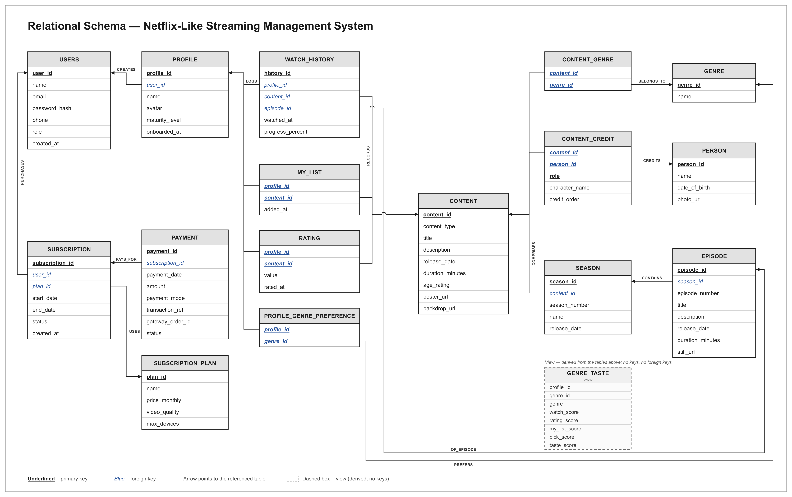
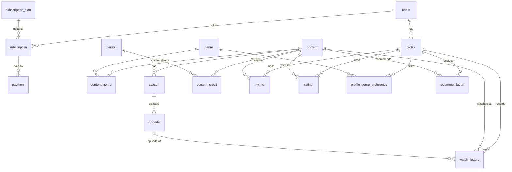
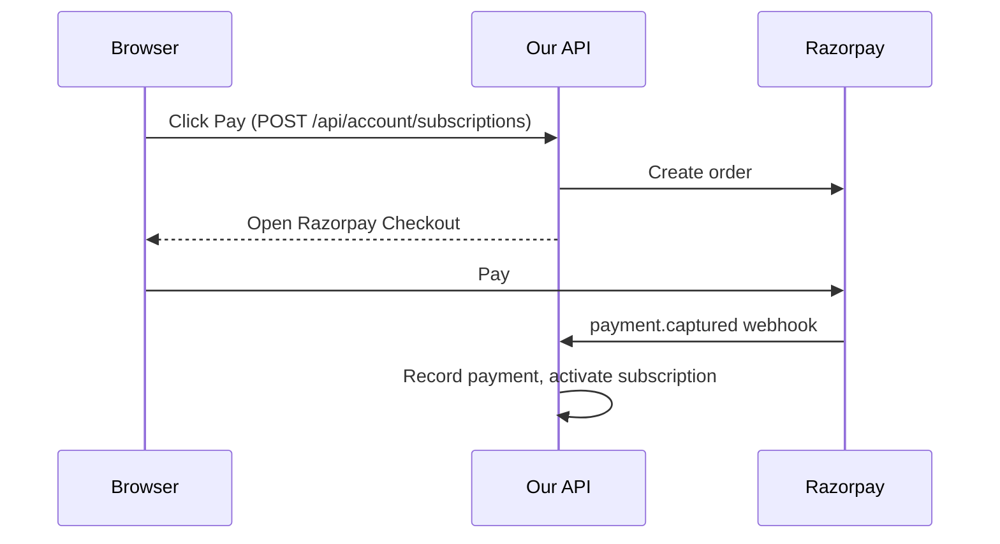

# Database schema

This is the agreed database design for Phase 1 (see the [backend guide](../backend/README.md)). It
runs on PostgreSQL 15+ (hosted on Neon) and has 17 tables, 1 view and 1 materialized view (a view
whose result is stored on disk and refreshed on demand). Every table is in 3NF (third normal form,
explained in [Normalisation notes](#normalisation-notes-for-the-report)).



## Contents

- [What changed from the domain description](#what-changed-from-the-domain-description)
- [Decisions](#decisions)
- [ER diagram](#er-diagram)
- [Definition (all the SQL)](#definition)
  - [Enums](#enums)
  - [Account and billing](#account--billing)
  - [Content catalogue](#content-catalogue) (including [Natural keys](#natural-keys) and [Credits](#credits))
  - [Viewing activity](#viewing-activity)
  - [Recommendations](#recommendations)
- [Ranking](#ranking)
- [Payment flow](#payment-flow)
- [Normalisation notes](#normalisation-notes-for-the-report)
- [Domain names to column names](#domain-names--column-names)
- [Drizzle notes](#drizzle-notes)
- [Still open](#still-open)

## What changed from the domain description

The domain description lists 16 entities. We merge CONTENT_CAST and CONTENT_DIRECTOR into one
`content_credit` table (16 - 1 = 15) and add two tables, `profile_genre_preference` and
`recommendation` (15 + 2 = 17). Everything that differs from the domain description:

- **`content_credit`** replaces CONTENT_CAST and CONTENT_DIRECTOR. One credits table with a `role`
  column, so a new credit type is a new enum value, not a new table (see [Credits](#credits)).
- **`maturity_of()` function.** Maturity is worked out from `content.age_rating` when a query needs
  it, and is never stored.
- **`profile_genre_preference`.** The genres a user picks during onboarding. They are the
  cold-start input for recommendations (what we know about a profile before it has any activity).
- **`recommendation`.** The recommendation pipeline's stored output: one row per (profile, title),
  with a feedback status.
- **`interaction_score` view and `content_similarity` materialized view.** Stage 1 and the
  item-kNN (item-to-item nearest-neighbour similarity) stage of the recommendation pipeline.
- **`users.role`, `watch_history.episode_id`, and image URLs** on `content`, `person` and
  `episode`. They support the admin panel, episode-level progress and real catalogue data.

## Decisions

Each bullet is one design choice and the reason behind it.

- **Table name `users`.** `user` is a reserved word in PostgreSQL.
- **Recommendations.**
  - They are stored per profile in `recommendation`, keyed `(profile_id, content_id)`, and
    refreshed after activity.
  - `rec_status` is the feedback loop.
  - A row's reason text and the "Because you liked X" anchor are computed when Home is built,
    never stored.
- **Watch history.** One row per (profile, title, episode), updated in place. This is enforced
  with `UNIQUE NULLS NOT DISTINCT` (a unique rule that treats two NULLs as equal, so movies with
  `episode_id = NULL` still get one row).
- **Maturity.**
  - Derived, never stored: `maturity_of(content.age_rating)`.
  - `age_rating` is a plain column limited by a CHECK to the US certificate codes.
- **Cast and directors.**
  - One `content_credit` table, with `role` = `'ACTOR'` or `'DIRECTOR'`.
  - The API still returns them as `cast` and `directors`.
- **Completed.**
  - Not a column. A row counts as completed when `progress_percent >= 90`, and that condition is
    written into each query that needs it.
  - In app code this is `isCompleted()` with `COMPLETED_THRESHOLD`.
- **Profile language.** Not stored, because there is no language data in the catalogue for it to
  filter on.
- **Ids.**
  - Surrogate keys (made-up ids) of the form `INT GENERATED ALWAYS AS IDENTITY`.
  - Natural keys made of real attributes are `UNIQUE`: `email`;
    `content (title, content_type, release_date)`; `person (name, date_of_birth)`, and so on.
- **TMDB ids.**
  - Not stored. The import and the seed find duplicates by the natural keys above.
  - TMDB ids live only outside the database (the `data/tmdb` snapshot and the admin's TMDB
    search). See [Natural keys](#natural-keys).
- **Billing deletes.** `RESTRICT` (the database refuses to delete a row that others still point
  at). Payments are financial records and never disappear with an account.
- **Payments.**
  - Razorpay is the payment gateway.
  - Checkout creates a PENDING `subscription` (this is the Razorpay order).
  - The webhook writes one `payment` row per attempt (FAILED or SUCCESS) and activates the
    subscription on capture. Checkout's verify call can record the capture first.
  - See [Payment flow](#payment-flow).

## ER diagram

An ER (entity-relationship) diagram shows which tables point at which. Read `A ||--o{ B` as "one A
has many B".



## Definition

This section is the full SQL, grouped by area. Comments inside the SQL explain the non-obvious
columns. Some terms used below:

- **`ON DELETE CASCADE`**: deleting the parent row also deletes the rows that point at it.
- **Partial unique index**: a uniqueness rule that only applies to rows matching a `WHERE` condition.
- **Upsert**: insert a row, or update it if it already exists.

### Enums

Enums (named lists of allowed values) used by the columns below.

```sql
CREATE TYPE user_role           AS ENUM ('USER', 'ADMIN');
CREATE TYPE maturity_level      AS ENUM ('KIDS', 'TEEN', 'ADULT');  -- declared order, so KIDS < TEEN < ADULT
CREATE TYPE content_type        AS ENUM ('MOVIE', 'SERIES');
CREATE TYPE credit_role         AS ENUM ('ACTOR', 'DIRECTOR');
CREATE TYPE subscription_status AS ENUM ('PENDING', 'ACTIVE', 'CANCELLED', 'EXPIRED');
CREATE TYPE payment_mode        AS ENUM ('CARD', 'UPI', 'NET_BANKING', 'WALLET');
CREATE TYPE payment_status      AS ENUM ('SUCCESS', 'FAILED', 'REFUNDED');   -- rows are written by the webhook, so never pending
CREATE TYPE rec_status          AS ENUM ('SHOWN', 'CLICKED', 'WATCHED', 'DISMISSED');
```

### Account & billing

Users, their profiles, the subscription plans, subscriptions and payments. A user can have up to 5
profiles (checked in the API) and many subscriptions over time, but only one ACTIVE subscription at
once.

```sql
CREATE TABLE users (
  user_id       INT GENERATED ALWAYS AS IDENTITY PRIMARY KEY,
  name          VARCHAR(100) NOT NULL,
  email         VARCHAR(255) NOT NULL,
  password_hash TEXT         NOT NULL,                 -- "scrypt$<salt>$<hash>"
  phone         VARCHAR(20),
  role          user_role    NOT NULL DEFAULT 'USER',
  created_at    TIMESTAMPTZ  NOT NULL DEFAULT now()
);
CREATE UNIQUE INDEX users_email_key ON users (lower(email));   -- case-insensitive uniqueness

CREATE TABLE profile (
  profile_id     INT GENERATED ALWAYS AS IDENTITY PRIMARY KEY,
  user_id        INT            NOT NULL REFERENCES users ON DELETE CASCADE,
  name           VARCHAR(24)    NOT NULL,
  avatar         VARCHAR(20)    NOT NULL,
  maturity_level maturity_level NOT NULL DEFAULT 'ADULT',
  onboarded_at   TIMESTAMPTZ                            -- NULL until onboarding is finished
);
CREATE UNIQUE INDEX profile_user_name_key ON profile (user_id, lower(name));
-- At most 5 profiles per user: checked in the API (a trigger would also work).

CREATE TABLE subscription_plan (
  plan_id       INT GENERATED ALWAYS AS IDENTITY PRIMARY KEY,
  name          VARCHAR(50)   NOT NULL UNIQUE,
  price_monthly NUMERIC(10,2) NOT NULL CHECK (price_monthly >= 0),
  video_quality VARCHAR(10)   NOT NULL,                -- '720p', '1080p', '4K'
  max_devices   SMALLINT      NOT NULL CHECK (max_devices > 0)
);

CREATE TABLE subscription (
  subscription_id INT GENERATED ALWAYS AS IDENTITY PRIMARY KEY,
  user_id         INT                 NOT NULL REFERENCES users ON DELETE RESTRICT,
  plan_id         INT                 NOT NULL REFERENCES subscription_plan ON DELETE RESTRICT,
  start_date      TIMESTAMPTZ,                         -- NULL while PENDING (checkout opened, not paid)
  end_date        TIMESTAMPTZ,
  status          subscription_status NOT NULL DEFAULT 'PENDING',
  created_at      TIMESTAMPTZ         NOT NULL DEFAULT now(),
  -- never-paid checkouts (PENDING, or CANCELLED before payment) have no dates; anything paid has both
  CHECK ((status IN ('PENDING', 'CANCELLED') AND start_date IS NULL AND end_date IS NULL)
         OR (start_date IS NOT NULL AND end_date > start_date))
);
-- A user can have many subscriptions over time, but only one ACTIVE at once.
CREATE UNIQUE INDEX subscription_one_active_per_user ON subscription (user_id) WHERE status = 'ACTIVE';

CREATE TABLE payment (                                -- one row per Razorpay payment attempt
  payment_id       INT GENERATED ALWAYS AS IDENTITY PRIMARY KEY,
  subscription_id  INT            NOT NULL REFERENCES subscription ON DELETE RESTRICT,
  payment_date     TIMESTAMPTZ    NOT NULL DEFAULT now(),
  amount           NUMERIC(10,2)  NOT NULL CHECK (amount > 0),  -- what was charged, not a copy of the plan price
  payment_mode     payment_mode   NOT NULL,
  transaction_ref  VARCHAR(64)    NOT NULL UNIQUE,     -- Razorpay pay_… id: the webhook's idempotency key
  gateway_order_id VARCHAR(64)    NOT NULL,            -- Razorpay order_…; an order can have several attempts
  status           payment_status NOT NULL
);
CREATE INDEX payment_subscription_idx ON payment (subscription_id, payment_date DESC);
```

### Content catalogue

Everything browsable: genres, titles (movies and series), seasons, episodes, people and credits.
`maturity_of()` turns a title's US certificate into KIDS, TEEN or ADULT.

```sql
CREATE TABLE genre (
  genre_id INT GENERATED ALWAYS AS IDENTITY PRIMARY KEY,
  name     VARCHAR(50) NOT NULL UNIQUE
);

CREATE TABLE content (
  content_id        INT GENERATED ALWAYS AS IDENTITY PRIMARY KEY,
  content_type      content_type NOT NULL,
  title             VARCHAR(255) NOT NULL,
  description       TEXT         NOT NULL DEFAULT '',
  release_date      DATE,
  duration_minutes  SMALLINT     CHECK (duration_minutes > 0),
  age_rating        VARCHAR(10),                                 -- US certificate; NULL = none (treated as TEEN)
  poster_url        TEXT,
  backdrop_url      TEXT,
  UNIQUE NULLS NOT DISTINCT (title, content_type, release_date), -- remakes differ by date; NULL dates still dedupe
  CHECK (content_type = 'MOVIE' OR duration_minutes IS NULL),    -- series carry duration per episode
  CHECK (age_rating IN ('G', 'PG', 'PG-13', 'R', 'NC-17', 'NR',
                        'TV-Y', 'TV-Y7', 'TV-G', 'TV-PG', 'TV-14', 'TV-MA'))
);

-- Maturity is derived from the certificate whenever a query needs it, never stored.
-- Catalogue queries filter with  maturity_of(c.age_rating) <= p.maturity_level  (enum order).
CREATE FUNCTION maturity_of(code VARCHAR) RETURNS maturity_level
LANGUAGE sql IMMUTABLE AS $$
  SELECT CASE
           WHEN code IN ('G', 'PG', 'TV-Y', 'TV-Y7', 'TV-G', 'TV-PG') THEN 'KIDS'
           WHEN code IN ('PG-13', 'TV-14')                           THEN 'TEEN'
           WHEN code IN ('R', 'NC-17', 'NR', 'TV-MA')                THEN 'ADULT'
           ELSE 'TEEN'                                               -- NULL: no certificate
         END::maturity_level
$$;

CREATE TABLE content_genre (
  content_id INT REFERENCES content ON DELETE CASCADE,
  genre_id   INT REFERENCES genre   ON DELETE CASCADE,
  PRIMARY KEY (content_id, genre_id)
);
CREATE INDEX content_genre_genre_idx ON content_genre (genre_id);

CREATE TABLE season (
  season_id     INT GENERATED ALWAYS AS IDENTITY PRIMARY KEY,
  content_id    INT          NOT NULL REFERENCES content ON DELETE CASCADE,
  season_number SMALLINT     NOT NULL CHECK (season_number > 0),
  name          VARCHAR(255) NOT NULL,
  release_date  DATE,
  UNIQUE (content_id, season_number)
);

CREATE TABLE episode (
  episode_id       INT GENERATED ALWAYS AS IDENTITY PRIMARY KEY,
  season_id        INT          NOT NULL REFERENCES season ON DELETE CASCADE,
  episode_number   SMALLINT     NOT NULL CHECK (episode_number > 0),
  title            VARCHAR(255) NOT NULL,
  description      TEXT         NOT NULL DEFAULT '',
  release_date     DATE,
  duration_minutes SMALLINT     CHECK (duration_minutes > 0),
  still_url        TEXT,
  UNIQUE (season_id, episode_number)
);

CREATE TABLE person (
  person_id     INT GENERATED ALWAYS AS IDENTITY PRIMARY KEY,
  name          VARCHAR(255) NOT NULL,
  date_of_birth DATE,
  photo_url     TEXT,
  UNIQUE NULLS NOT DISTINCT (name, date_of_birth)       -- namesakes with no birth date share a row (accepted)
);

CREATE TABLE content_credit (
  content_id     INT REFERENCES content ON DELETE CASCADE,
  person_id      INT REFERENCES person  ON DELETE CASCADE,
  role           credit_role  NOT NULL,
  character_name VARCHAR(255),                         -- actors only
  credit_order   SMALLINT     NOT NULL DEFAULT 0,      -- billing order within the role, 0 = top billed
  PRIMARY KEY (content_id, person_id, role),           -- someone can act in AND direct the same title
  CHECK (role = 'ACTOR' OR character_name IS NULL)
);
CREATE INDEX content_credit_person_idx ON content_credit (person_id);
```

#### Natural keys

The catalogue comes from TMDB, but the database stores no TMDB ids. Duplicates are found with
natural keys (unique combinations of real columns) that sit next to the surrogate
`content_id` / `person_id`.

- **`content (title, content_type, release_date)`**
  - _Dune_ (1984) and _Dune_ (2021) differ by date, so they are different rows.
  - `NULLS NOT DISTINCT` makes a title with no release date still match itself, instead of being
    inserted again on every import.
  - A title that TMDB later renames or re-dates comes in as a new row.
- **`person (name, date_of_birth)`**
  - Same idea as above.
  - Known limitation, accepted: two different people with the same name and no birth date are
    merged into one row.

How the import uses them:

- The admin import (`src/lib/sql/import-title.ts`) upserts on these keys and finds the rows again
  by them in every later statement (`... AND release_date IS NOT DISTINCT FROM $3`).
- TMDB ids exist only outside the database:
  - the `data/tmdb` snapshot and its mappers
  - the admin's TMDB search
  - the `data/mock` rows, which reference titles as `{ contentType, tmdbId }`
- The seed matches those mock references to snapshot entries in memory and inserts by natural key.
  It never stores the id.

#### Credits

`content_credit` deliberately merges two domain entities, CONTENT_CAST and CONTENT_DIRECTOR, using
`role` as a discriminator (a column that says which kind of row this is).

- Both are "this person is credited on this title", so one table holds them. A new credit type
  (writer, producer) is a new `credit_role` value, not a new table.
- `role` is part of the primary key, so one person can both act in and direct the same title.
- The CHECK keeps `character_name` for actors only.
- The API still returns two separate lists:
  - `cast` is `role = 'ACTOR' ORDER BY credit_order`
  - `directors` is `role = 'DIRECTOR' ORDER BY credit_order`

### Viewing activity

What each profile watches, saves, rates and picks during onboarding. Onboarding needs at least 3
genres (checked in the API).

```sql
CREATE TABLE watch_history (
  history_id       INT GENERATED ALWAYS AS IDENTITY PRIMARY KEY,
  profile_id       INT         NOT NULL REFERENCES profile ON DELETE CASCADE,
  content_id       INT         NOT NULL REFERENCES content ON DELETE CASCADE,
  episode_id       INT         REFERENCES episode ON DELETE CASCADE,  -- NULL for movies
  watched_at       TIMESTAMPTZ NOT NULL DEFAULT now(),                -- last time progress changed
  progress_percent SMALLINT    NOT NULL CHECK (progress_percent BETWEEN 0 AND 100),  -- completed = progress_percent >= 90
  UNIQUE NULLS NOT DISTINCT (profile_id, content_id, episode_id)      -- one row per title/episode
);
CREATE INDEX watch_history_recent_idx ON watch_history (profile_id, watched_at DESC);

CREATE TABLE my_list (
  profile_id INT REFERENCES profile ON DELETE CASCADE,
  content_id INT REFERENCES content ON DELETE CASCADE,
  added_at   TIMESTAMPTZ NOT NULL DEFAULT now(),
  PRIMARY KEY (profile_id, content_id)                 -- a title can't be listed twice
);

CREATE TABLE rating (
  profile_id INT REFERENCES profile ON DELETE CASCADE,
  content_id INT REFERENCES content ON DELETE CASCADE,
  value      SMALLINT    NOT NULL CHECK (value BETWEEN 1 AND 5),
  rated_at   TIMESTAMPTZ NOT NULL DEFAULT now(),
  PRIMARY KEY (profile_id, content_id)                 -- one rating per title; re-rating is an upsert
);
CREATE INDEX rating_content_idx ON rating (content_id);

CREATE TABLE profile_genre_preference (               -- onboarding: at least 3 genres (checked in the API)
  profile_id INT REFERENCES profile ON DELETE CASCADE,
  genre_id   INT REFERENCES genre   ON DELETE CASCADE,
  PRIMARY KEY (profile_id, genre_id)
);
```

### Recommendations

The stored recommendations, plus the two database objects that feed them:

- `interaction_score` (a view, a saved query that always shows fresh data) gives one score per
  (profile, title) from every signal.
- `content_similarity` (a materialized view) holds title-to-title similarity. It is expensive to
  compute, so it is stored and refreshed on a schedule.

```sql
CREATE TABLE recommendation (
  profile_id      INT         REFERENCES profile ON DELETE CASCADE,
  content_id      INT         REFERENCES content ON DELETE CASCADE,
  row_type        VARCHAR(30) NOT NULL,                -- 'top-picks', 'because-you-liked', …
  relevance_score REAL        NOT NULL,
  generated_at    TIMESTAMPTZ NOT NULL DEFAULT now(),
  rec_status      rec_status  NOT NULL DEFAULT 'SHOWN',
  PRIMARY KEY (profile_id, content_id)                 -- one recommendation per title per profile
);
-- No reason column: the text a row shows ("Because you liked X", "<Genre> is your strongest
-- genre") is built from row_type plus context when Home is served, so it can't go stale.
CREATE INDEX recommendation_rank_idx ON recommendation (profile_id, relevance_score DESC);

-- Stage 1 of the pipeline: one score per (profile, title) from every signal. Always fresh.
-- Onboarding genres aren't per-title signals; they add to genre affinity in stage 2 (see Ranking).
CREATE VIEW interaction_score AS
SELECT profile_id, content_id, SUM(weight) AS score
FROM (
  SELECT profile_id, content_id, (value - 3) * 2.0 AS weight FROM rating
  UNION ALL
  SELECT profile_id, content_id,
         CASE WHEN max(progress_percent) >= 90   THEN 3.0   -- completed
              WHEN max(progress_percent) >= 50   THEN 1.5
              WHEN max(progress_percent) < 10    THEN -0.5
              ELSE 0 END
  FROM watch_history
  GROUP BY profile_id, content_id                    -- a series has one row per episode
  UNION ALL
  SELECT profile_id, content_id, 1.0 FROM my_list
) AS signals
GROUP BY profile_id, content_id;

-- Item-item kNN: cosine similarity between titles over profiles' scores, shrunk when few
-- profiles overlap. Expensive, so materialized and refreshed on a schedule.
CREATE MATERIALIZED VIEW content_similarity AS
WITH norms AS (
  SELECT content_id, sqrt(SUM(score * score)) AS norm
  FROM interaction_score
  GROUP BY content_id
),
pairs AS (
  SELECT a.content_id AS content_a, b.content_id AS content_b,
         SUM(a.score * b.score) AS dot, COUNT(*) AS common
  FROM interaction_score AS a
  JOIN interaction_score AS b ON b.profile_id = a.profile_id AND b.content_id <> a.content_id
  GROUP BY a.content_id, b.content_id
)
SELECT p.content_a, p.content_b,
       (p.dot / (na.norm * nb.norm)) * (p.common::real / (p.common + 2)) AS score
FROM pairs AS p
JOIN norms AS na ON na.content_id = p.content_a
JOIN norms AS nb ON nb.content_id = p.content_b
WHERE na.norm > 0 AND nb.norm > 0;
CREATE UNIQUE INDEX content_similarity_pair_key ON content_similarity (content_a, content_b);
-- REFRESH MATERIALIZED VIEW CONCURRENTLY content_similarity;  (needs the unique index above)
```

## Ranking

`content` keeps no popularity or vote figures from TMDB. Every ranking is computed from our own
`watch_history` and `rating` rows. The full pipeline (signals, candidates, the home rows and their
reasons) is specified in `src/server/services/recommendations.service.ts` and
[`backend/person-c-activity-recommendations.md`](../backend/person-c-activity-recommendations.md).
This section covers only the parts that touch the schema.

### Measures

- **Popularity prior**
  - Definition: the number of distinct profiles who watched the title in the last 30 days,
    as `ln(1 + n)`, min-max normalised to 0-1.
  - Used by: the ranking blend, search with no query, and cold start.
- **Trending**
  - Definition: the most distinct viewers in the last 7 days.
  - Used by: the "Trending now" row.
- **Top rated**
  - Definition: the Bayesian average (an average pulled towards the global mean when a title has
    few ratings) of `rating.value`: `(v/(v+m))·R + (m/(v+m))·C`.
    - `v` is the title's rating count.
    - `R` is its average rating.
    - `C` is the average over all ratings.
    - `m` = 5.
  - Used by: the "Top rated in <genre>" row.

Ties always break on `release_date DESC`.

### SQL for the measures

```sql
-- Popularity prior for every title (0 when nobody watched it in the window).
WITH viewers AS (
  SELECT c.content_id, ln(1 + COUNT(DISTINCT w.profile_id)) AS v
  FROM content AS c
  LEFT JOIN watch_history AS w
         ON w.content_id = c.content_id AND w.watched_at > now() - interval '30 days'
  GROUP BY c.content_id
)
SELECT content_id,
       COALESCE((v - MIN(v) OVER ()) / NULLIF(MAX(v) OVER () - MIN(v) OVER (), 0), 0) AS popularity_prior
FROM viewers;

-- Top rated: titles with a few ratings are pulled towards the global average.
WITH stats AS (
  SELECT content_id, COUNT(*) AS v, AVG(value) AS r FROM rating GROUP BY content_id
), overall AS (
  SELECT AVG(value) AS c FROM rating
)
SELECT s.content_id, (s.v / (s.v + 5.0)) * s.r + (5.0 / (s.v + 5.0)) * o.c AS bayes
FROM stats AS s
CROSS JOIN overall AS o
JOIN content AS c ON c.content_id = s.content_id
ORDER BY bayes DESC, c.release_date DESC NULLS LAST;
```

### The blend

The blend that orders a profile's top picks:

```
affinity = 0.6 × genre affinity + 0.4 × people affinity
score    = 0.5 × affinity + 0.3 × item-kNN + 0.2 × popularity prior
```

### Cold start

Cold start is a brand-new profile with no activity yet.

- Onboarding stores only `profile_genre_preference` (at least 3 genres) and sets
  `profile.onboarded_at`.
- Each picked genre adds +2 to that genre's affinity.
- A new profile has no `interaction_score` rows, so people affinity and kNN are 0.
- So Home is the picked genres' titles, ranked by the popularity prior.
- Ratings, watching and My List take over as they accumulate.

## Payment flow

Razorpay's model is one order with many payment attempts. That maps onto one `subscription` with
many `payment` rows. The happy path looks like this:



Each event in plain words:

1. **Click "Pay"** (`POST /api/account/subscriptions`)
   - Insert a `subscription` with status `'PENDING'` and NULL dates. Any earlier PENDING ones for
     the user become CANCELLED.
   - Create a Razorpay order `{ amount = price_monthly × 100, notes: { subscription_id } }`.
   - Razorpay Checkout opens in the browser.
2. **Checkout success** (`POST /api/payments/verify`)
   - Checkout's `razorpay_signature` is verified first.
   - It then runs the same `recordCapturedPayment` as `payment.captured` below.
   - Whichever of the two arrives first records the payment. The other hits `ON CONFLICT` (the
     insert is refused because the row already exists) and stops.
3. **`payment.failed`** (`POST /api/payments/webhook`, signature verified)
   - `INSERT payment (…, 'FAILED') ON CONFLICT (transaction_ref) DO NOTHING`.
   - The subscription stays PENDING, so the user can retry on the same order.
4. **`payment.captured`** (`POST /api/payments/webhook`), all in one transaction:
   1. Lock the subscription row (`FOR UPDATE`, which makes other transactions wait for it).
   2. `INSERT payment (…, 'SUCCESS') ON CONFLICT (transaction_ref) DO NOTHING`. If nothing was
      inserted, it was already processed, so stop.
   3. Check that the amount equals the plan price.
   4. Turn the user's old ACTIVE subscription into CANCELLED (a plan change). This goes first
      because of the one-ACTIVE index.
   5. Set this subscription to ACTIVE, with `start_date = now()` and
      `end_date = now() + 1 month`. If it is already ACTIVE, this is a renewal order, so extend
      `end_date` instead.
5. **Never paid.** The subscription stays PENDING, is cancelled at the user's next checkout, and is
   never shown in billing history.
6. **Renewal.** A new order whose notes carry the ACTIVE `subscription_id` extends `end_date`.

Why this is safe to repeat (idempotent, meaning running it twice has the same effect as once):

- `UNIQUE (transaction_ref)` makes a repeated webhook a no-op.
- The row lock plus the partial unique index stop two payments from creating two ACTIVE plans.

## Normalisation notes (for the report)

Normalisation means arranging tables so each fact is stored once. These notes go through the first
three normal forms.

### 1NF (first normal form)

- Every column is atomic (one value per cell).
- Multi-valued facts (a title's genres, cast, directors) live in their own junction tables, never as
  lists in a column.

### 2NF (second normal form)

- Every composite-key table (`content_genre`, `content_credit`, `my_list`, `rating`,
  `profile_genre_preference`) has only attributes that depend on the _whole_ key.
- `character_name` and `credit_order` depend on (content, person, role).
- `rated_at` depends on (profile, content).
- `content_genre` and `profile_genre_preference` are all-key (they have no other columns).

### 3NF (third normal form)

No non-key attribute depends on another non-key attribute. Points worth noting:

- **Maturity**
  - It is a derived attribute: `maturity_of()` computes it from `content.age_rating`, and it is
    never stored.
  - So there is no transitive dependency (`content_id → age_rating → maturity`) and no lookup
    table is needed.
- **`recommendation` key**
  - It is keyed by `(profile_id, content_id)`: a recommendation is one title _for_ one profile, so
    the natural composite key is the primary key and no surrogate id is needed.
  - `row_type`, `relevance_score`, `generated_at` and `rec_status` all depend on the whole key
    (2NF).
  - Reaching the profile through a watch-history row would make it depend on a non-key attribute,
    and would leave profiles with no history (new ones) without recommendations.
- **Reason text and anchor not stored**
  - The human-readable reason and the "Because you liked X" anchor are _not_ stored.
  - The reason is a function of `row_type` plus context (a genre or person name, the anchor title).
    The anchor is recomputed from `content_similarity` when Home is built.
  - Storing either would duplicate derivable data and go stale when titles are renamed or
    similarities refresh.
- **"Completed" not stored**
  - It is derived from `progress_percent` (`>= 90`), so it is not stored at all, not even as a
    generated column.
  - Every query that needs it writes the predicate, so it can't drift.
- **Popularity, trending, average ratings not stored**
  - They are aggregates of `watch_history` and `rating`, so they are computed in queries (see
    [Ranking](#ranking)) instead of being stored on `content`, where they would duplicate the
    activity rows and go stale.
- **Candidate keys**
  - They are real attributes, not imported ids. `content` has `content_id` (primary) and
    `(title, content_type, release_date)`. `person` has `person_id` and `(name, date_of_birth)`.
  - Every non-key attribute depends on the whole of each candidate key, so the surrogate keys add
    no dependency of their own (see [Natural keys](#natural-keys)).
- **`payment.amount`**
  - It is not a copy of `subscription_plan.price_monthly`. Prices change, and a payment records what
    was charged at the time.
- **Failed payments**
  - A failed payment still points at its `subscription` (the PENDING one for that checkout), so
    `payment` never needs its own `user_id` / `plan_id`. Those are reached through the subscription.

### Known limits of declarative constraints

These rules cannot be expressed as plain table constraints. They are enforced in the API, or with a
trigger (database code that runs automatically on writes):

- Only `SERIES` content may have seasons.
- A `watch_history.episode_id` must belong to the row's `content_id`.
- At most 5 profiles per user.

## Domain names → column names

Columns follow the field names in `src/types` (snake_case). Where the domain description used a
longer name, this is the mapping (domain name, then the column):

- USER.password, created_date -> `users.password_hash`, `created_at`
- PROFILE.profile_name -> `profile.name`
- SUBSCRIPTION_PLAN.plan_name, price -> `subscription_plan.name`, `price_monthly`
- SUBSCRIPTION.subscription_status -> `subscription.status`
- PAYMENT.transaction_ref_no, payment_status -> `payment.transaction_ref` (Razorpay `pay_…`), `status`
- GENRE.genre_name -> `genre.name`
- CONTENT.duration -> `content.duration_minutes`
- CONTENT_CAST, CONTENT_DIRECTOR -> `content_credit`, with `role` = `'ACTOR'` / `'DIRECTOR'`
- CONTENT_CAST.role_name -> `content_credit.character_name`
- WATCH_HISTORY.watch_datetime, progress, completion_status -> `watched_at`, `progress_percent`;
  completion is derived (`progress_percent >= 90`)
- MY_LIST.date_added -> `my_list.added_at`
- RATING.rating_value, rating_date -> `rating.value`, `rated_at`

## Drizzle notes

Drizzle is the TypeScript library we use to define the schema. We write it in TypeScript with
`drizzle-orm/pg-core` and generate SQL migrations with `drizzle-kit`, so the migration files stay
plain PostgreSQL. Almost everything above maps directly (SQL -> Drizzle):

- `CREATE TYPE … AS ENUM` -> `pgEnum()`
- `GENERATED ALWAYS AS IDENTITY` -> `integer().generatedAlwaysAsIdentity()`
- CHECK constraints -> `check()` in the table's extra config
- `lower(email)` / `lower(name)` unique indexes -> ``uniqueIndex().on(sql`lower(${t.email})`)``
- partial unique index on `subscription` -> ``uniqueIndex().on(t.userId).where(sql`…`)``
- `UNIQUE NULLS NOT DISTINCT` (`watch_history`, the `content` and `person` natural keys) ->
  `unique().on(…).nullsNotDistinct()`, e.g.
  `unique().on(t.title, t.contentType, t.releaseDate).nullsNotDistinct()`
- composite primary keys (`my_list`, `rating`, `recommendation`, …) ->
  `primaryKey({ columns: [t.profileId, t.contentId] })`
- `interaction_score` view, `content_similarity` materialized view -> `pgView()`,
  `pgMaterializedView()`
- `maturity_of()` function -> a custom migration; queries call it with
  ``sql`maturity_of(${content.ageRating})` ``

Check every generated migration before applying it. Anything `drizzle-kit` doesn't emit the way we
want goes into a custom migration (`drizzle-kit generate --custom`).

The client (`src/server/db/index.ts`) is drizzle-orm over a node-postgres (`pg`) `Pool` on
`DATABASE_URL` (a Neon connection string), so `db.transaction` works.

## Still open

- When `recommendation` is regenerated (after each activity, on Home load when older than N
  minutes, or nightly) and how often `content_similarity` is refreshed.
- Weighted ranking (current plan) vs a small trained model: check with the teacher.
- Whether to keep the shorter column names above or switch to the domain's exact names.
